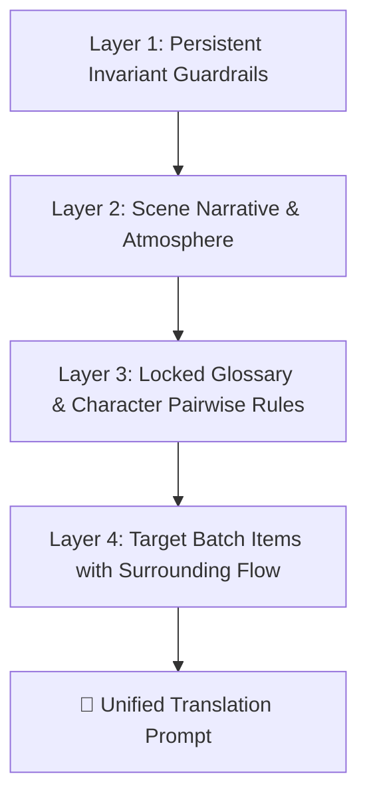

# Context-to-Prompt Synthesis Skill

คู่มือมาตรฐานในการถ่ายทอดองค์ความรู้และบริบทหลายมิติ (Multi-layered Narrative Context) แปลงเป็นโครงสร้าง Prompt ที่มีเสถียรภาพสูงสุด 100% สำหรับส่งให้โมเดลภายนอก (เช่น ChatGPT Web Bridge)

---

## 1. Multi-Layered Context Composition (ชั้นของข้อมูลบริบท)
ทุกครั้งที่มีการสร้าง Prompt แปลบทสนทนา ระบบจะต้องประกอบข้อมูล 4 ชั้นตามลำดับ:

1. **Layer 1: Persistent Invariant Guardrails (กฎเหล็กประจำระบบ):**
   - แนบกฎสั้นกระชับคุม Invariant Tags, Line Wrapping (~40-48 ตัวอักษร), Onomatopoeia, และ Format JSON เสมอ ไม่ว่าจะเป็นพร็อมพ์ที่ 1 หรือพร็อมพ์ติดตามถัดไป (Follow-up Prompts)
2. **Layer 2: Scene Narrative & Atmosphere (บริบทฉากและอารมณ์):**
   - สกัดจาก `rpgm_scenes_v5.json` และ `extractions_v4/`: ระบุสถานที่, อารมณ์ฉาก (Mood & Atmosphere), ความตึงเครียด (Tension), และจุดประสงค์ของบทสนทนานี้
3. **Layer 3: Locked Glossary & Pairwise Dynamics (คำศัพท์และคู่สรรพนาม):**
   - ชื่อตัวละครและสถานที่ที่ถูกล็อก 1:1 (ห้ามแปลงชื่อภาษาอังกฤษเป็นคำทับศัพท์ไทย)
   - ระบุสรรพนามเฉพาะคู่ เช่น `[Dan -> Shion: ผม / คุณ / ครับ]`, `[Lily -> Dan: หนู / พี่ Dan / ค่ะ]`
4. **Layer 4: Target Batch Items (ประโยคเป้าหมายพร้อมบริบทแวดล้อม):**
   - ประโยคก่อนหน้า (`preceding_dialogue`) และประโยคถัดไป (`subsequent_dialogue`) เพื่อให้คำแปลเชื่อมต่อกันอย่างลื่นไหลไร้รอยต่อ

---

## 2. Mitigation SOP: Five Pipeline Failure Modes (วิธีแก้บั๊ก 5 ประการ)

### SOP 2.1: กำจัดปัญหา System Prompt ล่องหน (Persistent Invariant)
- **ปัญหาเดิม:** ส่ง System Prompt เฉพาะแชตแรก แชตถัดไปส่งแต่ข้อความ ทำให้ AI ลืมกฎความยาวและสไตล์แปลแกว่ง
- **วิธีปฏิบัติ:** ใน `chatgpt_translator_runner.py` ต้องแนบ `MINI_SYSTEM_INVARIANT` ขนาดกระชับ (~20-30 บรรทัด) กำกับไว้หัวข้อความของผู้ใช้ (`user_content`) ในทุกๆ พร็อมพ์ 100%

### SOP 2.2: กำจัดปัญหาประโยคตาบอด (Forward-Filling Speaker)
- **ปัญหาเดิม:** บรรทัดที่ 2, 3 เป็นต้นไปไม่มีชื่อ Speaker ทำให้ `GlossaryScanner` หาไม่เจอ และ AI ต้องเดาเพศเอง
- **วิธีปฏิบัติ:** ก่อนรวมกลุ่ม Batch ให้รันฟังก์ชัน `propagate_speaker_in_scene()` คัดลอก Speaker จากแถวก่อนหน้ามาใส่แถวที่ว่างอยู่ หากยังอยู่ใน Scene Block เดียวกัน

### SOP 2.3: กำจัดปัญหาสรรพนามแกว่ง (Explicit Listener Detection)
- **ปัญหาเดิม:** รู้คนพูดแต่ไม่รู้คนฟัง ทำให้สรรพนามแกว่ง (นาย/เธอ/แก/คุณ)
- **วิธีปฏิบัติ:** สแกนหา Listener จากคู่สนทนาใน Scene หรือจากคำเรียกในประโยค แล้วใส่ฟิลด์ `"listener": "<Name>"` ใน Payload พร้อมบังคับใช้ตาราง `pair_rules` ในพร็อมพ์ทันที

### SOP 2.4: ป้องกันความยาวแกว่งตามขนาด Batch (Normalized Anchor Prompting)
- **ปัญหาเดิม:** ส่งข้อความเยอะแปลย่อ ส่งข้อความสั้นแปลยืดยาว
- **วิธีปฏิบัติ:** กำหนด Anchor Guideline ชัดเจนใน Invariant ว่า *"แปลความหมายให้ครบถ้วนทุกรายละเอียดตามต้นฉบับอย่างสมดุล ห้ามตัดทอนคำ และห้ามขยายความเกินจริง ไม่ว่าจะได้รับข้อความกี่บรรทัด"*

### SOP 2.5: การคัดกรองผลลัพธ์ด้วย LQA Guard (Auto-Reject & Retry)
- **ปัญหาเดิม:** คำแปลผิดเพศหลุดรอดลงดิสก์
- **วิธีปฏิบัติ:** หลังได้รับคำแปล ให้รันฟังก์ชัน `lqa_auditor.check_batch(results)` หากพบตัวละครหญิงพูด "ครับ" หรือนักเลงพูด "ครับ" ให้โยนทิ้ง (Reject) และส่ง Re-translate ซ้ำทันที
