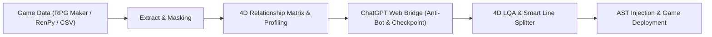

# Agentic Translation Framework (ATF)
> **Enterprise-Grade Universal Game Localization & Agentic Pipeline**  
> *ระบบโครงร่างการแปลเกมและอัปเดตแพตช์อัตโนมัติสากล รองรับ RPG Maker MV/MZ, Ren'Py, Visual Novel, Unity และ Game Engines ทุกแพลตฟอร์ม*

---

## 📖 เกี่ยวกับโปรเจกต์ (Project Overview)

**Agentic Translation Framework (ATF)** เป็นระบบสถาปัตยกรรมการแปลเกมภาษาต่างประเทศ (เช่น ญี่ปุ่น, อังกฤษ) สู่ภาษาไทยอย่างสมบูรณ์แบบระดับวรรณกรรม (Literary Quality) โดยไม่ได้เน้นการแปลแบบตรงตัว (Word-by-word) แต่ใช้เทคโนโลยี **Agentic AI Workflow** ร่วมกับโมเดลจิตวิทยาและความสัมพันธ์ตัวละคร 4 มิติ (**TLAS: Target Language Adaptation System**)

ATF ถูกออกแบบภายใต้หลักการ **"Universal Framework Paradigm"** — ไม่ได้จำกัดการใช้งานอยู่กับเกมใดเกมหนึ่ง แต่สามารถนำไปใช้งาน (Plug-and-Play) กับโปรเจกต์เกมและแพตช์เกมเวอร์ชันใหม่ได้อย่างไร้รอยต่อ



---

## 🌟 จุดเด่นและคุณสมบัติหลัก (Key Features)

1. **4D TLAS Relationship Matrix & Character Profiling:**
   - วิเคราะห์สรรพนาม (คำเรียกตัวเอง, คำเรียกคู่สนทนา), ระดับความเป็นทางการ, หางเสียง (คะ/ค่ะ/ครับ), อารมณ์, และสถานะอำนาจทางสังคมแบบไดนามิกตามแต่ละคู่สนทนาและไทม์ไลน์เนื้อเรื่อง
2. **ChatGPT Web Bridge Technology:**
   - เชื่อมต่อโปรแกรมเข้ากับหน้าเว็บ ChatGPT (`chatgpt.com`) โดยตรงผ่าน Tampermonkey Userscript ทำให้สามารถใช้งานโมเดลชั้นนำ (o3, GPT-4o, GPT-5) ได้อย่างเต็มประสิทธิภาพโดย**ไม่มีค่าใช้จ่าย API Token** และไม่มีปัญหา API Timeout
3. **Zero-Loss Control Code Masking:**
   - แปลงรหัสควบคุมภายในเกม เช่น `\C[2]`, `\V[1]`, `\N[1]`, `\!`, `\.` ให้อยู่ในรูป Semantic XML Tags ป้องกันไม่ให้ AI แปลง ทำลาย หรือทำรหัสควบคุมสีและเสียงของเกมเพี้ยน
4. **Smart Thai Line Splitting (ป้องกันข้อความล้นกล่อง):**
   - ใช้อัลกอริทึมตัดแบ่งบรรทัดภาษาไทยอัจฉริยะ (อ้างอิงพจนานุกรมและกฎไวยากรณ์) ให้ตรงกับจำนวนบรรทัดของต้นฉบับ (Strict Line-Count Parity) ป้องกันตัวหนังสือตกขอบในเกม
5. **Differential CSV Alignment & 100% Legacy Preservation:**
   - สำหรับงานอัปเดตแพตช์เกมใหม่ ระบบจะตรวจจับเฉพาะบรรทัดใหม่ที่เพิ่มเข้ามา (Delta Rows) และปกป้องบทแปลเดิมไว้ 100% โดยไม่ส่งไปแปลซ้ำ
6. **Atomic State Checkpointing & Zero-Skip Guarantee:**
   - ระบบบันทึกความคืบหน้าลงดิสก์ทุก Batch งาน พร้อมระบบกู้คืนอัตโนมัติ (Resume) เมื่อเกิดข้อผิดพลาด ป้องกันข้อมูลสูญหาย 100%

---

## 📁 โครงสร้างโปรเจกต์ (Directory Structure)

```text
Agentic Translation Framework (ATF)/
├── .agents/                 # AI Agent Skills & System Directives
│   └── skills/
│       └── atf-master-pipeline/   # คู่มือปฏิบัติการของ Agent
├── data/                    # โฟลเดอร์ฐานข้อมูลและเทมเพลต
│   ├── project_manifest.template.json  # เทมเพลต Manifest ของโปรเจกต์
│   ├── plugins_texts.template.csv      # เทมเพลต CSV ข้อความ UI เมนู
│   └── tlas/
│       ├── taxonomy.json                  # สารบัญกฎเกณฑ์ 4D Matrix สากล
│       ├── character_profile_template.json # เทมเพลตโปรไฟล์ตัวละคร
│       ├── tlas_glossary.template.json    # เทมเพลต Master Glossary 5 หมวด
│       ├── global_pronoun_matrix.template.json # เทมเพลตเมทริกซ์สรรพนาม
│       ├── alias_mapping.template.json    # เทมเพลตจับคู่ชื่อเรียกตัวละคร
│       └── profiles/                      # โฟลเดอร์เก็บโปรไฟล์ตัวละคร
├── docs/                    # สถาปัตยกรรมและเอกสารอ้างอิง (ADR / SAD / SDD)
├── prompts/                 # Universal Translation Prompts
├── src/
│   └── atf/
│       ├── agents/          # Agent รันไทม์ (Translator, QA, Summarizer, Analyzer)
│       ├── core/            # เครื่องมือหลัก (Masker, Splitter, Auditor, Glossary)
│       ├── memory/          # Context Engine ค้นหาบริบทฉาก
│       ├── parsers/         # ตัวอ่านไฟล์เกม (CSV, Ren'Py, RPG Maker)
│       └── tools/           # สคริปต์ปฏิบัติการทั้งหมด (Bridge, Profiler, Runner)
├── requirements.txt         # รายการแพ็กเกจ Python ที่จำเป็น
├── setup_paths.py           # สคริปต์ตั้งค่าตำแหน่งไฟล์ของโปรเจกต์
├── trace_scenes.py          # สคริปต์สกัดฉากเนื้อเรื่อง
├── extract_glossary.py      # สคริปต์สกัดคำศัพท์ไอเทม/สถานที่ใหม่
├── harvest_places.py        # สคริปต์ค้นหาชื่อสถานที่จากบทสนทนา
├── import_glossary.py       # สคริปต์นำเข้าคำศัพท์สู่ Glossary
├── extract_plugins.py       # สคริปต์สกัดข้อความ UI เมนูจาก plugins.js
├── inject_plugins.py        # สคริปต์ฉีดคำแปลกลับเข้า plugins.js
├── sync_checkpoint.py       # สคริปต์ซิงค์คำแปลจาก Checkpoint ลง CSV
├── verify_integrity.py      # สคริปต์ตรวจสอบความสมบูรณ์ของระบบ
└── translate.py             # สคริปต์หลักสั่งเริ่มกระบวนการแปล
```

---

## ⚙️ สิ่งที่ต้องเตรียมพร้อม (Prerequisites)

1. **Python 3.10 ขึ้นไป** ([ดาวน์โหลด Python](https://www.python.org/downloads/))
2. **เว็บเบราว์เซอร์** (Google Chrome, Microsoft Edge หรือ Brave)
3. **ส่วนขยายเบราว์เซอร์ Tampermonkey** ([ติดตั้ง Tampermonkey](https://www.tampermonkey.net/))
4. **บัญชี OpenAI ChatGPT** (เข้าสู่ระบบที่ [chatgpt.com](https://chatgpt.com))

---

## 🚀 วิธีการติดตั้ง (Installation Guide)

### ขั้นที่ 1: Clone Repository
เปิด Terminal (PowerShell หรือ CMD) แล้วรันคำสั่ง:
```bash
git clone https://github.com/xxshining01/Agentic_Translation_Framwork.git
cd Agentic_Translation_Framwork
```

### ขั้นที่ 2: สร้างและเปิดใช้งาน Virtual Environment (แนะนำ)
- **PowerShell:**
  ```powershell
  python -m venv venv
  .\venv\Scripts\Activate.ps1
  ```
- **Command Prompt (CMD):**
  ```cmd
  python -m venv venv
  venv\Scripts\activate.bat
  ```

### ขั้นที่ 3: ติดตั้ง Dependencies
```bash
pip install -r requirements.txt
```

### ขั้นที่ 4: ติดตั้ง Tampermonkey Userscript
1. เปิดเว็บเบราว์เซอร์ เข้าสู่ส่วนขยาย **Tampermonkey**
2. เลือก **Create a new script** (สร้างสคริปต์ใหม่)
3. คัดลอกโค้ดทั้งหมดจากไฟล์:
   ```text
   src/atf/tools/atf_chatgpt_userscript.user.js
   ```
4. วางลงในช่องแก้ไขของ Tampermonkey แล้วกด **Ctrl + S** เพื่อบันทึก
5. เปิดแท็บหน้าเว็บ `https://chatgpt.com` ค้างไว้ จะเห็นเมนูสถานะของ ATF แสดงขึ้นที่มุมจอ

---

## 🧭 คู่มือการใช้งาน Pipeline (User Manual & Workflow)

ATF รองรับการทำงาน 2 รูปแบบหลัก:
- **Case A: New Game Clean Slate** — แปลเกมใหม่แกะกล่องตั้งแต่ศูนย์
- **Case B: Patch Version Update** — อัปเดตแพตช์เกมเดิมที่มีบทแปลอยู่แล้ว

---

### ขั้นตอนเตรียมความพร้อม (Phase 0: Setup & Bridge)

#### 1. เปิด Bridge Server (รันแยกไว้ 1 Terminal เสมอ)
- **PowerShell / CMD:**
  ```bash
  python src/atf/tools/chatgpt_bridge_server.py
  ```
  *(เมื่อเชื่อมต่อกับหน้าเว็บ ChatGPT สำเร็จ คอนโซลจะแสดงสถานะว่า Userscript เชื่อมต่อแล้ว)*

#### 2. กำหนดค่าโปรเจกต์ผ่าน Manifest
สร้างไฟล์ `data/project_manifest.json` จาก `data/project_manifest.template.json` หรือรันสคริปต์ตั้งค่าแบบโต้ตอบ:
- **PowerShell / CMD:**
  ```bash
  python setup_paths.py
  ```

---

### 🟢 CASE A: แปลเกมใหม่ตั้งแต่ศูนย์ (New Game Clean Slate)

#### Stage A1: สกัดข้อความบทสนทนาและ UI เมนู
1. สกัดข้อความ UI เมนูจาก `plugins.js`:
   ```bash
   python extract_plugins.py
   ```
2. ผลลัพธ์จะได้ไฟล์ตาราง 8 คอลัมน์มาตรฐาน ATF ใน `data/plugins_texts.csv`

#### Stage A2: เก็บเกี่ยวคำศัพท์ (Glossary Calibration)
1. สกัดชื่อสถานที่ที่ปรากฏในบทสนทนาจริง:
   ```bash
   python harvest_places.py
   ```
2. มนุษย์ตรวจทานและแปลคำศัพท์ในตาราง $\to$ อัปเดตลง `data/tlas/tlas_glossary.json`

#### Stage A3: จำลองขอบเขตฉากเนื้อเรื่อง (Scene Tracing)
จำลอง Event Flow ของเกมเพื่อรวมบทสนทนาเป็นฉากที่ต่อเนื่องกัน:
```bash
python trace_scenes.py
```
ผลลัพธ์: จะได้โครงข่ายฉากเนื้อเรื่องใน `rpgm_scenes_v5.json`

#### Stage A4: วิเคราะห์ 4D TLAS & สร้างโปรไฟล์ตัวละคร
```bash
# 1. สกัด Macro Features ของแต่ละฉาก
python src/atf/tools/tlas_analyzer_v4.py

# 2. สังเคราะห์โปรไฟล์และเมทริกซ์สรรพนาม
python src/atf/tools/tlas_consensus_engine.py
```
ผลลัพธ์: จะได้ไฟล์โปรไฟล์ใน `data/tlas/profiles/{Character}.json` และ `global_pronoun_matrix.json`

#### Stage A5: สั่งรันการแปลผ่าน Web Bridge
```bash
# แปลข้อความ UI เมนูก่อน
python translate.py --plugins

# แปลบทสนทนาทั้งหมดอย่างต่อเนื่อง
python translate.py --all
```

---

### 🟡 CASE B: อัปเดตแพตช์เวอร์ชันใหม่ (Patch Version Update)

เมื่อผู้พัฒนาเกมปล่อยแพตช์เวอร์ชันใหม่ (มีข้อความเพิ่มขึ้น เช่น 14,000+ บรรทัดใหม่):

#### Stage B1: ประกบไฟล์และแยก Delta Queue
ระบบจะนำไฟล์แพตช์ใหม่มาประกบกับบทแปลเดิม บรรทัดที่เคยแปลแล้วจะถูกเก็บรักษาไว้ 100% และคัดแยกเฉพาะบรรทัดใหม่ที่ว่างเปล่าเป็นคิวแปล

#### Stage B2: สกัดศัพท์ใหม่ประจำแพตช์
```bash
# สกัดไอเทม/อุปกรณ์ใหม่
python extract_glossary.py

# สกัดสถานที่ใหม่จากบทสนทนา
python harvest_places.py

# นำเข้าคำศัพท์ที่แปลแล้วสู่ Glossary
python import_glossary.py
```

#### Stage B3: Re-trace ฉากบนแผนที่ใหม่
```bash
python trace_scenes.py
```

#### Stage B4: ซิงค์และวิเคราะห์ตัวละครใหม่
```bash
python sync_profiles.py
```

#### Stage B5: แปลเฉพาะแถวว่างใหม่ (Empty-only Mode)
```bash
# แปลเฉพาะข้อความใหม่โดยข้ามข้อความเดิมทั้งหมด
python translate.py --empty-only
```

---

### 🏁 การตรวจสอบคุณภาพและนำเข้าเกม (Convergence Phases)

#### Phase 6: ตรวจสอบความถูกต้องของระบบและฐานข้อมูล
```bash
python verify_integrity.py
```

#### Phase 7 & 8: ซิงค์ Checkpoint และจัดระเบียบบรรทัดภาษาไทย
ดึงคำแปลทั้งหมดจาก Checkpoint บันทึกลงในไฟล์ CSV พร้อมจัดบรรทัดภาษาไทยให้ตรงกับต้นฉบับ:
```bash
python sync_checkpoint.py
```

#### Phase 9: ฉีดคำแปลกลับเข้าสู่ตัวเกม
```bash
# 1. ฉีดคำแปล UI เมนูกลับเข้า plugins.js ของเกม
python inject_plugins.py
```
2. นำไฟล์ CSV บทสนทนาที่แปลเสร็จแล้ว วางลงในโฟลเดอร์เกม หรือ Recompile ผ่าน Translator++
3. เปิดเล่นเกมเพื่อตรวจสอบความเรียบร้อย

---

## 📋 สรุปคำสั่งที่ใช้งานบ่อย (Cheat Sheet)

| การทำงาน | คำสั่ง PowerShell / CMD |
| :--- | :--- |
| **เปิด Bridge Server** | `python src/atf/tools/chatgpt_bridge_server.py` |
| **ตั้งค่า Path โปรเจกต์** | `python setup_paths.py` |
| **ตรวจความสมบูรณ์ของระบบ** | `python verify_integrity.py` |
| **สกัด UI ปลั๊กอิน** | `python extract_plugins.py` |
| **สกัดฉากเนื้อเรื่อง** | `python trace_scenes.py` |
| **สกัดคำศัพท์ใหม่** | `python extract_glossary.py` |
| **สกัดสถานที่จากบทสนทนา** | `python harvest_places.py` |
| **นำเข้าคำศัพท์** | `python import_glossary.py` |
| **เริ่มแปล (ทั้งหมด)** | `python translate.py --all` |
| **เริ่มแปล (เฉพาะแถวใหม่)** | `python translate.py --empty-only` |
| **ซิงค์ Checkpoint สู่ CSV** | `python sync_checkpoint.py` |
| **ฉีดคำแปลเข้า plugins.js** | `python inject_plugins.py` |

---

## 🛠️ การแก้ไขปัญหาที่พบบ่อย (Troubleshooting)

- **Userscript ไม่เชื่อมต่อกับ Bridge Server:**
  - ตรวจสอบว่าได้รัน `python src/atf/tools/chatgpt_bridge_server.py` อยู่หรือไม่
  - เปิดเบราว์เซอร์ไปที่ `http://127.0.0.1:8765/bridge/status` ต้องแสดงผล JSON สถานะปกติ
  - ตรวจสอบว่าเปิดแท็บ `https://chatgpt.com` อยู่และส่วนขยาย Tampermonkey เปิดทำงาน
- **Control Codes ในเกมหลุดสีหรือเสียหาย:**
  - ATF มีระบบ `MessageCodeMasker` ปกป้องโค้ดอัตโนมัติ หากพบความผิดปกติ ให้รัน `python sync_checkpoint.py` เพื่อจัดระเบียบบรรทัดใหม่
- **ข้อความภาษาไทยล้นกล่อง:**
  - รัน `python sync_checkpoint.py` เพื่อให้ `SmartLineSplitter` ทำการคำนวณจุดตัดคำภาษาไทยและแบ่งบรรทัดใหม่ตามต้นฉบับภาษาอังกฤษ

---

## 📚 เอกสารสถาปัตยกรรม (Architecture References)

- [Architecture Index (ดัชนีสถาปัตยกรรม)](docs/ARCHITECTURE_INDEX.md)
- [ADR-024: Target Workspace Isolation](docs/adr/ADR-024-Target-Workspace-Isolation-and-Baseline-Immutability.md)
- [ADR-023: Dialogue-Corroborated Place Entity Extraction](docs/adr/ADR-023-Dialogue-Corroborated-Place-Entity-Extraction.md)
- [SAD-013: RPG Maker MV Plugin Localization Pipeline](docs/architecture/SAD-013-RPG-Maker-MV-Plugin-Localization-Pipeline.md)
- [SDD-014: Checkpoint Sync & Pure Queue Alignment](docs/design/SDD-014-Checkpoint-Consolidation-and-Strict-Parity-Sync.md)

---

## 📄 License
This project is licensed under the MIT License - see the LICENSE file for details.
