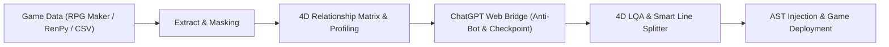

# Agentic Translation Framework (ATF)
> **Enterprise-Grade Universal Game Localization & Agentic Pipeline**  
> *ระบบโครงร่างการแปลเกมและอัปเดตแพตช์อัตโนมัติสากล รองรับ RPG Maker MV/MZ, Ren'Py, Visual Novel, Unity และ Game Engines ทุกแพลตฟอร์ม*

---

## 📖 เกี่ยวกับโปรเจกต์ (Project Overview)

**Agentic Translation Framework (ATF)** เป็นระบบสถาปัตยกรรมการแปลเกมภาษาต่างประเทศ (เช่น ญี่ปุ่น, อังกฤษ) สู่ภาษาไทยอย่างสมบูรณ์แบบระดับวรรณกรรม (Literary Quality) โดยไม่ได้เน้นการแปลแบบตรงตัว (Word-by-word) แต่ใช้เทคโนโลยี **Agentic AI Workflow** ร่วมกับโมเดลจิตวิทยาและความสัมพันธ์ตัวละคร 4 มิติ (**TLAS: Target Language Adaptation System**)

ATF ถูกออกแบบภายใต้หลักการ **"Universal Framework Paradigm"** — ไม่ได้จำกัดการใช้งานอยู่กับเกมใดเกมหนึ่ง แต่สามารถนำไปใช้งาน (Plug-and-Play) กับโปรเจกต์เกมและแพตช์เกมเวอร์ชันใหม่ได้อย่างไร้รอยต่อ



---

## 🌟 จุดเด่นและคุณสมบัติหลัก (Key Features)

1. **4D TLAS Relationship Matrix & Character Profiling:**
   - วิเคราะห์สรรพนาม (คำเรียกตัวเอง, คำเรียกคู่สนทนา), ระดับความเป็นทางการ, หางเสียง (คะ/ค่ะ/ครับ), อารมณ์, และสถานะอำนาจทางสังคมแบบไดนามิกตามแต่ละคู่สนทนาและไทม์ไลน์เนื้อเรื่อง
2. **ChatGPT Web Bridge Technology:**
   - เชื่อมต่อโปรแกรมเข้ากับหน้าเว็บ ChatGPT (`chatgpt.com`) โดยตรงผ่าน Tampermonkey Userscript ทำให้สามารถใช้งานโมเดลชั้นนำ (o3, GPT-4o, GPT-5) ได้อย่างเต็มประสิทธิภาพโดย**ไม่มีค่าใช้จ่าย API Token** และไม่มีปัญหา API Timeout
3. **Zero-Loss Control Code Masking:**
   - แปลงรหัสควบคุมภายในเกม เช่น `\C[2]`, `\V[1]`, `\N[1]`, `\!`, `\.` ให้อยู่ในรูป Semantic XML Tags ป้องกันไม่ให้ AI แปลง ทำลาย หรือทำรหัสควบคุมสีและเสียงของเกมเพี้ยน
4. **Smart Thai Line Splitting (ป้องกันข้อความล้นกล่อง):**
   - ใช้อัลกอริทึมตัดแบ่งบรรทัดภาษาไทยอัจฉริยะ (อ้างอิงพจนานุกรมและกฎไวยากรณ์) ให้ตรงกับจำนวนบรรทัดของต้นฉบับ (Strict Line-Count Parity) ป้องกันตัวหนังสือตกขอบในเกม
5. **Differential CSV Alignment & 100% Legacy Preservation:**
   - สำหรับงานอัปเดตแพตช์เกมใหม่ ระบบจะตรวจจับเฉพาะบรรทัดใหม่ที่เพิ่มเข้ามา (Delta Rows) และปกป้องบทแปลเดิมไว้ 100% โดยไม่ส่งไปแปลซ้ำ
6. **Atomic State Checkpointing & Zero-Skip Guarantee:**
   - ระบบบันทึกความคืบหน้าลงดิสก์ทุก Batch งาน พร้อมระบบกู้คืนอัตโนมัติ (Resume) เมื่อเกิดข้อผิดพลาด ป้องกันข้อมูลสูญหาย 100%
7. **Photoshop Hybrid Image Localization & OCR Bridge (ADR-034):**
   - สแกนคัดแยกเฉพาะภาพที่มี Text จากภาพนับพันภาพในเกมอัตโนมัติ ตัด CG/Sprite ออก 100%
   - สกัดข้อความภาษาอังกฤษด้วย Deep Learning OCR ยุบรวมข้อความซ้ำเป็น Unique Spreadsheet ให้แปลเพียง 1 ครั้งต่อ 1 ข้อความ
   - รองรับการทำงานร่วมกับ Adobe Photoshop สำหรับผู้ใช้ที่ต้องการจัดวาง Typography และแต่งภาพด้วยตนเอง
   - ระบบ Re-encryption อัตโนมัติ แปลงภาพ `.png` ภาษาไทยกลับเป็นไฟล์เกม (`.rpgmvp`) ฉีดเข้าเกมจริงทันที

---

## 📁 โครงสร้างโปรเจกต์ (Directory Structure)

```text
Agentic Translation Framework (ATF)/
├── .agents/                 # AI Agent Skills, Rules & Project Memories
├── archive/                 # โฟลเดอร์เก็บโค้ดยุคเก่าและสคริปต์เฉพาะกิจ (Safely Archived)
│   ├── legacy_agents/       # โค้ดยุคแรก (Early Multi-Agent / Gemma Prototype)
│   ├── legacy_tools/        # สคริปต์ซ่อมและสคริปต์วิเคราะห์ย่อยในอดีต 65+ รายการ
│   └── root_scripts/        # สคริปต์เทสต์ชั่วคราวและตัวรันเก่าใน Root
├── data/                    # โฟลเดอร์ฐานข้อมูลและเทมเพลต
│   ├── project_manifest.json# ไฟล์กำหนดตำแหน่งโฟลเดอร์เกมและเส้นทางไฟล์ของโปรเจกต์
│   ├── plugins_texts.csv    # ตารางแปลข้อความ UI เมนูจาก plugins.js
│   └── tlas/                # ฐานข้อมูล Master Glossary, Profiles และ Pronoun Matrix
├── docs/                    # สถาปัตยกรรมและคู่มือการใช้งาน (ADR / SAD / SDD / USER_MANUAL.md)
├── src/
│   └── atf/
│       ├── core/            # โมดูลระบบหลัก (DisplayableEngine, Masker, Splitter, LQA, Scanner)
│       └── tools/           # เครื่องมือปฏิบัติการหลัก (Bridge Server, Translation Runner, Triad Engine)
├── requirements.txt         # รายการแพ็กเกจ Python ที่จำเป็น
├── atf.py                   # Master Unified CLI สั่งการทำงานครบวงจรในคำสั่งเดียว
└── translate.py             # ทางลัดสำหรับสั่งรันการแปล (Shortcut to `python atf.py translate`)
```

---

## ⚙️ สิ่งที่ต้องเตรียมพร้อม (Prerequisites)

1. **Python 3.10 ขึ้นไป** ([ดาวน์โหลด Python](https://www.python.org/downloads/))
2. **เว็บเบราว์เซอร์** (Google Chrome, Microsoft Edge หรือ Brave)
3. **ส่วนขยายเบราว์เซอร์ Tampermonkey** ([ติดตั้ง Tampermonkey](https://www.tampermonkey.net/))
4. **บัญชี OpenAI ChatGPT** (เข้าสู่ระบบที่ [chatgpt.com](https://chatgpt.com))

---

## 🚀 วิธีการติดตั้ง (Installation Guide)

### ขั้นที่ 1: Clone Repository
เปิด Terminal (PowerShell หรือ CMD) แล้วรันคำสั่ง:
```bash
git clone https://github.com/xxshining01/Agentic_Translation_Framwork.git
cd Agentic_Translation_Framwork
```

### ขั้นที่ 2: สร้างและเปิดใช้งาน Virtual Environment (แนะนำ)
- **PowerShell:**
  ```powershell
  python -m venv venv
  .\venv\Scripts\Activate.ps1
  ```
- **Command Prompt (CMD):**
  ```cmd
  python -m venv venv
  venv\Scripts\activate.bat
  ```

### ขั้นที่ 3: ติดตั้ง Dependencies
```bash
pip install -r requirements.txt
```

### ขั้นที่ 4: ติดตั้ง Tampermonkey Userscript
1. เปิดเว็บเบราว์เซอร์ เข้าสู่ส่วนขยาย **Tampermonkey**
2. เลือก **Create a new script** (สร้างสคริปต์ใหม่)
3. คัดลอกโค้ดทั้งหมดจากไฟล์:
   ```text
   src/atf/tools/atf_chatgpt_userscript.user.js
   ```
4. วางลงในช่องแก้ไขของ Tampermonkey แล้วกด **Ctrl + S** เพื่อบันทึก
5. เปิดแท็บหน้าเว็บ `https://chatgpt.com` ค้างไว้ จะเห็นเมนูสถานะของ ATF แสดงขึ้นที่มุมจอ

---

## 🧭 คู่มือการใช้งานระบบ (User Manual & Execution Workflow)

> 💡 **คู่มือฉบับสมบูรณ์อย่างเป็นทางการ (Official Complete Manual):**  
> ตรวจสอบเอกสารฉบับเต็มที่แยกส่วนคำสั่งและการทำงานเชิงลึกอย่างละเอียดได้ที่ 👉 **[[คู่มือการใช้งานระบบ ATF (docs/USER_MANUAL.md)]](file:///d:/Agentic%20Translation%20Framework%20(ATF)%20Project/docs/USER_MANUAL.md)**
> - **หมวดที่ 1:** ส่วนการสั่งทำงานด่วน (Operational Cheatsheet: ตารางคำสั่งพร้อมรันทั้ง PowerShell และ CMD)
> - **หมวดที่ 2:** ส่วนอธิบายรายละเอียดเชิงลึก (System Mechanics & Architecture: ADR-035, SFX, 5D LQA)

---

### ⚡ สรุปลำดับการสั่งทำงานด่วน (Quick Start Pipeline)

```mermaid
flowchart LR
    S1["1. python atf.py setup<br>(ตั้งค่า Workspace)"] --> S2["2. python atf.py bridge<br>(เชื่อมต่อ ChatGPT)"]
    S2 --> S3["3. python atf.py prepare-all<br>(เตรียมข้อมูลครบวงจร)"]
    S3 --> S4["4. python atf.py translate<br>(สั่งรันการแปลต่อเนื่อง)"]
    S4 --> S5["5. python atf.py verify<br>(ตรวจ LQA 8 มิติ)"]
    S5 --> S6["6. python atf.py export<br>(ส่งออกแพตช์เกม)"]
    
    style S1 fill:#f6f8fa,stroke:#0969da
    style S2 fill:#f6f8fa,stroke:#0969da
    style S3 fill:#ddf4ff,stroke:#0969da,stroke-width:2px
    style S4 fill:#ddf4ff,stroke:#0969da,stroke-width:2px
    style S5 fill:#f6f8fa,stroke:#0969da
    style S6 fill:#f6f8fa,stroke:#0969da
```



#### ขั้นตอนที่ 1: ตั้งค่า Workspace และตำแหน่งไฟล์เกม:
```bash
python atf.py setup
```

#### ขั้นตอนที่ 2: เปิดสะพานเชื่อมต่อ ChatGPT Web Bridge (เปิดหน้าต่าง Terminal แยก):
```bash
python atf.py bridge
```

#### ขั้นตอนที่ 3: สั่งเตรียมข้อมูลทั้งเกมครบวงจรในคำสั่งเดียว (สแกนชื่อ, ศัพท์, ฉาก, เมทริกซ์, สร้างตาราง 10 คอลัมน์):
```bash
python atf.py prepare-all
```

#### ขั้นตอนที่ 4: สั่งรันการแปลเกม:
- **โหมดจำลองออฟไลน์ (Dry-Run ทดสอบระบบ):**
  ```bash
  python atf.py translate --dry-run
  ```
- **โหมดรันแปลจริงต่อเนื่องทั้งเรื่อง:**
  ```bash
  python atf.py translate
  ```

#### ขั้นตอนที่ 5: ตรวจสอบความถูกต้องและคุณภาพ LQA 8 มิติ:
```bash
python atf.py verify
```

#### ขั้นตอนที่ 6: ฉีดคำแปล UI เมนู และส่งออกไฟล์แพตช์เกม:
```bash
# ฉีดคำแปลเมนูเข้า www/js/plugins.js
python atf.py plugins --inject

# ส่งออกไฟล์ CSV สำหรับนำไปแพตช์เกม
python atf.py export
```
# แปลข้อความ UI เมนูก่อน
python translate.py --plugins

# แปลบทสนทนาทั้งหมดอย่างต่อเนื่อง
python translate.py --all
```

---

### 🟡 CASE B: อัปเดตแพตช์เวอร์ชันใหม่ (Patch Version Update)

เมื่อผู้พัฒนาเกมปล่อยแพตช์เวอร์ชันใหม่ (มีข้อความเพิ่มขึ้น เช่น 14,000+ บรรทัดใหม่):

#### Stage B1: ประกบไฟล์และแยก Delta Queue
ระบบจะนำไฟล์แพตช์ใหม่มาประกบกับบทแปลเดิม บรรทัดที่เคยแปลแล้วจะถูกเก็บรักษาไว้ 100% และคัดแยกเฉพาะบรรทัดใหม่ที่ว่างเปล่าเป็นคิวแปล

#### Stage B2: สกัดศัพท์ใหม่ประจำแพตช์
```bash
# สกัดไอเทม/อุปกรณ์ใหม่
python extract_glossary.py

# สกัดสถานที่ใหม่จากบทสนทนา
python harvest_places.py

# นำเข้าคำศัพท์ที่แปลแล้วสู่ Glossary
python import_glossary.py
```

#### Stage B3: Re-trace ฉากบนแผนที่ใหม่
```bash
python trace_scenes.py
```

#### Stage B4: ซิงค์และวิเคราะห์ตัวละครใหม่
```bash
python sync_profiles.py
```

#### Stage B5: แปลเฉพาะแถวว่างใหม่ (Empty-only Mode)
```bash
# แปลเฉพาะข้อความใหม่โดยข้ามข้อความเดิมทั้งหมด
python translate.py --empty-only
```

---

### 🏁 การตรวจสอบคุณภาพและนำเข้าเกม (Convergence Phases)

#### Phase 6: ตรวจสอบความถูกต้องของระบบและฐานข้อมูล
```bash
python verify_integrity.py
```

#### Phase 7 & 8: ซิงค์ Checkpoint และจัดระเบียบบรรทัดภาษาไทย
ดึงคำแปลทั้งหมดจาก Checkpoint บันทึกลงในไฟล์ CSV พร้อมจัดบรรทัดภาษาไทยให้ตรงกับต้นฉบับ:
```bash
python sync_checkpoint.py
```

#### Phase 9: ฉีดคำแปลกลับเข้าสู่ตัวเกม
```bash
# 1. ฉีดคำแปล UI เมนูกลับเข้า plugins.js ของเกม
python inject_plugins.py
```
2. นำไฟล์ CSV บทสนทนาที่แปลเสร็จแล้ว วางลงในโฟลเดอร์เกม หรือ Recompile ผ่าน Translator++
3. เปิดเล่นเกมเพื่อตรวจสอบความเรียบร้อย

---

### 🖼️ การแปลภาพกราฟิกในเกม (Image Localization: Photoshop Hybrid Workflow)

ATF รองรับท่อส่งข้อมูลการแปลภาพแบบ Hybrid ร่วมกับ Adobe Photoshop (ADR-026 ถึง ADR-034):

1. **สแกนและคัดกรองเฉพาะภาพที่มี Text (ตัด CG/Sprite ออกอัตโนมัติ):**
   ```bash
   python localize_images.py scan --decrypt
   ```
2. **สกัด Text ลงตารางและยุบรวมคำซ้ำ (Catalog, Repair & Dedupe):**
   ```bash
   python localize_images.py catalog --rebuild
   python localize_images.py repair
   python localize_images.py dedupe
   ```
3. **แปลใน `unique_dialogues.csv` แล้วกระจายคำแปลกลับสู่ทุกภาพ:**
   ```bash
   python localize_images.py propagate
   ```
4. **เปิดไฟล์ใน `raw/` แต่งใน Photoshop แล้วเซฟภาพภาษาไทย (.png) ลงโฟลเดอร์ `translated/`**
5. **เข้ารหัสและอัดภาพภาษาไทยกลับเข้าตัวเกม (.png -> .rpgmvp):**
   ```bash
   python localize_images.py encrypt --folder pictures
   ```

---

## 📋 สรุปคำสั่งที่ใช้งานบ่อย (Cheat Sheet)

| การทำงาน | คำสั่ง PowerShell / CMD |
| :--- | :--- |
| **เปิด Bridge Server** | `python src/atf/tools/chatgpt_bridge_server.py` |
| **ตั้งค่า Path โปรเจกต์** | `python setup_paths.py` |
| **ตรวจความสมบูรณ์ของระบบ** | `python verify_integrity.py` |
| **สกัด UI ปลั๊กอิน** | `python extract_plugins.py` |
| **สกัดฉากเนื้อเรื่อง** | `python trace_scenes.py` |
| **สกัดคำศัพท์ใหม่** | `python extract_glossary.py` |
| **สกัดสถานที่จากบทสนทนา** | `python harvest_places.py` |
| **นำเข้าคำศัพท์** | `python import_glossary.py` |
| **เริ่มแปล (ทั้งหมด)** | `python translate.py --all` |
| **เริ่มแปล (เฉพาะแถวใหม่)** | `python translate.py --empty-only` |
| **ซิงค์ Checkpoint สู่ CSV** | `python sync_checkpoint.py` |
| **ฉีดคำแปลเข้า plugins.js** | `python inject_plugins.py` |
| **สแกนคัดแยกภาพที่มี Text** | `python localize_images.py scan --decrypt` |
| **สกัด Text ภาพลงตาราง** | `python localize_images.py catalog --rebuild` |
| **ยุบรวมข้อความภาพซ้ำ (Dedupe)** | `python localize_images.py dedupe` |
| **กระจายคำแปลภาพที่ซ้ำกัน** | `python localize_images.py propagate` |
| **อัดภาพภาษาไทยกลับเข้าเกม** | `python localize_images.py encrypt --folder pictures` |

---

## 🛠️ การแก้ไขปัญหาที่พบบ่อย (Troubleshooting)

- **Userscript ไม่เชื่อมต่อกับ Bridge Server:**
  - ตรวจสอบว่าได้รัน `python src/atf/tools/chatgpt_bridge_server.py` อยู่หรือไม่
  - เปิดเบราว์เซอร์ไปที่ `http://127.0.0.1:8765/bridge/status` ต้องแสดงผล JSON สถานะปกติ
  - ตรวจสอบว่าเปิดแท็บ `https://chatgpt.com` อยู่และส่วนขยาย Tampermonkey เปิดทำงาน
- **Control Codes ในเกมหลุดสีหรือเสียหาย:**
  - ATF มีระบบ `MessageCodeMasker` ปกป้องโค้ดอัตโนมัติ หากพบความผิดปกติ ให้รัน `python sync_checkpoint.py` เพื่อจัดระเบียบบรรทัดใหม่
- **ข้อความภาษาไทยล้นกล่อง:**
  - รัน `python sync_checkpoint.py` เพื่อให้ `SmartLineSplitter` ทำการคำนวณจุดตัดคำภาษาไทยและแบ่งบรรทัดใหม่ตามต้นฉบับภาษาอังกฤษ

---

## 📚 เอกสารสถาปัตยกรรม (Architecture References)

- [Architecture Index (ดัชนีสถาปัตยกรรม)](docs/ARCHITECTURE_INDEX.md)
- [ADR-024: Target Workspace Isolation](docs/adr/ADR-024-Target-Workspace-Isolation-and-Baseline-Immutability.md)
- [ADR-023: Dialogue-Corroborated Place Entity Extraction](docs/adr/ADR-023-Dialogue-Corroborated-Place-Entity-Extraction.md)
- [SAD-013: RPG Maker MV Plugin Localization Pipeline](docs/architecture/SAD-013-RPG-Maker-MV-Plugin-Localization-Pipeline.md)
- [SDD-014: Checkpoint Sync & Pure Queue Alignment](docs/design/SDD-014-Checkpoint-Consolidation-and-Strict-Parity-Sync.md)

---

## 📄 License
This project is licensed under the MIT License - see the LICENSE file for details.
