# ATF Enterprise Architectural Master Index & Traceability Map
**Agentic Translation Framework (ATF) — Documentation Roadmap**

เอกสารฉบับนี้ทำหน้าที่เป็น **Master Index (สารบัญกลางและแผนที่นำทางสถาปัตยกรรม)** เพื่อเชื่อมโยงเอกสารการตัดสินใจทางสถาปัตยกรรม (ADR), เอกสารสถาปัตยกรรมระบบ (SAD), และเอกสารการออกแบบซอฟต์แวร์ (SDD) ทั้งหมดในโปรเจกต์เข้าด้วยกันเป็นโครงข่ายที่มีความสอดคล้องและตรวจสอบย้อนกลับได้ (Traceable Network) 100%

---

## 1. ผังรวมท่อส่งข้อมูลหลักของ ATF (ATF End-to-End Localization Pipeline)

```mermaid
flowchart TD
    subgraph Layer1["1. Raw Game Extraction & Data Modeling"]
        L1A["SAD-005: Raw Game Data Layer"] --> L1B["SAD-005: Control Code Masking & Parsing"]
        L1B --> L1C["SDD-004: Game Syntax & CSV Schema"]
    end

    subgraph Layer2["2. Macro Parameter Consensus (TLAS v4.0)"]
        L1C --> L2A["ADR-015: Elimination of Timeline Dependencies"]
        L2A --> L2B["SAD-010: Stage 1-3 Feature Extraction & Consensus"]
        L2B --> L2C["SDD-011: Python Statistical Consensus Engine"]
        L2C --> L2D["SDD-010 / SDD-012: Calibrated Character Profiles"]
    end

    subgraph Layer3["3. Translation Runtime, Code Masking & Smart Batching"]
        L2D --> L3A["ADR-010: Smart Batching Engine"]
        L3A --> L3B["ADR-019 / SAD-014: Stage 4.1 Control Code Masker"]
        L3B --> L3C["SDD-016: Semantic Tag Transformer"]
        L3C --> L3D["SAD-010: Stage 4 Translation Runtime"]
        L3D --> L3E["Raw Thai Translated Output (XML-Guarded)"]
    end

    subgraph Layer4["4. Typography & Line-Break Parity Restoration"]
        L3E --> L4A["ADR-019 / SAD-014: Stage 4.2 Tag Unmasker & Parity Assertion"]
        L4A --> L4B["ADR-016: Strict Invariant Restoration Architecture"]
        L4B --> L4C["SAD-011: Stage 5 Typography Alignment Engine"]
        L4C --> L4D["SDD-013: SmartLineSplitter Specification"]
        L4D --> L4E["100% Strict Line Parity Thai Dialogue"]
    end

    subgraph Layer5["5. State Persistence, Fault Tolerance & Plugin Localization"]
        L4E --> L5A["ADR-017 / SAD-012: Checkpoint Atomic Persistence"]
        L5A --> L5B["SDD-014: Untranslated Queue Filter Engine"]
        L5B --> L5C["ADR-018 / SAD-013: RPG Maker Plugin Extractor & Injector"]
        L5C --> L5D["Final Playable Localized Game Release"]
    end
```

---

## 2. ตารางรวมเอกสารทั้งหมดในระบบ (Complete Documentation Registry)

### 2.1 Architecture Decision Records (ADR) — บันทึกการตัดสินใจทางสถาปัตยกรรม
| ID | Title | Status | Scope / Core Impact |
|:---:|---|:---:|---|
| **ADR-000** | Initial Framework & Agent Architecture | Accepted | โครงสร้างพื้นฐาน Agentic Architecture แรกเริ่ม |
| **ADR-004** | Narrative Timeline & Map-Reduce Paradigm | Superseded | ระบบ Timeline ยุค v3.x (ถูกแทนที่ด้วย ADR-015) |
| **ADR-009** | TLAS Multi-Agent Orchestration | Accepted | สถาปัตยกรรมการประสานงานของ Multi-Agent |
| **ADR-010** | Smart Batching Engine | Accepted | การแบ่งก้อนข้อมูลบทสนทนาอย่างชาญฉลาดตามความจุ Token |
| **ADR-011** | Auto-Translation Memory | Accepted | ฐานข้อมูลหน่วยความจำการแปลระดับโปรเจกต์ |
| **ADR-012** | TLAS 3-Tier Fallback Engine | Accepted | ปรัชญาระบบลดหลั่น (Waterfall Evaluation) ป้องกันระบบหยุดชะงัก |
| **ADR-013** | 4D Relationship & Dynamic Overrides | Accepted | เมทริกซ์ความสัมพันธ์ 4 มิติและการ Override ตามอารมณ์ |
| **ADR-014** | Global Character Profile Consolidation | Accepted | การรวมศูนย์คุณลักษณะตัวละครข้ามทั้งโปรเจกต์ |
| **ADR-015** | Global-Relational Architecture Without Timeline | **Approved** | **TLAS v4.0:** ยกเลิก Timeline ใช้ Macro Consensus สรรพนาม 100% |
| **ADR-016** | Smart Line Splitting & Strict Invariant Restoration | **Approved** | **Typography Engine:** การันตีจำนวนบรรทัดตรงต้นฉบับ 100% ป้องกันคำประสม |
| **ADR-017** | Atomic Checkpoint Persistence & Pure Queue Filtering | **Approved** | **State Persistence:** ซิงค์ Checkpoint ข้าม Section สองทาง บันทึก Atomic ไร้ข้อมูลสูญหาย |
| **ADR-018** | RPG Maker Plugin Parameter Extraction & AST Injection | **Approved** | **Plugin Framework:** สกัดและฉีดคำแปล UI Text ใน `plugins.js` ปลอดภัย 100% |
| **ADR-019** | Control Code Masking & Bidirectional Parity Preservation | **Approved** | **Control Code Engine:** แปลงรหัสเกมเป็น Semantic XML ป้องกันแท็กหายและการแปลมั่ว |
| **ADR-020** | Tiered Self-Healing Protocol and Dynamic Glossary Propagation | **Approved** | **Self-Healing & Propagation:** กระบวนการฟื้นตัวแบบลดหลั่นและส่งต่อ Glossary อัตโนมัติ |
| **ADR-021** | Strict Pure Dialogue Thai Invariant | **Approved** | **Dialogue Purity:** ป้องกันข้อความบทแปลหลุด/ปนเปื้อนด้วยกฎ Invariant |
| **ADR-022** | Decoupled Legacy Curation & Rogue Translation Purge | **Approved** | **Curation Layer:** ล้างไพ่บทแปลหลอนในจังหวะเงียบและแท็กสลับขั้วจากอดีต |
| **ADR-023** | Dialogue-Corroborated Place Entity Extraction | **Approved** | **Glossary Precision:** สกัดชื่อสถานที่แท้จริงผ่านการเทียบเคียงบทสนทนา ขจัดขยะ Map Label ทางเทคนิค |
| **ADR-024** | Target Workspace Isolation & Patch Asset Separation | **Approved** | **Workspace Isolation:** รวมไฟล์ผลลัพธ์และฐานข้อมูลทั้งหมดไว้ในโฟลเดอร์ปลายทางที่ Browse ไว้ 100% |

---

### 2.2 System Architecture Documents (SAD) — พิมพ์เขียวสถาปัตยกรรมระบบ
| ID | Title | Status | Pipeline Layer / Role |
|:---:|---|:---:|---|
| **SAD-001** | ATF System Architecture Overview | Accepted | ภาพรวมระบบ ATF ยุคเริ่มต้น |
| **SAD-002** | TLAS Localization Architecture | Accepted | สถาปัตยกรรม TLAS Core System |
| **SAD-004** | Rule-Based Dialogue Localization Processing Pipeline | Accepted | ไปป์ไลน์การประมวลผลข้อความเกมและกฎภาษาศาสตร์ |
| **SAD-005** | TLAS Localization Engine 4D Pipeline | Accepted | รายละเอียดท่อส่งข้อมูล 4D Matrix และ Control Code Masking |
| **SAD-006** | Global Character Consolidation & Synthesis | Accepted | ระบบวิเคราะห์และรวบรวมโปรไฟล์ตัวละคร |
| **SAD-010** | TLAS Global-Relational Localization Architecture (v4.0) | **Approved** | สถาปัตยกรรมหลัก Stage 1–4 (Feature Extract $\to$ Consensus $\to$ Pronoun) |
| **SAD-011** | Typography Alignment and Line-Break Parity Architecture | **Approved** | **Stage 5 Engine:** การจัดวางตัวอักษร, Dynamic Windowing, Strict Parity |
| **SAD-012** | Fault-Tolerant Translation Runner & State Sync | **Approved** | **Stage 6 Engine:** Multi-Section Sync, Pure Queue Filter, Atomic Replacement |
| **SAD-013** | RPG Maker Plugin Localization Pipeline | **Approved** | **Stage 7 Engine:** Nested JSON Unpacker/Packer, Semantic Classifier, AST Guard |
| **SAD-014** | Control Code Masking and Sanitization Engine | **Approved** | **Stage 4.1 / 4.2 Engine:** Universal Code Normalizer, XML-like Guard, Tag Parity Assertion |

---

### 2.3 Software Design Documents (SDD) — รายละเอียดการออกแบบเชิงวิศวกรรม
| ID | Title | Status | Technical Target / Module |
|:---:|---|:---:|---|
| **SDD-004** | TLAS Implementation Details | Accepted | ข้อกำหนดเชิงเทคนิค RPG Maker Syntax, Data Columns |
| **SDD-005** | TLAS Taxonomy v3.5 Specification | Accepted | โครงสร้าง Taxonomy และ Tag Definitions |
| **SDD-006** | Character & Metadata Schema | Accepted | โครงสร้าง JSON Schema ของโปรไฟล์และเมทาดาตา |
| **SDD-008** | Rule-Based Engine Specification | Accepted | อัลกอริทึมจัดการคำลงท้าย (ครับ/ค่ะ) และ Tokenizer |
| **SDD-010** | Global Character and Speech Schema | Accepted | โครงสร้างข้อมูลสรรพนามบุรุษที่ 1, 2, 3 รายคู่ความสัมพันธ์ |
| **SDD-011** | Python Consensus and Pronoun Engine | Accepted | ขั้นตอนวิธี Majority Vote, Trait Histogram และ Rule Engine |
| **SDD-012** | Data-Driven Taxonomy Calibration | Accepted | การ Calibrate พารามิเตอร์และ Threshold จากข้อมูลสถิติจริง |
| **SDD-013** | SmartLineSplitter & Typography Restoration Specification | **Approved** | ข้อกำหนดอัลกอริทึม `SmartLineSplitter`, ตาราง Scoring, Regex Library |
| **SDD-014** | Untranslated Queue Filter & Checkpoint Sync Engine | **Approved** | ข้อกำหนดอัลกอริทึมคัดกรองคิวบริสุทธิ์, Multi-Section Consolidation, Atomic Sync |
| **SDD-015** | RPG Maker Plugin Parameter Extractor & Injector | **Approved** | ข้อกำหนด `PluginASTParser`, `RecursiveJsonUnpacker/Packer`, Classifier, CSV Bridge |
| **SDD-016** | MessageCodeMasker and Tag Parity Specification | **Approved** | ข้อกำหนด `MessageCodeMasker`, Paired/Self-closing Tags Regex, Auto-Repair Logic |
| **SDD-017** | Place Entity Harvester and Dialogue Alignment | **Approved** | ข้อกำหนด `PlaceEntityHarvester`, `SeedSanitizer`, Dialogue Preposition Matcher |

---

## 3. เมทริกซ์การตรวจสอบย้อนกลับทางสถาปัตยกรรม (Traceability Matrix)

| Requirement / Problem Area | Architectural Decision (ADR) | System Blueprints (SAD) | Detailed Design (SDD) | Verification Tool / Script |
|---|---|---|---|---|
| **Elimination of Pronoun Drift** | [ADR-015](adr/ADR-015-Global-Relational-Architecture-Without-Timeline.md) | [SAD-010](architecture/SAD-010-TLAS-Global-Relational-Architecture.md) | [SDD-011](design/SDD-011-Python-Consensus-and-Pronoun-Engine.md), [SDD-010](design/SDD-010-TLAS-Global-Character-and-Speech-Schema.md) | `verify_updated_glossary.py` |
| **Control Code & Escape Integrity** | [ADR-019](adr/ADR-019-Control-Code-Masking-and-Bidirectional-Parity-Preservation.md) | [SAD-014](architecture/SAD-014-Control-Code-Masking-and-Sanitization-Engine.md) | [SDD-016](design/SDD-016-MessageCodeMasker-and-Tag-Parity-Specification.md) | `scratch/audit_control_code_corruption.py`, `testing files/control_code_masker.py` |
| **Line-Count Parity (100% Parity)** | [ADR-016](adr/ADR-016-Smart-Line-Splitting-and-Strict-Invariant-Restoration.md) | [SAD-011](architecture/SAD-011-Typography-Alignment-and-Line-Break-Parity.md) | [SDD-013](design/SDD-013-SmartLineSplitter-and-Typography-Restoration.md) | `inspect_line_breaks.py`, `repair_line_breaks.py --test` |
| **Compound Word Integrity** | [ADR-016](adr/ADR-016-Smart-Line-Splitting-and-Strict-Invariant-Restoration.md) | [SAD-011](architecture/SAD-011-Typography-Alignment-and-Line-Break-Parity.md) | [SDD-013](design/SDD-013-SmartLineSplitter-and-Typography-Restoration.md) | `repair_line_breaks.py (Test Jinnie Row 465)` |
| **Fault-Tolerant Checkpoint & Resume** | [ADR-017](adr/ADR-017-Atomic-Checkpoint-Persistence-and-Queue-Filtering.md) | [SAD-012](architecture/SAD-012-Fault-Tolerant-Translation-Runner-and-State-Sync.md) | [SDD-014](design/SDD-014-Untranslated-Queue-Filter-and-Checkpoint-Sync-Specification.md) | `diagnose_untranslated_discrepancy.py`, `sync_checkpoint_to_csv.py` |
| **Plugin UI Localization** | [ADR-018](adr/ADR-018-RPG-Maker-MV-Plugin-Parameter-Extraction-and-AST-Injection.md) | [SAD-013](architecture/SAD-013-RPG-Maker-MV-Plugin-Localization-Pipeline.md) | [SDD-015](design/SDD-015-Plugin-Parameter-Extractor-and-Injector-Specification.md) | `extract_plugin_texts.py`, `inject_plugin_texts.py` |
| **Dialogue-Corroborated Places** | [ADR-023](adr/ADR-023-Dialogue-Corroborated-Place-Entity-Extraction.md) | [SAD-002](architecture/SAD-002-TLAS-Localization-Architecture.md) | [SDD-017](design/SDD-017-Place-Entity-Harvester-and-Dialogue-Alignment.md) | `harvest_places.py`, `extract_glossary.py` |
