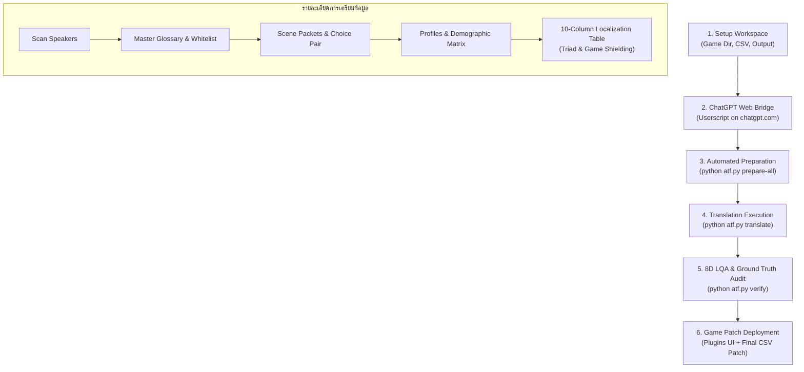

# คู่มือการใช้งานระบบ Agentic Translation Framework (ATF User Manual)
> **Enterprise-Grade Universal Game Localization & Agentic Pipeline v2.0**  
> คู่มือปฏิบัติการฉบับรวมศูนย์ (Single Master Manual): รวบรวมขั้นตอนการทำงานครบวงจรตั้งแต่การสร้าง Workspace, เชื่อมต่อ ChatGPT Bridge, สกัดและวิเคราะห์บริบทเกม, สั่งรันการแปล, จนถึงการตรวจสอบ LQA และแพตช์คืนเกม

---

## 📑 สารบัญ (Table of Contents)
- [1. สิ่งที่ต้องเตรียมพร้อม (Prerequisites)](#1-สิ่งที่ต้องเตรียมพร้อม-prerequisites)
- [2. ผังขั้นตอนการทำงานครบวงจร (Complete Pipeline Workflow)](#2-ผังขั้นตอนการทำงานครบวงจร-complete-pipeline-workflow)
- [3. ขั้นตอนที่ 1: ตั้งค่าพื้นที่ทำงานและโปรเจกต์ (Workspace & Manifest Setup)](#3-ขั้นตอนที่-1-ตั้งค่าพื้นที่ทำงานและโปรเจกต์-workspace--manifest-setup)
- [4. ขั้นตอนที่ 2: เชื่อมต่อ ChatGPT Web Bridge (Web Bridge Setup)](#4-ขั้นตอนที่-2-เชื่อมต่อ-chatgpt-web-bridge-web-bridge-setup)
- [5. ขั้นตอนที่ 3: เตรียมข้อมูลบทสนทนาและบริบทเกม (Preparation Pipeline)](#5-ขั้นตอนที่-3-เตรียมข้อมูลบทสนทนาและบริบทเกม-preparation-pipeline)
  - [3.1 รันเตรียมข้อมูลแบบอัตโนมัติครบวงจร (One-Command Automation - แนะนำ)](#31-รันเตรียมข้อมูลแบบอัตโนมัติครบวงจร-one-command-automation---แนะนำ)
  - [3.2 รันแยกทีละขั้นตอน (Step-by-Step Manual Execution)](#32-รันแยกทีละขั้นตอน-step-by-step-manual-execution)
- [6. ขั้นตอนที่ 4: สั่งรันการแปลเกม (Translation Runner)](#6-ขั้นตอนที่-4-สั่งรันการแปลเกม-translation-runner)
- [7. ขั้นตอนที่ 5: ตรวจสอบคุณภาพและความสมบูรณ์ 8 มิติ (8D LQA Audit & Verification)](#7-ขั้นตอนที่-5-ตรวจสอบคุณภาพและความสมบูรณ์-8-มิติ-8d-lqa-audit--verification)
- [8. ขั้นตอนที่ 6: ฉีดคำแปลและแพตช์คืนเกม (Game Patch Deployment)](#8-ขั้นตอนที่-6-ฉีดคำแปลและแพตช์คืนเกม-game-patch-deployment)
- [9. ตารางสรุปคำสั่งด่วน (Command Cheat Sheet)](#9-ตารางสรุปคำสั่งด่วน-command-cheat-sheet)

---

## 1. สิ่งที่ต้องเตรียมพร้อม (Prerequisites)

1. **Python 3.10 ขึ้นไป**
   - ตรวจสอบด้วยคำสั่ง: `python --version`
2. **ติดตั้งไลบรารีที่จำเป็น (Dependencies):**
   - **PowerShell / CMD:**
     ```bash
     pip install -r requirements.txt
     ```
3. **เว็บเบราว์เซอร์** (Chrome, Edge หรือ Brave)
4. **ส่วนขยาย Tampermonkey** (ติดตั้งจาก [tampermonkey.net](https://www.tampermonkey.net/))
5. **บัญชี OpenAI ChatGPT** (เข้าสู่ระบบที่ [chatgpt.com](https://chatgpt.com))

---

## 2. ผังขั้นตอนการทำงานครบวงจร (Complete Pipeline Workflow)



---

## 3. ขั้นตอนที่ 1: ตั้งค่าพื้นที่ทำงานและโปรเจกต์ (Workspace & Manifest Setup)

เครื่องมือตั้งค่าจะค้นหาและจับคู่ตำแหน่งไฟล์ของเกมอัตโนมัติ:
- โฟลเดอร์เกมเป้าหมาย (`Game Directory` เช่น `Example RPGM Game/離れ木の5日間+`)
- โฟลเดอร์ข้อมูลเกม (`Game Data Directory` เช่น `www/data`)
- สคริปต์ปลั๊กอิน (`www/js/plugins.js`)
- ไฟล์ตารางข้อความต้นฉบับ / ไฟล์แปลเก่า (`raw_pre_csv`)
- โฟลเดอร์ผลลัพธ์ (`output_dir`)

### คำสั่งรันตั้งค่า Workspace:
- **PowerShell:**
  ```powershell
  python atf.py setup
  ```
- **CMD:**
  ```cmd
  python atf.py setup
  ```
*ผลลัพธ์:* ระบบจะบันทึกการตั้งค่าทั้งหมดลงใน `data/project_manifest.json` ซึ่งทุกโมดูลในระบบจะใช้เป็นค่าอ้างอิงอัตโนมัติ

---

## 4. ขั้นตอนที่ 2: เชื่อมต่อ ChatGPT Web Bridge (Web Bridge Setup)

เทคโนโลยี **ChatGPT Web Bridge** ช่วยให้เชื่อมต่อโปรแกรมเข้ากับหน้าเว็บ `chatgpt.com` โดยตรงผ่าน Tampermonkey Userscript ทำให้ใช้งานโมเดลเรือธง (GPT-4o, o3, GPT-5) ได้ต่อเนื่องโดย **ไม่มีค่าใช้จ่าย API Token** และไม่มี Timeout

### วิธีการเชื่อมต่อ:
1. **ติดตั้ง Userscript ใน Tampermonkey:**
   - คัดลอกโค้ดทั้งหมดจากไฟล์: [atf_chatgpt_userscript.user.js](file:///d:/Agentic%20Translation%20Framework%20(ATF)%20Project/src/atf/tools/atf_chatgpt_userscript.user.js)
   - ไปที่ Tampermonkey Dashboard -> สร้าง New Script -> วางโค้ดและกดบันทึก (Save)
2. **เปิดหน้าเว็บ ChatGPT:**
   - เปิดเบราว์เซอร์ไปที่ `https://chatgpt.com` และล็อกอินบัญชีของคุณค้างไว้
   - สังเกตแถบสถานะ Userscript ที่มุมจอ จะต้องขึ้นพร้อมเชื่อมต่อ
3. **เปิดเซิร์ฟเวอร์ Bridge Server (เปิดหน้าต่าง Terminal แยกค้างไว้ 1 หน้าต่าง):**
   - **PowerShell:**
     ```powershell
     python atf.py bridge
     ```
   - **CMD:**
     ```cmd
     python atf.py bridge
     ```
   *หน้าต่างนี้จะรันรอรับ-ส่งข้อความระหว่าง Python และ Web Browser ตลอดการทำงาน*

---

## 5. ขั้นตอนที่ 3: เตรียมข้อมูลบทสนทนาและบริบทเกม (Preparation Pipeline)

### 3.1 รันเตรียมข้อมูลแบบอัตโนมัติครบวงจร (One-Command Automation - แนะนำ)
คำสั่งเดียวจะรันต่อเนื่องครบทั้ง 5 ขั้นตอนหลัก:
- **PowerShell:**
  ```powershell
  python atf.py prepare-all
  ```
- **CMD:**
  ```cmd
  python atf.py prepare-all
  ```

---

### 3.2 รันแยกทีละขั้นตอน (Step-by-Step Manual Execution)
หากต้องการรันเพื่อตรวจสอบผลลัพธ์ทีละส่วน สามารถรันคำสั่งย่อยได้ดังนี้:

#### ขั้นตอนที่ 3.2.1: สแกนรายชื่อตัวละคร (Speaker Tags)
สกัดชื่อและแท็กตัวละครทั้งหมด 100% (รองรับ Lenticular Brackets `【...】` และทุกรูปแบบ):
- **PowerShell / CMD:**
  ```bash
  python atf.py scan
  ```
- *ผลลัพธ์:* `data/tlas/scanned_speakers.json`

#### ขั้นตอนที่ 3.2.2: สังเคราะห์ Master Glossary & Character Whitelist
ล็อกคำแปลชื่อตัวละคร 1:1 และคัดกรองเฉพาะตัวละครสำคัญเข้าสู่ Whitelist (ตัด Ambient NPCs ออกเพื่อป้องกัน Default Fallback Trap ตาม ADR-035):
- **PowerShell / CMD:**
  ```bash
  python atf.py glossary
  ```
- *ผลลัพธ์:* `data/tlas/tlas_glossary.json` และ `data/tlas/character_whitelist.json`

#### ขั้นตอนที่ 3.2.3: สกัดความต่อเนื่องของฉากและจับคู่ Choice Collision (Scene Packets)
จัดกลุ่มบทสนทนาตาม Scene Flow พร้อมวิเคราะห์ช้อยส์ตัวเลือกเพื่อใช้ Universal Safe Translation:
- **PowerShell / CMD:**
  ```bash
  python atf.py packets
  ```
- *ผลลัพธ์:* `data/tlas/scene_packets.json`

#### ขั้นตอนที่ 3.2.4: สังเคราะห์ Character Profiles & Demographic Pronoun Matrix (IDPR v5.0)
สร้างโปรไฟล์ตัวละครและจับคู่สรรพนามแบบ 2 ชั้น (Specific Pairwise Rules 1:1 + Dynamic Demographic Match):
- **PowerShell / CMD:**
  ```bash
  python atf.py matrix
  ```
- *ผลลัพธ์:* `data/tlas/profiles/*.json` และ `data/tlas/global_pronoun_matrix.json`

#### ขั้นตอนที่ 3.2.5: สร้างตารางแปล 10 มิติ (Rich 10-Column Localization Table)
ขับเคลื่อนด้วย **Universal Conversational Triad Engine** และ **GameDisplayableEngine**:
- สกัดตัวตนผู้พูดจริง (`Speaker`)
- สกัดคู่สนทนาที่ถูกพูดด้วย (`Listener`) อิงตาม Scene Turn-Taking
- สกัดบุคคลที่สามที่ถูกพาดพิงถึง (`Third_Person`)
- สแกน `www/data/*.json` สกัดกั้นโค้ด สคริปต์ สวิตช์ และตัวแปรเกม 100% (`Displayable: No`)
- **PowerShell / CMD:**
  ```bash
  python atf.py build-table
  ```
- *ผลลัพธ์:* ได้ไฟล์ตารางแปลฉบับสมบูรณ์พร้อมแปลในโฟลเดอร์ `output/`

---

## 6. ขั้นตอนที่ 4: สั่งรันการแปลเกม (Translation Runner)

ระบบแปลมาพร้อมกับ:
- **Persistent Mini-System Invariant:** ป้องกันคำสั่งล่องหนและ Style Drift
- **Zero-Token FastPath:** แปลแท็กชื่อและเครื่องหมายวรรคตอนญี่ปุ่น (`【夫】`, `・・・・`) ด้วย Python ตรง 100% ประหยัด Token
- **State Checkpointing:** บันทึกความคืบหน้าทุก Batch สามารถกดหยุดและรันต่อได้ทันที (Zero Skip Guarantee)

### 4.1 ทดสอบจำลองการแปลออฟไลน์ (Dry-Run):
ทดสอบการจัดกลุ่ม Batch, การดึงสรรพนาม, และจำลอง LQA โดยไม่ต้องต่อเน็ต:
- **PowerShell / CMD:**
  ```bash
  python atf.py translate --dry-run
  ```

### 4.2 สั่งรันแปลแบบระบุจำนวน Batch (เช่น ทดสอบ 5 แบตช์):
- **PowerShell / CMD:**
  ```bash
  python atf.py translate --batches 5
  ```

### 4.3 สั่งรันแปลจริงต่อเนื่องทั้งเรื่อง (Production Translation):
ระบบจะข้ามแถวที่แปลเสร็จแล้วอัตโนมัติ และรันต่อจนจบเรื่อง:
- **PowerShell / CMD:**
  ```bash
  python atf.py translate
  ```
*(หรือใช้คำสั่งลัด `python translate.py`)*

### ตัวเลือกเสริม (Optional Flags):
- `--unified`: แปลข้อความ UI เมนูจาก `plugins_texts.csv` ก่อน แล้วตามด้วยบทสนทนาของเกม
- `--reset-checkpoint`: ล้างความจำ Checkpoint และเริ่มแปลใหม่ตั้งแต่แถวแรก

---

## 7. ขั้นตอนที่ 5: ตรวจสอบคุณภาพและความสมบูรณ์ 8 มิติ (8D LQA Audit & Verification)

ตรวจสอบผลลัพธ์การแปลอย่างเข้มงวด 8 มิติตามหลักสากล:
1. **Explicit Tag Ground Truth:** ความถูกต้องของแท็กชื่อและบทสนทนา
2. **Triad Disjointness:** ห้ามระบุบุคคลเดียวกันเป็นทั้งผู้ฟังและบุคคลที่สามพร้อมกัน
3. **Inquiry Exclusion:** บุคคลที่ถูกถามหาต้องไม่ถูกระบุเป็นคู่สนทนา
4. **Non-Displayable Shielding:** โค้ด สวิตช์ ตัวแปรเกม ต้องคงสภาพต้นฉบับ 100%
5. **Monologue Isolation:** บทพูดคนเดียว/คิดในใจ ต้องระบุ Listener เป็น Self
6. **Active Dialogue Continuity:** บทสนทนาต้องมีความต่อเนื่อง
7. **Register & Persona Invariant:** ลีลาภาษาตรงตามบทบาท ปลอดอคติความสุภาพ (Anti-Polite Bias)
8. **Content Loss & Dropped Dialogue Shielding:** ป้องกันเนื้อหาบทสนทนาสูญหาย

### คำสั่งรันการตรวจสอบ 8 มิติ:
- **PowerShell:**
  ```powershell
  python atf.py verify
  ```
- **CMD:**
  ```cmd
  python atf.py verify
  ```
*ผลลัพธ์มาตรฐานระดับ Production: `0 Violations Certified (100% Pass)`*

---

## 8. ขั้นตอนที่ 6: ฉีดคำแปลและแพตช์คืนเกม (Game Patch Deployment)

### 8.1 สกัดและฉีดคำแปล UI เมนูของปลั๊กอิน (`plugins.js`):
- **สกัด UI Strings จากปลั๊กอิน:**
  ```bash
  python atf.py plugins --extract
  ```
- **ฉีดคำแปลภาษาไทยกลับเข้าสู่ `www/js/plugins.js` ของเกม:**
  ```bash
  python atf.py plugins --inject
  ```
  *(ระบบจะสร้างไฟล์แบ็กอัป `plugins.js.backup_plugin_<timestamp>.js` ป้องกันความเสียหายอัตโนมัติ)*

### 8.2 ส่งออกไฟล์ตารางแปลสำหรับแพตช์เกม (Final CSV Export):
ส่งออกไฟล์ CSV พร้อมนำไป Import ผ่าน Translator++ หรือ Tool ฉีดแพตช์ของ Game Engine:
- **PowerShell:**
  ```powershell
  python atf.py export
  ```
- **CMD:**
  ```cmd
  python atf.py export
  ```

---

## 9. ตารางสรุปคำสั่งด่วน (Command Cheat Sheet)

| ขั้นตอน | งานที่ทำ | คำสั่งสำหรับรัน |
| :---: | :--- | :--- |
| **0** | เปิดสะพานเชื่อมต่อ ChatGPT | `python atf.py bridge` |
| **1** | ตั้งค่า Workspace & Manifest | `python atf.py setup` |
| **2** | **เตรียมข้อมูลทั้งเกมในคำสั่งเดียว** | `python atf.py prepare-all` |
| 2.1 | สแกน Speaker Tags | `python atf.py scan` |
| 2.2 | สร้าง Master Glossary & Whitelist | `python atf.py glossary` |
| 2.3 | สกัด Scene Packets | `python atf.py packets` |
| 2.4 | สร้าง Profiles & Matrix | `python atf.py matrix` |
| 2.5 | สร้างตารางแปล 10 คอลัมน์ | `python atf.py build-table` |
| **3** | ทดสอบแปลออฟไลน์ (Dry Run) | `python atf.py translate --dry-run` |
| **4** | **สั่งรันแปลจริงต่อเนื่องจนจบ** | `python atf.py translate` |
| **5** | ตรวจสอบคุณภาพ LQA 8 มิติ | `python atf.py verify` |
| **6** | ฉีดคำแปล UI คืน `plugins.js` | `python atf.py plugins --inject` |
| **7** | ส่งออกไฟล์แปลพร้อมแพตช์คืนเกม | `python atf.py export` |
