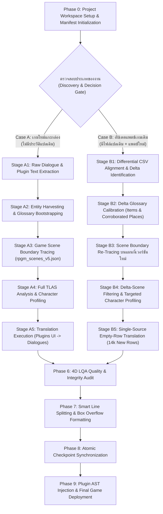

# ATF Enterprise User Manual & End-to-End Pipeline Execution Guide
**Agentic Translation Framework (ATF) — มาตรฐานสากลสำหรับการแปลและการอัปเดตแพตช์เกมทุกเอนจิน**

คู่มือฉบับนี้จัดทำขึ้นเพื่อให้ผู้พัฒนาและผู้ใช้งานระบบ สามารถสั่งรันคำสั่งใน Pipeline ตั้งแต่เริ่มต้นได้รับไฟล์เกมภาษาต้นฉบับ (RPG Maker MV/MZ, Ren'Py, Unity, Visual Novel) จนกระทั่งแปลภาษาไทยเสร็จสมบูรณ์ 100% และพร้อมนำไปเปิดเล่นจริงในเกม โดยปฏิบัติตามมาตรฐานสถาปัตยกรรมระดับองค์กร (ADR-015 ถึง ADR-024, SAD-010 ถึง SAD-014, SDD-010 ถึง SDD-017)

---

## 🗺️ สารบัญท่อส่งข้อมูลระบบ (Master Pipeline Overview Diagram)



---

## 🏛️ หมวดที่ 1: กฎเหล็กประจำระบบ (Core System Invariants & Prohibitions)

1. **Target Workspace Isolation Invariant (ADR-024):**
   - ไฟล์ผลลัพธ์ทั้งหมดของแพตช์ใหม่ (CSVs, TLAS databases, extractions, profiles, checkpoints) **ต้องถูกบันทึกลงในโฟลเดอร์ปลายทางที่ผู้ใช้ระบุ (Target Workspace)** เสมอ ห้ามเขียนปะปนกับโฟลเดอร์เกมตัวอย่างหรือไฟล์ตั้งต้นเด็ดขาด
2. **Human Terminal Execution Rule:**
   - ห้าม Agent แอบรันคำสั่งประมวลผลงานจริงด้วยตนเองเด็ดขาด ต้องส่งคำสั่งให้ผู้ใช้สั่งรันเองบน Terminal ทั้งแบบ **PowerShell** และ **Command Prompt (CMD)**
3. **Mandatory Verification Gate (ตรวจงานจริง 100% ก่อนผ่านไปขั้นถัดไป):**
   - ก่อนจะข้ามไปยัง Stage ถัดไป ต้องรันสคริปต์ตรวจสอบความมีอยู่จริงของไฟล์ (Path Existence), ตรวจสอบความถูกต้องของ Schema/คอลัมน์, และตรวจนับจำนวนแถวข้อมูลจริง ห้ามสมมติหรืออนุมานเอาเองเด็ดขาด
4. **Zero-Skip & 100% Resilience Guarantee:**
   - ห้ามข้าม (Skip) ไฟล์หรือแถวข้อมูลที่มีปัญหาเด็ดขาด หากพบ Error (เช่น 400 Bad Request หรือ Token Overflow) ระบบต้องทำการ Auto-repair, หั่นแบ่งครึ่ง (Binary Fallback), หรือแก้ไขจนกว่าจะสำเร็จ ห้ามแกล้งทำเป็นเสร็จแล้วแอบข้าม
5. **Preservation of Existing Translations:**
   - ในการอัปเดตแพตช์ แถวข้อมูลที่มีบทแปลเดิมอยู่แล้ว **ต้องถูกรักษาไว้ 100% ห้ามส่งไปแปลซ้ำ** เพื่อป้องกันการเสีย Token และป้องกันไม่ให้สำนวนแปลเดิมผิดเพี้ยน

---

## 🧭 หมวดที่ 2: Phase 0 — Target Discovery, Ingestion & Branching Decision Gate

### 0.1 ขั้นตอนการ Browse และค้นหาไฟล์เกมต้นฉบับ (Game Discovery Protocol)
ก่อนเริ่มดำเนินการใดๆ ให้ตรวจสอบโครงสร้างของโฟลเดอร์เกมเป้าหมาย:
1. **ค้นหาเอนจินของเกม (Engine Detection):**
   - ตรวจหาโฟลเดอร์ข้อมูลเกม:
     - RPG Maker MV/MZ: `<GameRoot>\www\data\` หรือ `<GameRoot>\data\` (ต้องพบ `System.json`, `MapInfos.json`, `CommonEvents.json`)
     - RPG Maker Plugins: `<GameRoot>\www\js\plugins.js` หรือ `<GameRoot>\js\plugins.js`
     - Visual Novel / Ren'Py: `<GameRoot>\game\` (ต้องพบ `.rpy` หรือ `.rpa`)
     - Unity / TextMeshPro: `<GameRoot>\*_Data\`
2. **ค้นหาไฟล์ข้อมูลข้อความดิบ (Raw Game Texts):**
   - ตรวจหาไฟล์ Spreadsheet ข้อความที่ผู้พัฒนาส่งให้ หรือที่สกัดมาจากเกม เช่น `*.csv` ในโฟลเดอร์แพตช์
3. **ค้นหาประวัติการแปลเดิม (Legacy Translation Discovery):**
   - ตรวจหาไฟล์ในโปรเจกต์เดิม:
     - ไฟล์ CSV ที่แปลแล้วเดิม (เช่น `*translated*.csv`)
     - ไฟล์ Master Glossary เดิม (`data/tlas/tlas_glossary.json`)
     - โฟลเดอร์โปรไฟล์ตัวละครเดิม (`data/tlas/profiles/*.json`)
     - ไฟล์ Checkpoint เดิม (`data/tlas/*checkpoint.json`)

### 0.2 แผนผังเกณฑ์การตัดสินใจสลับโหมด (Branching Decision Tree)
- **เลือกเข้าสู่ CASE A (New Game Clean Slate) เมื่อ:** เป็นเกมใหม่แกะกล่องที่ไม่เคยมีประวัติการแปลในระบบ ATF มาก่อน ไม่มี Glossary เดิม และไม่มี Checkpoint เดิม
- **เลือกเข้าสู่ CASE B (Patch Version Update) เมื่อ:** มีเกมเวอร์ชันเก่าที่แปลค้างไว้หรือแปลเสร็จแล้ว และมีไฟล์เกมเวอร์ชันใหม่ (New Patch) ปล่อยออกมา

### 0.3 การลงทะเบียน Manifest (`data/project_manifest.json`)
ระบบต้องสร้างหรืออัปเดต Manifest เป็นเอกสารอ้างอิงกลาง (Single Source of Truth) ประจำโปรเจกต์:
```json
{
  "project_name": "Project Name",
  "game_directory": "E:\\Path\\To\\Game",
  "game_data_directory": "E:\\Path\\To\\Game\\www\\data",
  "game_plugins_js": "E:\\Path\\To\\Game\\www\\js\\plugins.js",
  "raw_pre_csv": "E:\\Path\\To\\Patch\\Raw_Dialogues.csv",
  "output_dir": "E:\\Path\\To\\Target_Output_Workspace",
  "output_processed_csv": "E:\\Path\\To\\Target\\processed_dialogues_v3.csv",
  "output_tlas_dir": "E:\\Path\\To\\Target\\tlas",
  "output_glossary_json": "E:\\Path\\To\\Target\\tlas\\tlas_glossary.json",
  "output_profiles_dir": "E:\\Path\\To\\Target\\tlas\\profiles",
  "output_scenes_json": "E:\\Path\\To\\Target\\tlas\\rpgm_scenes_v5.json",
  "output_checkpoint_json": "E:\\Path\\To\\Target\\tlas\\chatgpt_translation_checkpoint.json",
  "output_plugins_csv": "E:\\Path\\To\\Target\\plugins_texts.csv"
}
```

### 0.4 คำสั่งเปิด Bridge Server (รันแยกไว้ 1 Terminal ตลอดการทำงาน):
- **PowerShell / CMD:**
  ```powershell
  python "src\atf\tools\chatgpt_bridge_server.py"
  ```
- **สถานะที่พร้อมใช้งาน:** เปิดเบราว์เซอร์ไปที่ `https://chatgpt.com` ตรวจสอบผ่าน `curl http://127.0.0.1:8765/bridge/status` ต้องแสดง `"userscript_connected": true`

---

## 🟢 หมวดที่ 3: CASE A — New Game Clean Slate (เกมใหม่จากศูนย์)

### Stage A1: Raw Dialogue & Plugin Text Extraction
- **เป้าหมาย:** สกัดข้อความบทสนทนา (Dialogues), คำบรรยาย, และตัวเลือก (Choices) จากไฟล์เกม
- **คำสั่งรัน:**
  ```powershell
  python "scripts\extract_game_dialogues.py" --input-dir "<DataDir>" --output-csv "<TargetCSV>"
  python "testing files\extract_plugin_texts.py" --plugins-js "<PluginsJs>" --output-csv "<PluginsCSV>"
  ```
- **ผลลัพธ์:** 
  - CSV บทสนทนา 8 คอลัมน์: `Original, Initial, Filename, Row, Note, Role, Speaker, Displayable`
  - `data/plugins_texts.csv` (ตารางข้อความ UI เมนู)
- **เกณฑ์ตรวจรับ (Verification Gate):** คอลัมน์ `Displayable` ต้องมีค่า `Yes` หรือ `No` ครบ 100%

### Stage A2: Entity Harvesting & Master Glossary Bootstrapping
- **เป้าหมาย:** สกัดไอเทม อาวุธ ชุดเกราะ ศัพท์ระบบ และชื่อสถานที่ผ่านการเทียบเคียงบทสนทนาจริง (Dialogue Corroboration ADR-023)
- **คำสั่งรัน:**
  ```powershell
  python "src\atf\tools\harvest_database_terms.py"
  python "src\atf\tools\harvest_spoken_places.py"
  ```
- **ผลลัพธ์:** ตารางคำศัพท์ให้มนุษย์ตรวจทาน $\to$ นำเข้าสู่ `tlas_glossary.json` จัดหมวด 5 กลุ่ม: `Characters`, `Places`, `Items`, `Skills`, `System`
- **เกณฑ์ตรวจรับ:** ทุกตัวละครหลักต้องระบุ `analysis_target: True` เพื่อนำไปวิเคราะห์ใน Stage A4

### Stage A3: Game Scene Boundary Tracing
- **เป้าหมาย:** สกัดขอบเขตฉากเนื้อเรื่อง (Narrative Scenes) โดยจำลองการประมวลผลของเอนจินเกม (State Emulation)
- **คำสั่งรัน:**
  ```powershell
  python "src\atf\tools\trace_game_scenes.py"
  ```
- **ผลลัพธ์:** `data/tlas/rpgm_scenes_v5.json` รวมบทสนทนาเป็นฉากเนื้อเรื่องที่ต่อเนื่องกันสมบูรณ์

### Stage A4: Full TLAS Analysis & Character Profiling (หัวใจของระบบ)
- **เป้าหมาย:** สกัด Macro Features และสังเคราะห์โปรไฟล์ตัวละคร
- **คำสั่งรัน:**
  ```powershell
  # 1. Smart Scene Packing & Feature Extraction
  python "src\atf\tools\tlas_analyzer_v4.py"
  # 2. Consensus Engine & Pronoun Mapping
  python "src\atf\tools\tlas_consensus_engine.py"
  ```
- **ผลลัพธ์:** `data/tlas/profiles/{Character}.json` และ `data/tlas/global_pronoun_matrix.json`

### Stage A5: Translation Execution
- **เป้าหมาย:** ส่งแปลผ่าน ChatGPT Web Bridge
- **คำสั่งรัน:**
  ```powershell
  python "src\atf\tools\chatgpt_translator_runner.py" --plugins
  python "src\atf\tools\chatgpt_translator_runner.py" --all
  ```

---

## 🟡 หมวดที่ 4: CASE B — Patch Version Update (อัปเดตแพตช์เกมเดิม)

### Stage B1: Differential CSV Alignment & Delta Identification
- **เป้าหมาย:** เปรียบเทียบไฟล์เกมเวอร์ชันเดิมกับเวอร์ชันใหม่ เพื่อแยกของเก่ากับของใหม่ออกจากกัน
- **กระบวนการ:**
  1. นำ Raw CSV ของแพตช์ใหม่มาประกบกับคำแปลเดิม
  2. แถวเดิมที่เคยแปลแล้ว: Preserve คำแปลเดิมไว้ 100% ห้ามแปลซ้ำ
  3. แถวที่ไม่แสดงผล (`Displayable == 'No'`): Auto-copy ข้อความต้นฉบับลงช่องแปล
  4. แถวใหม่ที่ยังไม่มีคำแปล (`Displayable == 'Yes'` และ `Initial == ""`): ระบุเป็น **Untranslated Delta Queue** (เช่น 14,908 แถว)
- **ผลลัพธ์:** `processed_dialogues_v3.csv` และ `plugins_texts_v035.csv`

### Stage B2: Delta Glossary Calibration
- **เป้าหมาย:** สกัดเฉพาะไอเทม อุปกรณ์ และสถานที่ที่เพิ่มเข้ามาใหม่ในแพตช์
- **คำสั่งรัน:**
  ```powershell
  python extract_glossary.py
  python harvest_places.py
  # มนุษย์ตรวจทานและแปลใน spreadsheet -> รันนำเข้า:
  python import_glossary.py
  ```
- **ผลลัพธ์:** `tlas_glossary.json` ปลายทางได้รับการอัปเดตคำศัพท์ใหม่ครบถ้วน

### Stage B3: Scene Boundary Re-Tracing บนแผนที่เวอร์ชันใหม่
- **เป้าหมาย:** สกัดขอบเขตฉากเนื้อเรื่องใหม่จากโฟลเดอร์เกมเวอร์ชันล่าสุด
- **คำสั่งรัน:**
  ```powershell
  python trace_scenes.py
  ```
- **ผลลัพธ์:** `rpgm_scenes_v5.json` ประจำเวอร์ชันใหม่ใน Target Workspace

### Stage B4: Delta-Scene Filtering & Targeted Character Profiling (หัวใจสำคัญ!)
- **เป้าหมาย:** วิเคราะห์โปรไฟล์ตัวละครเฉพาะส่วนที่เปลี่ยนแปลงหรือเพิ่มใหม่ในแพตช์
- **กระบวนการทำงาน:**
  1. **Delta Speaker Scan:** สแกนรายชื่อผู้พูดในบทสนทนาใหม่ 14,908 แถว เพื่อหาตัวละครใหม่ (New Characters) ที่ยังไม่มี Profile
  2. **Delta Scene Matching:** กรองจับคู่เฉพาะ Scene ใน `rpgm_scenes_v5.json` ที่มีบทสนทนาใหม่ 14,908 แถวบรรจุอยู่ (ข้าม Scene เก่าที่แปลเสร็จแล้วเพื่อประหยัด Token)
  3. **Targeted Feature Extraction:** ส่งเฉพาะ Scene ที่มีบทสนทนาใหม่ ให้ LLM วิเคราะห์บุคลิกภาพและความสัมพันธ์คู่สนทนาของตัวละครใหม่/ตัวละครเดิมที่มีบทพูดใหม่ บันทึกลง `extractions_v4/{scene_id}.json`
  4. **Profile Consensus Update:** รัน `tlas_consensus_engine.py` สังเคราะห์ผลการสกัด อัปเดตไฟล์ `profiles/{Character}.json` และ `global_pronoun_matrix.json` ประจำแพตช์ใหม่

### Stage B5: Single-Source Empty-Row Translation
- **เป้าหมาย:** แปลเฉพาะข้อความใหม่โดยดึงข้อมูลบริบทฉากและโปรไฟล์ตัวละครที่อัปเดตแล้ว
- **คำสั่งรัน:**
  ```powershell
  # แปลข้อความ UI เมนูส่วนที่ยังว่าง
  python translate.py --plugins
  # แปลเฉพาะบทสนทนาใหม่ (Empty Rows) ต่อเนื่องจนจบ 100%
  python translate.py --empty-only
  ```

---

## 🏁 หมวดที่ 5: Convergence Phases (การตรวจสอบคุณภาพและนำเข้าเกม)

### Phase 6: 4D LQA Quality & Integrity Audit
- **เป้าหมาย:** ตรวจสอบคุณภาพบทแปล 4 มิติผ่าน `src/atf/core/lqa_translation_auditor.py`
  - ตรวจรหัส XML (`<color>`, `<pause_second/>`, `<wait_input/>`) ว่าอยู่ครบและไม่เสียหาย
  - ตรวจสอบสรรพนามตรงตาม Character Profiles
  - ตรวจสอบคำศัพท์เฉพาะต้องตรงกับ Glossary 100%
  - กรองขจัด Form Feed `\x0c` และข้อความหลอน

### Phase 7: Smart Line Splitting & Box Overflow Formatting
- **เป้าหมาย:** ตัดแบ่งบรรทัดภาษาไทย (~40-48 ตัวอักษรต่อบรรทัด) เพื่อป้องกันข้อความล้นกล่องในเกม
- **คำสั่งรัน:**
  ```powershell
  python "testing files\smart_line_splitter.py"
  ```

### Phase 8: Atomic Checkpoint Synchronization
- **เป้าหมาย:** ซิงค์ข้อมูลคำแปลทั้งหมดจาก Checkpoint เขียนทับลงคอลัมน์ `Initial` ของ CSV หลักอย่างสมบูรณ์แบบ Atomic Write
- **คำสั่งรัน:**
  ```powershell
  python "testing files\sync_checkpoint_to_csv.py"
  ```

### Phase 9: Plugin AST Injection & Final Game Deployment
- **เป้าหมาย:** ฉีดคำแปลกลับเข้าสู่ตัวเกมจริงและทดสอบเล่น
- **คำสั่งรัน:**
  ```powershell
  # 1. ฉีดคำแปล UI เมนูกลับเข้า plugins.js ของเกมจริง
  python "testing files\inject_plugin_texts.py"
  ```
- **Playability Verification:** เปิดเกมจริง ตรวจสอบหน้า Title, Options, Menu, Quests, และบทสนทนาในฉากจริงว่าแสดงผลภาษาไทยถูกต้องสวยงาม 100%

---

## 🖼️ หมวดที่ 6: การแปลภาพกราฟิกในเกม (Image Localization Manual: Photoshop Hybrid Workflow)

มาตรฐานการแปลภาพกราฟิกของ ATF (อ้างอิงตาม ADR-026 ถึง ADR-034) ใช้แนวคิด **Photoshop Hybrid Workflow** โดยแบ่งหน้าที่ระหว่าง **AI Automation** (ทำหน้าที่สแกน คัดกรอง แกะข้อความ ทำตาราง และเข้ารหัสเข้าเกม) ร่วมกับ **Human Artistry** (ผู้ใช้แต่งภาพ จัดวาง Typography และแสงเงาใน Adobe Photoshop อย่างอิสระ 100%)

### โครงสร้างโฟลเดอร์ทำงานของภาพ (Image Directory Layout)
```text
data/images/ (หรือ <output_dir>/images/)
├── raw/                  # โฟลเดอร์เก็บภาพต้นฉบับ .png ที่ผ่านการสแกนและมี Text
├── translated/           # โฟลเดอร์ที่ผู้ใช้นำภาพ .png ที่แต่งเสร็จจาก Photoshop มาวาง
├── unique_dialogues.csv  # ตารางรวมข้อความที่ไม่ซ้ำกัน สำหรับแปลครั้งเดียวและใช้ Copy-Paste
├── image_dialogues.csv   # ตารางแคตตาล็อกระบุภาพ พิกัด และข้อความทั้งหมด
└── ocr_corrections.json  # พจนานุกรมกฎคำแก้ผิดอัตโนมัติของ OCR
```

---

### ขั้นตอนการทำงาน 3 สเต็ปหลัก (The 3-Step Execution Workflow)

#### 🔹 สเต็ปที่ 1: สแกนและคัดกรองเฉพาะภาพที่มี Text (Image Scanning & Noise Purge)
ระบบจะทำการค้นหาและคัดกรองภาพทั้งเกม แยกภาพที่มีตัวหนังสือ (แชตมือถือ, หน้าจอสอนเล่น, UI, เมนู) ออกจากภาพที่เป็น CG ลายเส้น, สไปรต์ตัวละคร, และ Texture พื้นหลังโดยอัตโนมัติ ทำให้ผู้ใช้ไม่ต้องเสียเวลางมหาเองทีละภาพ

1. **ถอดรหัสภาพจากเกม (.rpgmvp -> .png):**
   - **PowerShell / CMD:**
     ```bash
     python localize_images.py decrypt --folder pictures
     ```
2. **สแกนและคัดแยกเฉพาะภาพที่มี Text:**
   - **PowerShell / CMD:**
     ```bash
     python localize_images.py scan --decrypt
     ```
3. **ตรวจสอบและลบภาพที่ไม่ต้องการแปล:**
   - ผู้ใช้สามารถเปิดโฟลเดอร์ `raw/` ดูพรีวิว หากมีภาพไหนที่ไม่ต้องการแปล สามารถกดลบไฟล์ `.png` นั้นทิ้งได้ทันที
   - จากนั้นสั่ง Sync เพื่ออัปเดตตารางให้ตรงกับไฟล์ที่เหลืออยู่บนดิสก์จริง:
     ```bash
     python localize_images.py sync
     ```

---

#### 🔹 สเต็ปที่ 2: แกะ Text, ทำตาราง Unique, และแปลข้อความ (OCR & Translation Bridge)
ระบบจะสกัดข้อความภาษาอังกฤษออกมาเป็น Spreadsheet เพื่อให้ผู้ใช้สามารถ Copy-Paste ไปแปลเป็นภาษาไทยได้อย่างสะดวกสบาย โดยไม่ต้องนั่งพิมพ์ข้อความจากภาพเองทีละตัว

1. **สกัดข้อความจากภาพทั้งหมดลงตาราง (Catalog):**
   - **PowerShell / CMD:**
     ```bash
     python localize_images.py catalog --rebuild
     ```
2. **ซ่อมแซมคำผิด Homoglyphs และจัดช่องว่างวรรคตอนอัตโนมัติ (Repair):**
   - **PowerShell / CMD:**
     ```bash
     python localize_images.py repair
     ```
3. **ยุบรวมข้อความซ้ำเป็น Unique Spreadsheet (Dedupe):**
   - คำสั่งนี้จะสกัดข้อความที่ไม่ซ้ำกันออกมาเป็น `unique_dialogues.csv`:
     ```bash
     python localize_images.py dedupe
     ```
4. **เปิดแปลและ Copy-Paste ข้อความ:**
   - เปิดไฟล์ `unique_dialogues.csv` ด้วย Excel หรือโปรแกรม Spreadsheet
   - ใส่คำแปลภาษาไทยลงในคอลัมน์ `Thai_Text` (แปลเพียง 1 ครั้งต่อ 1 ข้อความ แม้ข้อความนั้นจะปรากฏในภาพ 20 ภาพก็ตาม)
5. **กระจายคำแปลกลับสู่ทุกภาพที่ซ้ำกัน (Propagate):**
   - **PowerShell / CMD:**
     ```bash
     python localize_images.py propagate
     ```
6. **ตกแต่งภาพใน Adobe Photoshop (Human Artistry):**
   - เปิดไฟล์ภาพต้นฉบับจากโฟลเดอร์ `raw/` ใน Adobe Photoshop
   - Copy คำแปลภาษาไทยจาก `unique_dialogues.csv` หรือ `image_dialogues.csv` ไปวางลงใน Text Layer ของ Photoshop
   - ปรับแต่งฟอนต์, สี, ขนาด, และ Layer Styles (Drop Shadow, Stroke, Gradient) ได้อย่างอิสระ 100% ตามที่ต้องการ
   - บันทึกไฟล์ภาพภาษาไทยเป็นชื่อเดิมนามสกุล `.png` แล้วนำไปวางไว้ในโฟลเดอร์ `translated/`

---

#### 🔹 สเต็ปที่ 3: เข้ารหัสและอัดภาพภาษาไทยกลับเข้าสู่เกมจริง (In-Game Deployment)
เมื่อตกแต่งภาพเสร็จแล้ว คำสั่งนี้จะนำภาพ `.png` ทั้งหมดในโฟลเดอร์ `translated/` ไปเข้ารหัสกลับเป็นไฟล์ของเกม และส่งเข้าตัวเกมจริงทันที พร้อมระบบสำรองไฟล์เดิมอัตโนมัติ

- **คำสั่งเข้ารหัสและฉีดเข้าเกม (Encrypt & Inject):**
  - **PowerShell / CMD:**
    ```bash
    python localize_images.py encrypt --folder pictures
    ```
- **Playability Verification:** เปิดเกมจริงเพื่อตรวจสอบภาพที่แปลแล้วในฉากจริง

---

## 🚨 หมวดที่ 7: คู่มือการแก้ไขปัญหาและรับมือข้อผิดพลาด (Troubleshooting Playbook)

| อาการ / ปัญหา | สาเหตุรากเหง้า (Root Cause) | แนวทางแก้ไขตามมาตรฐาน (Standard Remedy) |
| :--- | :--- | :--- |
| **Token Overflow / Error 400** | ข้อมูลใน Scene หรือ Batch ยาวเกินลิมิต | ทำ Binary Fallback: หั่นแบ่งครึ่ง Batch อัตโนมัติและ Retry |
| **AI แปลงชื่อภาษาอังกฤษเป็นคำอ่านไทย** | หลุดกฎ No-Transliteration | ตรวจสอบคำสั่งใน System Prompt และใช้ Auto-Repair Engine ซ่อมแซมคำศัพท์ตาม Glossary ทันที |
| **Control Codes ในเกมเพี้ยน / ตัวหนังสือหลุดสี** | AI เผลอแปลหรือลบ In-line Code | ตรวจสอบผ่าน `MessageCodeMasker` ต้องแปลงเป็น Semantic XML Tags ก่อนส่ง AI เสมอ |
| **Web Bridge หลุดการเชื่อมต่อ** | เบราว์เซอร์ค้างหรือหน้าเว็บ ChatGPT ปิด | ตรวจสอบผ่าน `/bridge/status` หาก userscript หลุด ให้ระบบหยุดรอ (No Timeout) จนกว่าจะต่อติด |
| **ตรวจพบตัวละครใหม่กลางคัน** | ผู้พูดตกสำรวจจาก Glossary | หยุดการแปลชั่วคราว ดึงเข้า Stage B4 สกัด Profile และลงทะเบียน Glossary ก่อนรันต่อ |
| **ภาพในเกมไม่แสดงเป็นภาษาไทยหลังฉีด** | ชื่อไฟล์ใน `translated/` สะกดไม่ตรงกับต้นฉบับ หรือ Encryption Key ผิด | ตรวจสอบชื่อไฟล์ `.png` ว่าตรงกับภาพต้นฉบับทุกตัวอักษร และตรวจว่า `System.json` มี Encryption Key ครบถ้วน |
