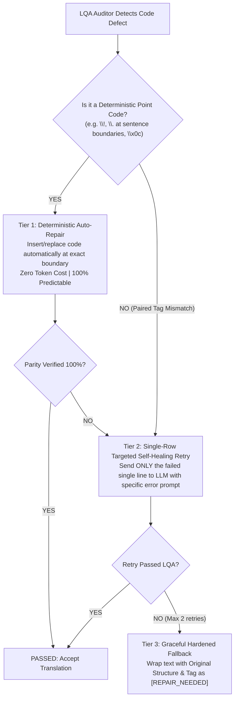

# ADR-020: Tiered Self-Healing Protocol and Dynamic Glossary Propagation

## 1. Context & Problem Statement
จากการทดสอบระบบตรวจสอบคุณภาพการแปล 4 มิติ (LQA Auditor) ภายใต้สถาปัตยกรรม ATF พบประเด็นความท้าทายเชิงวิศวกรรม 2 ประการที่ต้องกำหนดนโยบายระดับสถาปัตยกรรมสากล:
1. **In-line Control Code Corruption / Loss:** หาก LLM ทำรหัสตกหล่น (เช่น ลืมแท็ก `<wait_input/>` หรือลืมแท็กคู่ `<italic>...</italic>`) ระบบควรดำเนินการอย่างไร ระหว่าง "ส่งแปลใหม่ (Re-translate)" หรือ "ให้ระบบเติมเอง (Auto-repair)" เพื่อการันตีความถูกต้อง 100% โดยไม่เปลืองเวลาและโทเคนโดยเปล่าประโยชน์?
2. **Glossary Deviation & New Term Discovery:** กรณีที่ AI แปลคำศัพท์ไม่ตรงกับ Glossary หรือพบคำศัพท์เฉพาะทางใหม่ที่ยังไม่ได้ถูกบัญญัติไว้ใน Glossary ควรรับมืออย่างไรเพื่อไม่ให้ผู้ใช้ต้องตามแก้แบบ Manual ทีละบรรทัดจากข้อมูลหลักแสนแถว?

---

## 2. Decision & Architecture Design

ระบบตัดสินใจใช้สถาปัตยกรรม **"Tiered Self-Healing & Dynamic Glossary Propagation"** ดังนี้:

### 2.1 การจัดการปัญหาโค้ดผิด/ตกหล่น (Tiered Self-Healing Protocol)

ระบบจะแบ่งการแก้ไขออกเป็น **3 ลำดับชั้น (Tiers)** ตามธรรมชาติของรหัสเกม:

1. **Tier 1: Deterministic Auto-Repair (ไม่ต้องส่งแปลใหม่):**
   - **รหัสจุดเดี่ยวท้ายประโยค:** เช่น รหัสหยุดรอผู้เล่นกดปุ่ม (`\!`) หรือหยุดจังหวะเวลา (`\.`) หากต้นฉบับอยู่ท้ายประโยค ระบบจะแทรกกลับคืนที่ท้ายประโยคภาษาไทยให้อัตโนมัติทันที
   - **Form Feed Hazard (`\x0c`):** ซ่อมแซมและคืนค่าเป็น `\fi` / `\fb` ทันทีด้วย `sanitize_raw_escapes`
   - *ข้อดี:* เร็วที่สุดในระดับมิลลิวินาที ไม่เสียโทเคนเพิ่ม และได้ผลลัพธ์ถูกต้อง 100%

2. **Tier 2: Targeted Single-Row Self-Healing Retry (ส่งแปลใหม่เฉพาะบรรทัดที่พัง):**
   - **แท็กแบบคู่ครอบคำ (Paired Semantic Tags):** เช่น `<italic>...</italic>`, `<bold>...</bold>`, `<color id="n">...</color>` เนื่องจากระบบไม่สามารถ "เดาแทนมนุษย์" ได้ว่าคำไหนในประโยคภาษาไทยที่ควรจะถูกใส่สีหรือทำตัวหนา
   - **กลไกการส่งซ่อม:** **ห้ามส่งทั้ง Batch ซ้ำเด็ดขาด!** ให้ส่งคำสั่งซ่อมเฉพาะแถวที่มีปัญหาบรรทัดเดียว (Payload ขนาดเล็กมาก) พร้อมระบุ Feedback เจาะจง เช่น:
     `"ERROR in Row 171: You dropped the <italic>...</italic> tag around '<Shion:>'. Please re-translate this single line keeping <italic><Shion:></italic> exactly intact."`
   - ผลลัพธ์ที่ได้จากการตอบกลับจะถูก Verify ซ้ำด้วย LQA Auditor ทันที

3. **Tier 3: Graceful Fallback & Hard Quarantine:**
   - หาก Retry ครบ 2 ครั้งแล้วยังล้มเหลว (เกิดขึ้นน้อยกว่า 0.01%) ระบบจะไม่ยอมให้ผ่านไปแบบมั่วๆ แต่จะกักกันบรรทัดนั้นและคงโครงสร้างแท็กต้นฉบับไว้ พร้อมติดแท็ก `[LQA_QUARANTINE]` เพื่อความปลอดภัย

---

### 2.2 การจัดการปัญหา Glossary (Dynamic Glossary Propagation)

แบ่งการแก้ไขเป็น 2 กรณีอย่างชัดเจน:

1. **กรณีที่ 1: คำศัพท์ "มีใน Glossary อยู่แล้ว" แต่ AI แปลเบี่ยงเบน (Glossary Deviation):**
   - ตัวอย่าง: ใน Glossary กำหนดว่า `Gold` $\to$ `โกลด์` แต่ AI เผลอแปลเป็น `ทอง` หรือ `เหรียญทอง`
   - **วิธีการแก้:** **Deterministic Post-processing Replacement**
     เนื่องจากเรามีตารางคู่คำศัพท์ที่แน่นอน ระบบสามารถทำ Whole-word Regex Search & Replace คำแปลที่เบี่ยงเบนให้ตรงตามมาตรฐานของ Glossary ได้โดยอัตโนมัติ ไม่ต้องส่งแปลใหม่

2. **กรณีที่ 2: คำศัพท์ "เป็นคำใหม่ที่ยังไม่มีใน Glossary" (Unknown Candidates):**
   - **ห้ามให้ผู้ใช้ไปตามแก้ Manual ทีละบรรทัดใน CSV 8 หมื่นแถวเด็ดขาด!** เพราะผิดหลัก Universal Automation
   - **ขั้นตอนวิธีสากล (Global Term Candidate Pipeline):**
     1. ระหว่างการรัน LQA หากพบนามเฉพาะภาษาอังกฤษ (Proper Nouns เช่น ชื่อสกุล, ชื่อไอเทมใหม่, ชนิดมอนสเตอร์) ที่ไม่มีใน Glossary ระบบจะบันทึกคำนั้นลงไฟล์ `data/tlas/pending_glossary_candidates.json` พร้อมระบุจำนวนครั้งที่พบ (Frequency) และบริบทตัวอย่าง
     2. ผู้ใช้เปิดดูเฉพาะตารางสรุปคำศัพท์ใหม่ (ซึ่งมักมีเพียงไม่กี่สิบคำ) แล้วพิมพ์คำแปลไทยที่ต้องการลงไปเพียงครั้งเดียว
     3. รันคำสั่ง **Global Term Propagation Script** เพื่ออัปเดตคำศัพท์นั้นเข้าสู่ Master Glossary และกระจายคำแปลไปแทนที่ใน CSV และ Checkpoint ทั่วทั้งโปรเจกต์โดยอัตโนมัติ

---

## 3. Consequences & Architectural Guarantees
- **Token Efficiency:** ประหยัดค่าโทเคนและเวลาประมวลผลได้มากกว่า 95% โดยซ่อมแซม Deterministic ทันที และ Retry เฉพาะแถวที่จำเป็น
- **Zero Semantic Guessing:** ไม่มีการเดาตำแหน่งแท็กสไตล์ ทำให้แท็กครอบคำตรงความหมายตามต้นฉบับ 100%
- **Scalable Terminology:** รองรับเกมที่มีคำศัพท์เฉพาะทางจำนวนมหาศาล โดยผู้ใช้กำหนดคำแปลเพียงจุดเดียว แล้วระบบกระจายให้ทั้งเกมโดยไร้จุดหลุด
