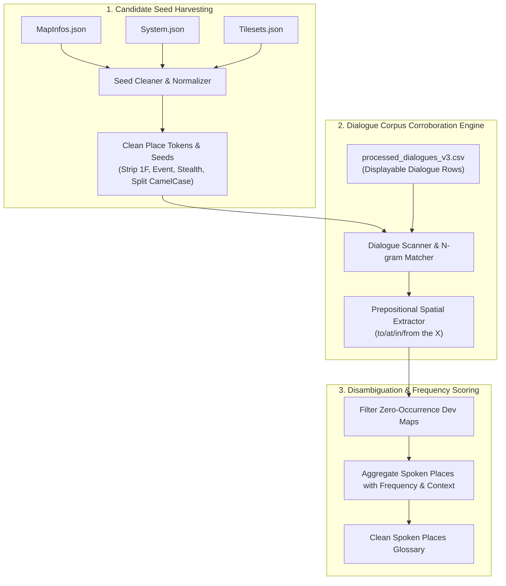

# ADR-023: Dialogue-Corroborated Place Entity Extraction Subsystem

## Status
Accepted

## Context
ในการสกัดคำศัพท์เฉพาะ (Proper Nouns / Terminology) เพื่อสร้างฐานข้อมูล TLAS Glossary สำหรับการแปลเกม RPG Maker ระบบเดิมอาศัยการดึงข้อมูลรายชื่อแผนที่จากไฟล์ `MapInfos.json` เข้าสู่หมวดหมู่ `Places` โดยตรง จากการนำไปใช้งานจริงกับเกมตัวอย่างและการทำ Human Review พบความล้มเหลวเชิงสถาปัตยกรรม (Architectural Failure Boundary) ที่สำคัญดังนี้:

1. **Internal Developer Map Labels (มลพิษจากชื่อเทคนิคของผู้พัฒนา):**
   ชื่อใน `MapInfos.json` ถูกสร้างขึ้นโดย Game Developer เพื่อใช้จัดระเบียบโครงสร้างแมพในโปรแกรม RPG Maker Editor ไม่ใช่ชื่อที่ตัวละครใช้สื่อสารในเนื้อเรื่อง เช่น:
   - รหัสระบุชั้นและพื้นที่: `Beach House (True) 1F`, `Drex Place 2F(Stealth)`
   - รหัสสาขาของอีเวนต์/คัตซีน: `InsideRV(Event)`, `Park with RV(Event)`, `InsideRV(2)`, `Park with RV(D2)`
   - รหัสกลไกของเกม: `Carpark(Day)(NO RV)`, `Drex Place(For Stealth)`, `Drex Place(Normal)`, `Drex Place(REC)`
   - รหัสโครงงาน/การทำซ้ำ: `Ram City(Questdup)`, `Park with RV(D2) Masaru`, `FlashbackMaps(Studio)`

2. **Ghost Entity & Context Absence (คำศัพท์ผีที่ไม่มีตัวตนในบทสนทนา):**
   ชื่อเทคนิคข้างต้นไม่เคยถูกตัวละครพูดถึงในบทสนทนา (Dialogue) เลยแม้แต่ครั้งเดียว การนำเข้าสู่ Glossary จึงเป็นการสร้างภาระให้ผู้แปลต้องมานั่งแปลขยะที่ไม่ได้ใช้จริง และหากมีการบังคับใช้ (Enforce) อาจสร้างความผิดเพี้ยนให้กับระบบแปล

3. **Missing Real In-Game Venues (สถานที่จริงในเกมตกหล่น):**
   สถานที่จริงที่ตัวละครในเนื้อเรื่องพูดถึงเป็นประจำ (เช่น "ห้างสรรพสินค้าเมือง Ram", "โรงแรม", "ห้องนอนของตัวละคร", "ร้านค้า") อาจเป็นเพียง Event ย่อยบนแผนที่ขนาดใหญ่ (เช่น อยู่ในแผนที่ `Map045.json` หรือ `Ram City`) ทำให้ชื่อสถานที่เหล่านี้ไม่มีปรากฏอยู่ใน `MapInfos.json` เลยแม้แต่ชื่อเดียว

4. **Universal Framework Paradigm Requirement:**
   ระบบจะต้องไม่ผูกติดกับการ Hardcode ชื่อสถานที่ของเกมใดเกมหนึ่ง แต่ต้องมีอัลกอริทึมที่เป็นสากล (Universal Paradigm) ในการค้นหาและยืนยันชื่อสถานที่จริงที่เกิดขึ้นในบทสนทนาสำหรับเกม RPG Maker และ Visual Novel ทุกเกม

---

## Decision

เราตัดสินใจยกเลิกการดึงชื่อจาก `MapInfos.json` เข้า Glossary แบบดิบๆ (Raw Ingestion) และแทนที่ด้วย **"Dialogue-Corroborated Place Entity Extraction Subsystem"** ซึ่งทำงานร่วมกัน 3 ขั้นตอน:

### 1. Candidate Seed Harvesting & Sanitization (การเก็บเกี่ยวและขจัดสิ่งปนเปื้อนของคำตั้งต้น)
ระบบจะสกัดคำตั้งต้นจาก 3 แหล่งข้อมูลในโฟลเดอร์ `data/`:
* `MapInfos.json`: รายชื่อแมพ
* `Tilesets.json`: รายชื่อ Tileset (เช่น Exterior, Interior, Dungeon, Modern City)
* `System.json`: คำศัพท์ระบบและคำระบุสภาพแวดล้อม
* **Sanitization Filter (ตัวกรองความสะอาด):**
  1. ลบข้อความในวงเล็บและก้ามปูทั้งหมด: `r"\(.*?\)|\s*\[.*?\]"`
  2. ลบตัวระบุชั้น: `r"\b\d+[Ff]\b|\b[Ff]\d+\b|\bB\d+\b"`
  3. คลี่การเขียนแบบ CamelCase เป็นคำเว้นวรรค: `BeachHouse` $\to$ `Beach House`, `PeachGarden` $\to$ `Peach Garden`, `BeachArea` $\to$ `Beach Area`
  4. ตัดตัวเลขต่อท้ายที่ระบุเวอร์ชันแมพ: `InsideRV2` $\to$ `Inside RV`

### 2. Dialogue Corpus Corroboration (การเทียบเคียงและยืนยันผ่านบทสนทนาจริง)
* นำ Candidate Place Seeds ไปสแกนกับข้อความในบทสนทนาจริง (`processed_dialogues_v3.csv` เฉพาะแถว `Displayable == 'Yes'` และ `Role in ['Dialogue', 'Choice']`)
* **Spatial Preposition Alignment:** สแกนหาคำที่ปรากฏตามหลังบุพบทบอกสถานที่ เช่น `to/at/in/from [the] <Place>` หรือกริยานำทาง เช่น `go to <Place>`, `meet at <Place>`, `visit <Place>`
* **Spoken Invariant:** เฉพาะคำหรือกลุ่มคำที่มีการ **"ถูกพูดถึงจริงในบทสนทนา" (Dialogue Occurrence $\ge$ 1)** เท่านั้นที่จะได้รับการพิจารณาเป็น Place Entity

### 3. Deduplication & Cross-Referencing With Existing Curation
* รวบรวมคำที่มีความหมายเดียวกัน (Variants) เช่น `Drex Place` และ `Drex's Place` เข้าสู่กลุ่มเดียวกัน
* ระบบจะทำการ Cross-reference กับไฟล์ `delta_glossary_review.csv` ที่ผู้ใช้ได้ทำการแปลไว้แล้ว เพื่อนำคำแปลภาษาไทยที่ผู้ใช้ตรวจทานแล้วมารวมเข้าด้วยกันโดยอัตโนมัติ ไม่ให้การทำงานของผู้ใช้สูญเปล่า

---

## Consequences

### Positive (ผลดี):
1. **ขจัดขยะ Technical Labels ได้ 100%:** ชื่อประเภท `(True) 1F`, `(For Stealth)`, `(Event)` จะถูกคัดทิ้งโดยอัตโนมัติ ไม่หลุดเข้าไปรกใน Glossary
2. **ได้ชื่อสถานที่ที่แท้จริงในเกม (True In-Game Venues):** สถานที่จริงที่ปรากฏในบทสนทนาแต่ไม่มีแมพแยก เช่น ห้องต่างๆ หรือห้างสรรพสินค้า จะถูกค้นพบและนำมาลงทะเบียน
3. **ลดภาระงานผู้แปล:** จำนวนรายการที่ต้องตรวจสอบจะลดลงเหลือเฉพาะสถานที่ที่ตัวละครพูดถึงจริงๆ และมีความหมายต่อเนื้อเรื่อง
4. **ความสอดคล้องระดับสากล (Universal Framework Compliance):** สามารถนำไปรันกับเกม RPG Maker ใดๆ ในอนาคตได้ทันทีโดยไม่ต้องแก้ไขโค้ด

### Neutral (ข้อสังเกต):
* การสแกน Dialogue ทั้งหมด 75,000+ แถว จะใช้เวลาประมวลผลเพิ่มขึ้นประมาณ 1-3 วินาที ซึ่งอยู่ในเกณฑ์ที่รวดเร็วอย่างยิ่งเนื่องจากประมวลผลบนหน่วยความจำ In-memory ด้วย Python Compiled Regex
