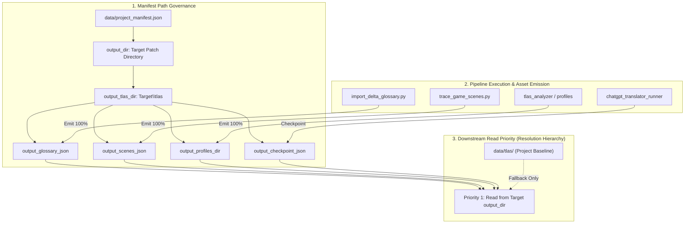

# ADR-024: Target Workspace Isolation & Patch Asset Separation Subsystem

## Status
Accepted

## Context
ในการแปลเกมเวอร์ชันใหม่ (Patch / Version Update) ด้วย Agentic Translation Framework (ATF) สถาปัตยกรรมเดิมมีการเก็บไฟล์ฐานข้อมูล (TLAS Glossary, RPG Maker Scenes, Character Profiles, Translation Checkpoints) ไว้ที่โฟลเดอร์ส่วนกลางของโปรเจกต์ (`data/tlas/`) เป็นหลัก จากการนำไปใช้งานจริงพบความเสี่ยงและปัญหาสำคัญดังนี้:

1. **Workspace Pollution & Template Collision (การปนเปื้อนของไฟล์ตัวอย่างและเกมจริง):**
   การบันทึกไฟล์ผลลัพธ์ของเกมใหม่กลับเข้าสู่ `data/` ทำให้ไฟล์ของแพตช์ใหม่ไปปะปนกับข้อมูลตัวอย่าง (Example RPGM Game) หรือข้อมูลการทดสอบเดิม ส่งผลให้สับสนและยากต่อการแยกแยะว่าไฟล์ไหนเป็นของเกมเวอร์ชันใด
2. **Missing Standalone Patch Package (ขาดชุดแพตช์ที่เบ็ดเสร็จในตัวเอง):**
   เมื่อผู้ใช้กำหนดโฟลเดอร์ปลายทางสำหรับการสร้างแพตช์ เช่น `E:\SummerStolenV035_PUBLIC_patch\New folder\` ไฟล์ผลลัพธ์ทั้งหมด (CSVs, Plugins, TLAS Databases, Scenes, Checkpoints) ควรถูกรวบรวมไว้ในโฟลเดอร์ปลายทางนี้อย่างครบถ้วน เพื่อให้สามารถนำทั้งโฟลเดอร์ไปติดตั้ง หรือส่งมอบเป็น Localization Release ได้ทันที
3. **Downstream Asset Resolution Ambiguity (ความสับสนในการดึงข้อมูลของเครื่องมือถัดไป):**
   หากแต่ละเครื่องมือดึงข้อมูลคนละโฟลเดอร์ (บางตัวดึงจาก `data/` บางตัวดึงจาก `New folder/`) อาจทำให้เกิดปัญหา Version Mismatch หรือการนำข้อมูลเก่ามาใช้งานซ้ำ

---

## Decision

เราตัดสินใจสถาปนาหลักการ **"Target Workspace Isolation & Single Source of Output (การแยกพื้นที่ผลลัพธ์แบบเอกเทศ 100%)"** โดยมีข้อกำหนดทางวิศวกรรมดังนี้:

### 1. Hierarchical Manifest Structure
บันทึกโฟลเดอร์ผลลัพธ์และทรัพย์สินทั้งหมดใน `project_manifest.json`:
* `output_dir`: โฟลเดอร์รากของผลลัพธ์แพตช์ใหม่ (เช่น `E:\SummerStolenV035_PUBLIC_patch\New folder`)
* `output_tlas_dir`: โฟลเดอร์ฐานข้อมูล TLAS ประจำแพตช์ (`<output_dir>\tlas`)
* `output_glossary_json`: `<output_tlas_dir>\tlas_glossary.json`
* `output_scenes_json`: `<output_tlas_dir>\rpgm_scenes_v5.json`
* `output_profiles_dir`: `<output_tlas_dir>\profiles\`
* `output_checkpoint_json`: `<output_tlas_dir>\chatgpt_translation_checkpoint.json`

### 2. Dual-Write with Target Primacy (การเขียนสองทางโดยยึดโฟลเดอร์ปลายทางเป็นหลัก)
* ทุกสคริปต์ที่สร้างไฟล์ฐานข้อมูลหรือเอกสารใหม่ (Glossary, Scenes, Profiles, Checkpoints, Spreadsheets) จะต้องบันทึกลงใน `output_dir` และ `output_tlas_dir` เป็นเป้าหมายหลัก 100%
* ทำการซิงค์สำเนาเข้า `data/tlas/` เพื่อเป็น Project Baseline Mirror ป้องกันข้อมูลสูญหาย

### 3. Downstream Resolution Priority
ทุกเครื่องมือในขั้นตอนถัดไป (Next Pipeline Stages) จะต้องตรวจสอบและอ่านไฟล์จาก **`output_tlas_dir` และ `output_dir` ก่อนเสมอ** หากพบไฟล์ในโฟลเดอร์ปลายทาง จะต้องใช้ไฟล์นั้นเป็น Single Source of Truth ห้ามย้อนกลับไปใช้ไฟล์เก่าใน `data/`

---

## Consequences

### Positive (ผลดี):
1. **Zero Pollution:** โฟลเดอร์ตัวอย่างและไฟล์ทดสอบใน `data/` จะไม่ถูกปนเปื้อนด้วยข้อมูลของเกมจริง
2. **Self-Contained Localization Package:** โฟลเดอร์ที่ผู้ใช้ Browse ไว้จะมีไฟล์ที่จำเป็นต่อการแปลครบ 100% สามารถตรวจสอบ สำรอง หรือเคลื่อนย้ายได้ง่าย
3. **Universal Compatibility:** ไม่ว่าผู้ใช้จะเปลี่ยนไปแปลเกมเวอร์ชันไหน หรือวางโฟลเดอร์ไว้ที่ไดรฟ์ใด ระบบจะปรับตัวตาม Manifest และทำงานได้อย่างแม่นยำ

### Neutral (ข้อสังเกต):
* สคริปต์ทุกตัวในไปป์ไลน์จะต้องเรียกใช้งานผ่าน Manifest Resolution Helper เพื่อให้แน่ใจว่ายึด Path เดียวกันอย่างสม่ำเสมอ
