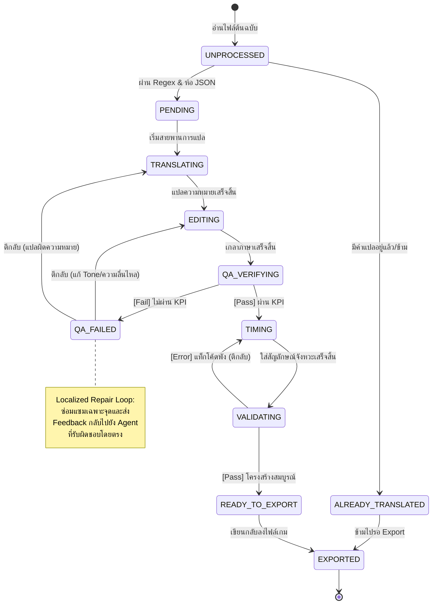

# SAD-002: Component Breakdown, State Machine, and Directory Structure

**Project:** Agentic Translation Framework (ATF)
**Phase:** 2 - Architecture Definition
**Status:** Draft

---

## 1. Component & Module Breakdown (โครงสร้างโมดูลระบบ)

เพื่อรองรับสถาปัตยกรรมแบบ Decoupled และ Event-Driven ตามที่ตกลงไว้ใน ADR-005 และ ADR-006 ระบบฝั่ง Python จะถูกแบ่งออกเป็น Package และ Module ย่อยๆ ดังนี้:

### 1.1 `atf.core` (ระบบแกนกลาง)

* `atf.core.event_bus`: คลาสจัดการ Message Queue และการลงทะเบียนผู้ฟัง (Event Subscriptions) แบบ Asynchronous
* `atf.core.state_machine`: ตัวควบคุมและตรวจสอบสิทธิ์การเปลี่ยนสถานะ (State Transitions) ของแต่ละประโยค
* `atf.core.orchestrator`: ตัวควบคุมหลักที่คอยดักฟัง Event และสั่งการโมดูลอื่นให้ทำงานสัมพันธ์กัน

### 1.2 `atf.parsers` (ระบบถอดรหัสและกรองไฟล์)

* `atf.parsers.base`: Abstract Base Class สำหรับ Parser ทุกตัว
* `atf.parsers.renpy`: Parser เฉพาะสำหรับ Ren'Py Script (.rpy) มีระบบ Regex ชั้นสูงในการกรองคำสั่งระบบออก
* `atf.parsers.rpgmaker`: Parser สำหรับแกะไฟล์ JSON/Data ของ RPG Maker
* `atf.parsers.csv_excel_spreadsheet_parser`: Parser สำหรับไฟล์ประเภทตาราง เช่น CSV หรือ Excel
* `atf.parsers.validator`: โมดูลตรวจสอบ Syntax และประกอบข้อความกลับคืนไฟล์ต้นฉบับ

### 1.3 `atf.memory` (ระบบจัดการความจำและบริบท)

* `atf.memory.db`: ตัวเชื่อมต่อฐานข้อมูลหลัก (SQLite / Supabase)
* `atf.memory.context_engine`: โมดูลสแกนประโยคเพื่อจับคู่คำใน Glossary และดึงข้อมูลตัวละครมาประกอบเป็น Prompt (JIT Assembly)

### 1.4 `atf.agents` (ระบบจัดการ AI Agents)

* `atf.agents.base`: คลาสแม่สำหรับเชื่อมต่อกับ LLM API (รองรับการสลับค่ายโมดูล)
* `atf.agents.translator`, `atf.agents.editor`, `atf.agents.qa`, `atf.agents.timing`: โมดูลย่อยที่บรรจุ System Prompt เฉพาะทางของแต่ละ Agent
* `atf.agents.summarizer`: โมดูลสำหรับสรุปเนื้อเรื่องจากประวัติการแปล (TM) เพื่อใช้เป็นบริบทรวม

---

## 2. State Machine & Object Lifecycle (วงจรชีวิตของข้อความ)

ประโยคทุกประโยคที่ถูกแกะออกมาจากไฟล์เกมจะถูกมองเป็น `TranslationToken` ซึ่งจะมีสถานะ (State) ที่เปลี่ยนไปตามความสำเร็จหรือล้มเหลวในสายพานการผลิตดังนี้:

* **`UNPROCESSED`** ➔ เริ่มต้นเมื่ออ่านไฟล์เกม
* **`ALREADY_TRANSLATED`** ➔ ประโยคที่มีคำแปลอยู่แล้วหรือถูกละเว้นการแปล (ข้ามขั้นตอน AI ทั้งหมด)
* **`PENDING`** ➔ ผ่านการกรองด้วย Regex และพร้อมที่จะเข้าสู่กระบวนการแปล
* **`TRANSLATING`** ➔ อยู่ในขั้นตอนของ Translator Agent
* **`EDITING`** ➔ อยู่ในขั้นตอนของ Editor Agent เพื่อเกลาภาษาและปรับอารมณ์
* **`QA_VERIFYING`** ➔ อยู่ในขั้นตอนของ QA Agent เพื่อประเมินตามเกณฑ์ KPI (ADR-009)
* **`QA_FAILED`** ➔ หากคะแนน KPI ไม่ผ่าน เกณฑ์จะตกมาที่สถานะนี้เพื่อเตรียมเข้า **Repair Loop** โดยจะส่งกลับไปที่ `EDITING` หรือ `TRANSLATING` พร้อม Feedback เจาะจง
* **`TIMING`** ➔ ผ่าน QA แล้ว และกำลังใส่สัญลักษณ์ Narrative Timing (`✎`, `|`, `.`)
* **`VALIDATING`** ➔ ตรวจสอบ Syntax โครงสร้างโค้ดและแท็กคำสั่งขั้นสุดท้ายโดย Python
* **`READY_TO_EXPORT`** ➔ ปลอดภัย 100% พร้อมเขียนกลับลงไฟล์เกม
* **`EXPORTED`** ➔ บันทึกลงไฟล์ปลายทางเสร็จสิ้น

---

## 3. Directory Structure (โครงสร้างโฟลเดอร์โปรเจกต์)

นี่คือโครงสร้างโฟลเดอร์มาตรฐานที่คุณสามารถนำไปใช้สร้างจริงในพาร์ทหน้า เพื่อเตรียมพร้อมรับระบบทั้งหมด:

```text
D:\Agentic Translation Framework (ATF) Project\
│
├── docs/                           # โฟลเดอร์เก็บเอกสารทั้งหมด
│   ├── adr/                        # [สร้างแล้ว] เก็บ ADR-000 ถึง ADR-009
│   ├── architecture/               # เก็บ SAD-01, SAD-02
│   └── design/                     # สำหรับ SDD ในอนาคต
│
├── src/                            # โอร์เดอร์โค้ดหลัก (Source Code)
│   └── atf/
│       ├── __init__.py
│       ├── main.py                 # จุดรันโปรแกรมหลัก (Entry Point)
│       ├── ui_dashboard.py         # UI สำหรับแสดงผล Dashboard บน Terminal
│       │
│       ├── core/                   # ระบบควบคุมและระบบท่อส่งข้อมูล
│       │   ├── __init__.py
│       │   ├── event_bus.py
│       │   ├── models.py           # โมเดลข้อมูลและ State ของ TranslationToken
│       │   ├── orchestrator.py
│       │   └── state_machine.py
│       │
│       ├── parsers/                # ระบบแกะไฟล์และคัดกรองโค้ดด้วย Regex
│       │   ├── __init__.py
│       │   ├── base.py
│       │   ├── renpy.py
│       │   ├── rpgmaker.py
│       │   ├── csv_excel_spreadsheet_parser.py
│       │   └── validator.py
│       │
│       ├── memory/                 # ระบบจัดการคลังความจำและฐานข้อมูล
│       │   ├── __init__.py
│       │   ├── db_client.py
│       │   └── context_engine.py
│       │
│       └── agents/                 # คลังคำสั่งและระบบต่อสาย API ไปยัง AI
│           ├── __init__.py
│           ├── base.py
│           ├── translator.py
│           ├── editor.py
│           ├── qa.py
│           ├── timing.py
│           └── summarizer.py
│
├── tests/                          # โฟลเดอร์สำหรับทำ Unit Test ของแต่ละโมดูล
└── config/                         # ไฟล์สำหรับตั้งค่า Key API และ Prompt หลัก

```

## 4. State Machine Diagram (Mermaid)

