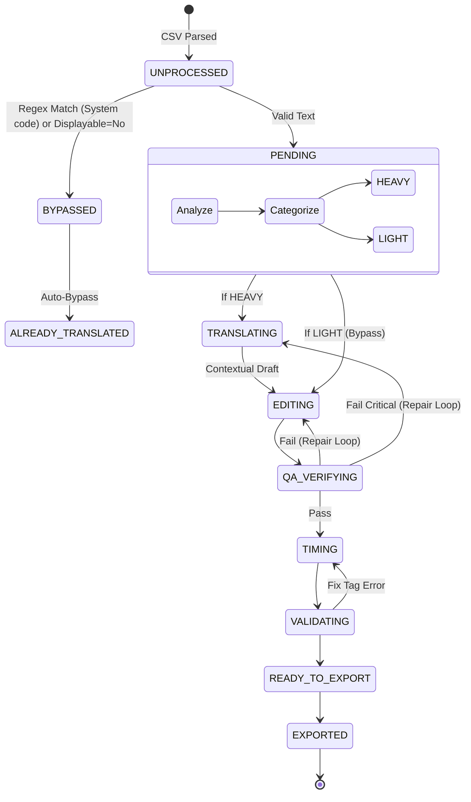

# SAD-003: Smart Batching & Task Routing Architecture

**Date:** 2026-07-12
**Related ADRs:** ADR-010, ADR-011

## 1. Introduction
เอกสารฉบับนี้อธิบายถึงสถาปัตยกรรมส่วนขยายของระบบ Agentic Translation Framework (ATF) ในส่วนของการจัดการคิวงาน (Batching) และการส่งต่องาน (Task Routing) เพื่อเพิ่มประสิทธิภาพและความสามารถในการประมวลผลแบบขนาน (Concurrency) ของ Multi-Agent System

## 2. Token-based Batching
สถาปัตยกรรมดั้งเดิม (SAD-001) ใช้การแบ่ง Batch ตามจำนวนบรรทัด (เช่น 50 บรรทัด = 1 Batch) ซึ่งมีข้อจำกัดเรื่องปริมาณข้อมูลที่ไม่สม่ำเสมอ

สถาปัตยกรรมใหม่ใช้ **Token-based Estimation** (การประมาณการ Token):
- สูตรคำนวณพื้นฐาน: `Estimated Tokens = Length of English String // 4 + 1`
- ประโยคแต่ละประโยค (Token) จะถูกสะสมน้ำหนัก (Estimated Tokens) ไปเรื่อยๆ จนกว่าจะถึงจุดอิ่มตัว (Threshold) ที่กำหนดไว้ จึงจะสร้างเป็น Batch ใหม่
- วิธีนี้ทำให้รับประกันได้ว่า LLM (โดยเฉพาะ Local LLM อย่าง LM Studio) จะได้รับปริมาณข้อความที่คงที่ในแต่ละครั้ง ป้องกันปัญหา Request Timeout (600s)

## 3. Categorical Pipeline Routing
สถาปัตยกรรมนี้ปรับเปลี่ยน Linear Pipeline ของ SAD-002 ให้มีความยืดหยุ่น โดยมี **Pre-filter Classification** เพื่อแยกประเภทข้อมูล:

1. **CODE_ONLY (System Logic) & NON_DISPLAYABLE:**
   - ข้อความที่มีแต่โค้ด, ตัวแปร, สัญลักษณ์ทางเทคนิค หรือถูกกำหนดจากคอลัมน์ว่า `Displayable = No`
   - *Routing:* ถูกแท็กเป็น `ALREADY_TRANSLATED` ทันทีตั้งแต่ใน `CSVParser` (ไม่เข้า Event Bus โดยคืนค่าต้นฉบับกลับไป)
   - *(Historical Note: ในเวอร์ชันก่อนหน้า จะบายพาสเฉพาะ Text ที่เป็น Code เท่านั้น ปัจจุบันรองรับการกรอง Displayable จาก CSV)*
2. **HEAVY (Narrative & Contextual Text):**
   - บทสนทนาที่มี Speaker Tags หรือคำอธิบายที่ยาวกว่า 80 ตัวอักษร
   - *Routing:* เข้าสู่ Pipeline เต็มรูปแบบ `PENDING -> TRANSLATING -> EDITING -> QA -> ...`
   - *Limit:* Max 150 tokens per batch.
3. **LIGHT (UI, Items, Short Texts):**
   - ข้อความสั้นที่ไม่มีบริบทลึกซึ้ง (เช่น ไอเทมหน้าจอ, ปุ่มกด)
   - *Routing:* ถูกบายพาส (Bypass) ไปสู่ `EDITING` ทันที (`PENDING -> EDITING -> QA -> ...`)
   - *Limit:* Max 200 tokens per batch.

### Dual-Role EditorAgent
เมื่อ `LIGHT` Batch ข้ามขั้นตอน `TranslatorAgent` ตัว `EditorAgent` จะต้องปรับบทบาท:
- ถ้า Batch = `HEAVY`: Editor ทำตัวเป็น "ผู้เกลาภาษา" (Editor Mode) รับ Input จาก Translator มาขัดเกลา
- ถ้า Batch = `LIGHT`: Editor ทำตัวเป็น "ผู้แปลหลัก" (Translator Mode) รับ Input ตรงจาก Original Text แล้วแปลให้กระชับ เหมาะกับบริบท UI

## 4. Architectural Diagram (Revised State Machine)

## 5. Non-Functional Requirements Addressed
- **Performance:** การส่ง `LIGHT` Batch ให้ Model 2 (Editor) แปลพร้อมๆ กับที่ `HEAVY` Batch กำลังถูกแปลโดย Model 1 (Translator) ทำให้ระบบทำงานแบบ Parallel Concurrency ได้อย่างแท้จริง
- **Reliability:** Token Batching ลดอัตราการล่มของ LLM Service จาก Out-of-Memory หรือ Request Timeout
- **Accuracy:** การลดบริบทเรื่องราวออกจากการแปล UI (LIGHT Batch) ช่วยลดอัตราการ Hallucinate ที่ AI มักจะเติมอารมณ์ความรู้สึกเข้าไปในปุ่มหรือชื่อไอเทม
