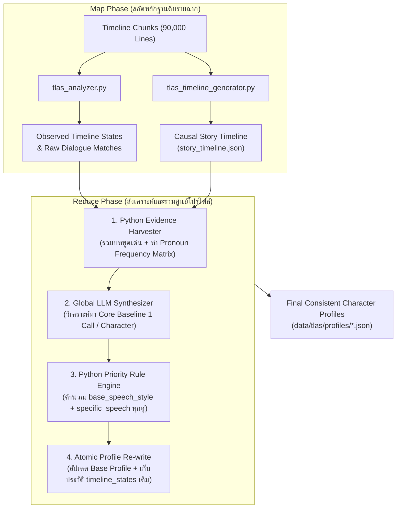

# Software Architecture Document (SAD)

**หมายเลขเอกสาร:** SAD-006
**ชื่อระบบ:** TLAS Global Character Profile Consolidation & Synthesis Architecture
**เวอร์ชันระบบ:** 1.0
**สถานะ:** Approved Architecture
**วันที่:** 2026-08-08
**ผู้รับผิดชอบ:** ATF Core Team

---

## 1. ภาพรวมสถาปัตยกรรม (System Overview & Architectural Vision)

สถาปัตยกรรม **TLAS Global Character Profile Consolidation & Synthesis** ถูกออกแบบขึ้นเพื่อแก้ปัญหาความไม่คงเส้นคงวาของ Character Profile (Sequential Cold-Start Drift & Lock-in) ในระบบแปลภาษาขนาดใหญ่

ในระบบประมวลผลข้อมูลขนาดใหญ่ (Big Data Systems) การสกัดความรู้จะถูกแบ่งออกเป็น 2 ช่วงตามหลักการ **Map-Reduce**:
1. **Map Phase (Evidence Extraction - `tlas_analyzer.py` & `tlas_timeline_generator.py`):** 
   - กวาดอ่านทั้ง 90,000 บรรทัดบทสนทนา
   - จัดเรียง Causal Timeline และบันทึก `story_timeline.json`
   - สกัดเหตุการณ์ จุดเปลี่ยนชีวิต และความเปลี่ยนแปลงทางอารมณ์ย่อย (`timeline_states`) ของตัวละครในแต่ละช่วงเวลา
2. **Reduce Phase (Global Character Profile Synthesis - `tlas_profile_consolidator.py`):**
   - นำ "หลักฐานทั้งหมด" (Dialogue Corpus ทั้งหมดที่พูดจริง, สถิติสรรพนามจริงจาก TH Legacy, และบันทึกเหตุการณ์ทั้งหมด) มารวมศูนย์เป็น **Character Dossier (แฟ้มประวัติรวม)**
   - สังเคราะห์ตัวตนแกนกลาง (Core Personality, Values, Speech Habits, 4D Relationships) ผ่าน LLM ในมุมมองภาพรวมทั้งเกม (Global Perspective)
   - คำนวณระบบภาษาและสรรพนามใหม่ทั้งหมดด้วย **Deterministic Priority Rule Engine**

---

## 2. โครงสร้างท่อส่งข้อมูล (Data Flow & Pipeline Stages)

### Stage 1: Python Character Evidence Harvester
ทำหน้าที่กวาดข้อมูลหลักฐานทั้งหมดของตัวละคร $C$ จากแหล่งข้อมูลในระบบโดยไม่พึ่งพา LLM:
- **Dialogue Sampling:** สกัดบทสนทนาทั้งหมดที่ตัวละคร $C$ พูดจริงจาก `data/tlas/timeline_chunks/*.json` ทั้งประโยคภาษาอังกฤษและคำแปลภาษาไทยดั้งเดิม (คัดเลือกประโยคที่มีความยาวและอารมณ์หลากหลาย เช่น ฉากโกรธ, ฉากปกติ, ฉากคุยกับผู้มีอำนาจ)
- **Pronoun Frequency Matrix:** นับความถี่การใช้คำสรรพนามและหางเสียงจากคำแปลภาษาไทยแยกตามคู่สนทนา (Target Listener) เช่น:
  $$\text{Frequency}(C \rightarrow L_{\text{Dan}}) = \{\text{"ฉัน"}: 45, \text{"แก"}: 30, \text{"หางเสียงไม่มี"}: 75\}$$
  $$\text{Frequency}(C \rightarrow L_{\text{Mayor}}) = \{\text{"ผม"}: 12, \text{"ครับ"}: 12\}$$
- **Trait Histogram:** รวบรวมความถี่ของ Personality Tags และ Emotion Tags ที่เคยปรากฏใน `timeline_states` ของตัวละครนั้น

### Stage 2: Global LLM Character Synthesizer
ส่ง **Character Dossier** ให้ LLM สังเคราะห์ภาพรวมระดับตัวละคร (1 API Call ต่อ 1 ตัวละคร):
- **Input Context:**
  - บทสนทนาตัวอย่างตลอดทั้งเรื่อง (ต้นฉบับ + TH Legacy)
  - สรุปเส้นเรื่องและบทบาทของตัวละครในภาพรวม
  - ตารางความถี่ของคำสรรพนามจริง
- **Analytical Directive:**
  - วิเคราะห์หา **Core Archetype** (บุคลิกภาพพื้นฐานเมื่ออยู่ตามลำพังหรือคุยกับคนทั่วไป)
  - แยกแยะระหว่าง "พฤติกรรมแกนกลาง (Core Baseline)" ออกจาก "พฤติกรรมเฉพาะสถานการณ์ (Situational State)"
  - ระบุความสัมพันธ์ระดับ 4 มิติ (`roles`, `affinity`, `intimacy`, `power_dynamic`) กับตัวละครหลักอื่นๆ
- **Output:** คืนค่า JSON ตามโครงสร้าง Taxonomy ของ SDD-005 และ SDD-006 อย่างเคร่งครัด

### Stage 3: Deterministic Priority Rule Engine
นำ Core Baseline ที่ได้จาก LLM มาประมวลผลผ่าน Python Rule Engine (ADR-013 & SDD-008):
- คำนวณ `formality_level` (1-10) จาก Tag และสถิติคำสรรพนาม
- กำหนด `base_speech_style` (`self_pronoun`, `target_pronoun`, `ending_particle`)
- วิ่งผ่าน **Priority Pipeline (Tier 0 -> Tier 1 -> Tier 2 -> Tier 3)** เพื่อสร้าง `specific_speech` ให้กับทุกความสัมพันธ์ใน `relationships`

### Stage 4: Atomic Profile Re-write
ทำการเขียนทับเฉพาะฟิลด์:
- `identity` (Gender, Age, Species)
- `base_state` (Personality, Speech Habit, Values)
- `base_speech_style` (Formality, Pronouns, Particles)
- `relationships` (4D Matrix + Specific Speech Guidelines)
โดย **รักษา `timeline_states` เดิมทั้งหมดไว้ 100%** ด้วย Atomic Write (`.tmp` -> `os.replace()`)

---

## 3. ความปลอดภัยและความทนทาน (Resilience & State Persistence)

1. **Idempotency & Checkpointing:**
   - ระบบบันทึกสถานะตัวละครที่ Consolidate เสร็จแล้วลงใน `data/tlas/consolidated_characters.log`
   - หากกระบวนการหยุดชะงัก สามารถรันต่อ (Resume) ได้ทันทีโดยไม่ต้องประมวลผลตัวละครเดิมซ้ำ
2. **Profile Backup Safety:**
   - ก่อนเริ่มกระบวนการ Consolidate ระบบจะสำรองข้อมูลโฟลเดอร์ `data/tlas/profiles/` ไปยัง `data/tlas/profiles_backup_pre_consolidation/` อัตโนมัติ เพื่อรับประกันความปลอดภัยของข้อมูลเดิม
3. **Zero RAM Leak:**
   - ประมวลผลและเขียนลงดิสก์ทีละตัวละคร ไม่เก็บข้อมูลทั้งโปรเจกต์ค้างไว้ใน RAM
