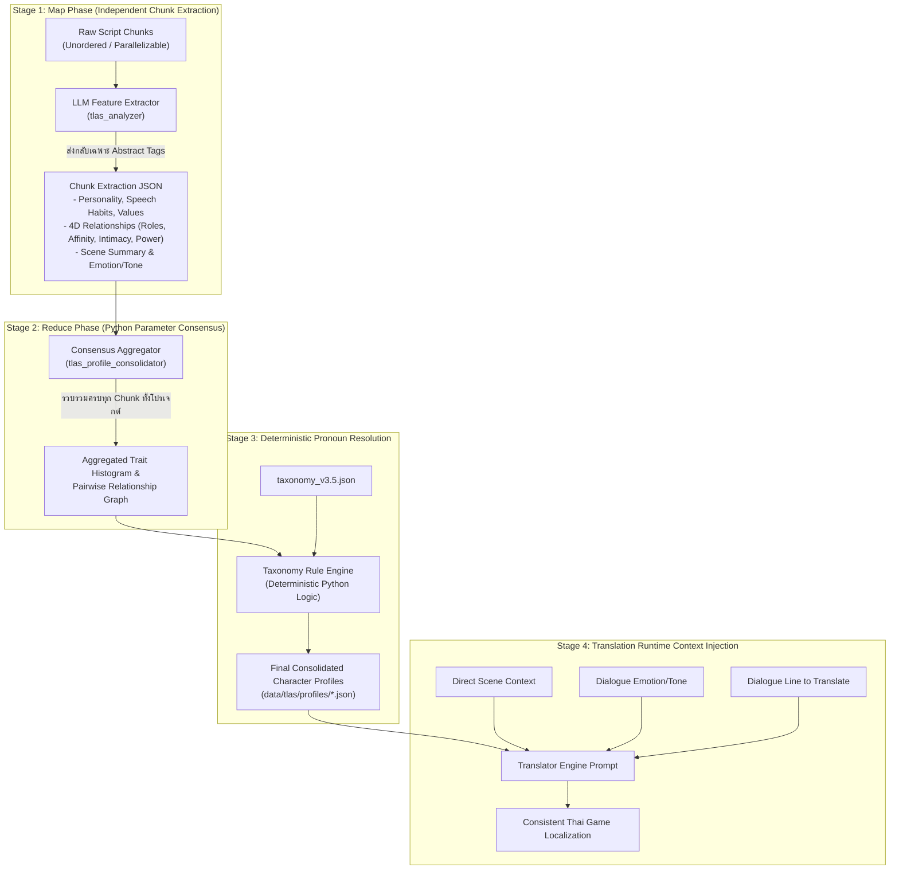

# Software Architecture Document (SAD)

**หมายเลขเอกสาร:** SAD-010  
**ชื่อระบบ:** TLAS Global-Relational Localization Architecture (v4.0)  
**สถานะ:** Approved Architecture  
**วันที่:** 2026-09-13  
**เอกสารอ้างอิง:** ADR-015, SDD-005, SDD-010, SDD-011  

---

## 1. บทนำและวิสัยทัศน์ของระบบ (System Overview & Architectural Vision)

สถาปัตยกรรม **TLAS v4.0 (Global-Relational Architecture)** ถูกออกแบบขึ้นเพื่อแก้ปัญหาความซับซ้อนของการจัดเรียงลำดับเวลา (Timeline Ordering) ในสคริปต์เกมที่มีความไม่เป็นเส้นตรง (Non-linear Narrative) โดยเปลี่ยนจากการพึ่งพา Timeline States มาเป็นการใช้ **Statistical Consensus บนพารามิเตอร์เชิงนามธรรมระดับทั้งโปรเจกต์ (Project-wide Abstract Parameter Consensus)** ควบคู่กับ **การแมปสรรพนามแบบจำเพาะคู่ความสัมพันธ์ (Directed Pairwise Pronoun Resolution)**

### แกนหลักของสถาปัตยกรรม (Core Architectural Pillars)
1. **Zero Timeline Dependency:** ไม่มีการเรียงลำดับเวลาของเหตุการณ์ และไม่มี `timeline_states` ในโปรไฟล์ตัวละคร
2. **Abstract Feature Extraction Only:** ในช่วงการวิเคราะห์ (Analysis Phase) LLM ทำหน้าที่สกัดเฉพาะ Taxonomy Tags และ Weights เท่านั้น **ห้ามส่งคำสรรพนามภาษาไทยกลับมาเด็ดขาด**
3. **Macro-Level Parameter Consensus:** รวมผลลัพธ์พารามิเตอร์จากทุก Chunk ของโปรเจกต์ แล้วหาค่าเฉลี่ยทางสถิติ (Majority Vote / Weighted Mode) ในภาษา Python
4. **Deterministic Taxonomy Mapping:** แปลงค่าเฉลี่ยของพารามิเตอร์ไปเป็นคำสรรพนามบุรุษที่ 1, 2, 3 และคำลงท้าย ผ่านกฎเกณฑ์ที่ชัดเจนใน Python ก่อนเริ่มขั้นตอนแปลจริง

---

## 2. ผังการทำงานและท่อส่งข้อมูล (Data Flow & Pipeline Stages)

---

## 3. รายละเอียดขั้นตอนการทำงาน (Pipeline Breakdown)

### Stage 1: Map Phase — Chunk-level Abstract Feature Extraction
- **Input:** ชิ้นส่วนบทสนทนา (Chunks) โดยไม่จำเป็นต้องเรียงตามลำดับเนื้อเรื่อง
- **กระบวนการ:**
  1. LLM อ่านเนื้อหาบทสนทนาและบริบทเฉพาะหน้าใน Chunk
  2. สกัดพารามิเตอร์เชิงนามธรรมของตัวละครที่ปรากฏใน Chunk ตาม Taxonomy v3.5:
     - `personality`: Array ของ `{"tag": PER_*, "weight": int}`
     - `speech_habit`: Array ของ `{"tag": SPR_*, "weight": int}`
     - `values`: Array ของ `{"tag": VAL_*, "weight": int}`
     - `relationships`: ข้อมูลความสัมพันธ์ต่อคู่สนทนา (`roles`, `affinity`, `intimacy`, `power_dynamic`)
     - `scene_context`: สรุปสถานการณ์เฉพาะหน้าในฉากนั้น
     - `dialogue_emotions`: ระดับอารมณ์และน้ำเสียงของแต่ละประโยค (`EMO_*`, `TON_*`)
  3. **ข้อห้ามเด็ดขาด:** LLM ต้องไม่สร้างหรือเสนอคำสรรพนามภาษาไทย (เช่น ผม, ฉัน, มึง, กู) ในขั้นตอนนี้

### Stage 2: Reduce Phase — Project-wide Parameter Aggregation (Python)
- รันหลังจาก LLM ประมวลผลเสร็จสิ้นครบทุก Chunk ของโปรเจกต์
- Python รวมข้อมูลพารามิเตอร์ของตัวละครแต่ละตัวจากทุกไฟล์:
  - **Personality / Values / Habits:** คำนวณความถี่และค่าน้ำหนักเฉลี่ย (Weighted Frequency Score) คัดเลือกเฉพาะ Top Tags ที่สะท้อนตัวตนแกนกลางของตัวละคร
  - **Relationships (Directed Pairwise Graph):** รวมข้อมูลการปฏิสัมพันธ์ระหว่างคู่ตัวละคร $A \to B$ เพื่อหาค่า Consensus ของ `roles`, `affinity`, `intimacy`, และ `power_dynamic`

### Stage 3: Deterministic Pronoun Resolution (Python Rule Engine)
- นำค่าเฉลี่ยของ Trait และ Relationship ที่สรุปได้ เข้าสู่กระบวนการแมปคำสรรพนามตาม Taxonomy:
  - **Base Speech Style:** สรรพนามพื้นฐานเมื่อพูดทั่วไปหรือคุยกับคนแปลกหน้า (`self_pronoun`, `target_pronoun`, `third_person_pronoun`, `ending_particle`, `formality_level`)
  - **Pairwise Specific Speech Style:** สรรพนามเฉพาะที่ตัวละคร $A$ ใช้กับตัวละคร $B$ โดยพิจารณาจาก 4 มิติความสัมพันธ์:
    - สรรพนามบุรุษที่ 1 (`self_pronoun`): คำแทนตัวเองที่ $A$ ใช้เมื่อคุยกับ $B$
    - สรรพนามบุรุษที่ 2 (`target_pronoun`): คำที่ $A$ ใช้เรียก $B$
    - สรรพนามบุรุษที่ 3 (`third_person_pronoun`): คำที่ $A$ ใช้เรียกบุคคลอื่นเมื่อสนทนากับ $B$ หรือเมื่อกล่าวถึง $B$
    - คำลงท้าย (`ending_particle`): หางเสียงที่ $A$ ใช้กับ $B$
    - ระดับความเป็นทางการ (`formality_level`): ค่าระดับ 1 - 5 (หรือ 1 - 10)
- บันทึกผลลัพธ์เป็น Character Profile สมบูรณ์ลงดิสก์ (`data/tlas/profiles/<Name>.json`)

### Stage 4: Translation Runtime Context Injection
เมื่อเข้าสู่ขั้นตอนการแปลจริง โมเดลแปลจะได้รับ Context ที่กระชับและตรงจุด:
1. **Speaker Profile:** ตัวตนและสไตล์การพูดพื้นฐานของผู้พูด
2. **Pairwise Relationship:** สรรพนามที่ผู้พูด ($A$) ต้องใช้กับผู้ฟัง ($B$) ในฉากนั้น (บุรุษที่ 1, 2, 3 และคำลงท้าย)
3. **Direct Scene Context:** บริบทเหตุการณ์เฉพาะหน้าของฉาก
4. **Dialogue Tone & Emotion:** อารมณ์เฉพาะของประโยคเพื่อปรับแต่งรูปประโยคให้มีชีวิตชีวา

---

## 4. คุณสมบัติเชิงสถาปัตยกรรม (Architectural Quality Attributes)

1. **Scalability & Concurrency:** การตัด Timeline Dependency ทำให้การประมวลผล Chunk ทำงานแบบขนานได้อย่างสมบูรณ์ (Massive Parallel Processing)
2. **Determinism & Consistency:** ปัญหาสรรพนามแกว่งถูกกำจัดด้วยการใช้อัลกอริทึมทางสถิติและ Rule-based Logic ควบคุมแทนการเดาของ LLM
3. **Fault Tolerance & Resilience:** สามารถ Checkpoint และ Resume ได้ทุกขั้นตอน Chunk ใดล้มเหลวสามารถประมวลผลซ้ำเฉพาะ Chunk นั้นได้โดยไม่กระทบโครงสร้างของทั้งเรื่อง
4. **Human-in-the-Loop Friendly:** ตารางสรุป Pronoun และ Relationship Matrix สามารถนำออกมาแสดงผลให้ผู้ใช้ตรวจสอบและปรับแก้ (Manual Override) ก่อนเริ่มแปลได้ในจุดเดียว
