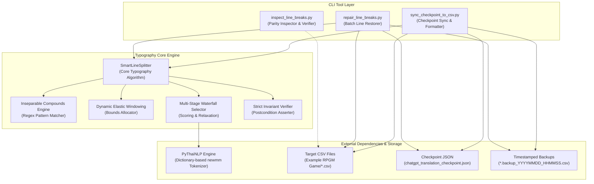
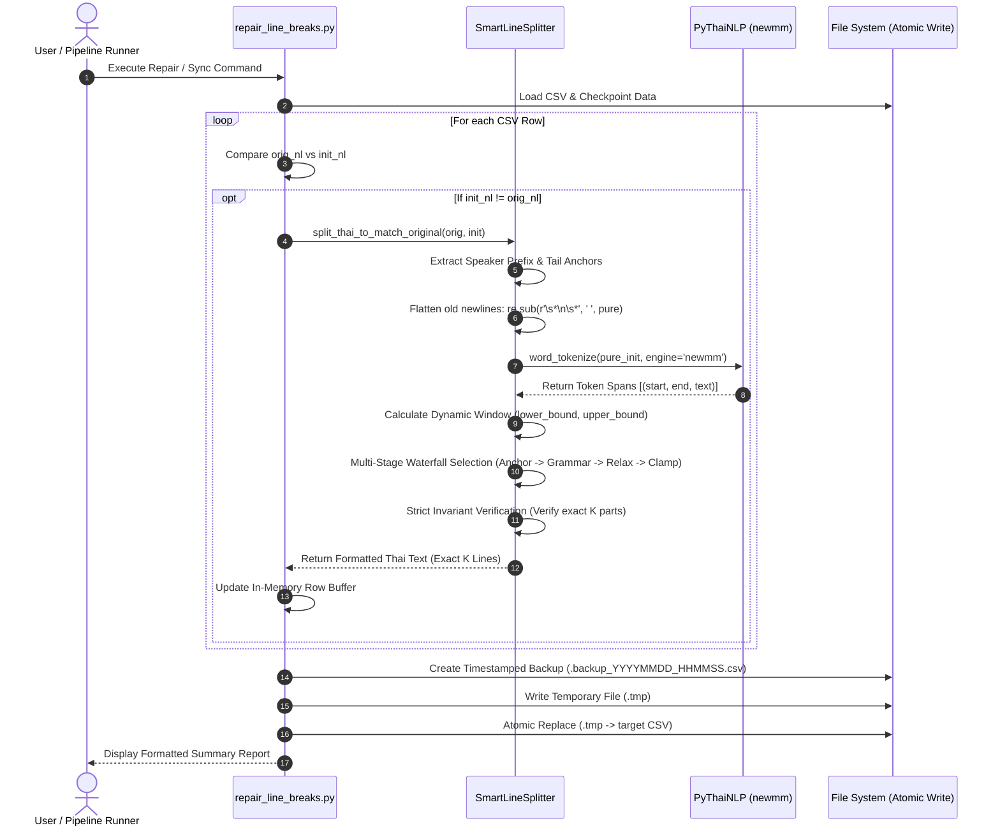

# Software Architecture Document (SAD)

**หมายเลขเอกสาร:** SAD-011  
**ชื่อระบบ:** Typography Alignment and Line-Break Parity Architecture  
**สถานะ:** Approved Architecture  
**วันที่:** 2026-09-23  
**เอกสารอ้างอิง:** ADR-016, SDD-013, SAD-004  

---

## 1. บทนำและวิสัยทัศน์ของระบบ (System Overview & Architectural Vision)

ในงานแปลเกมภาษา (Game Localization) โดยเฉพาะเอนจิน RPG Maker MV/MZ ปัญหาการแสดงผลข้อความภาษาไทยไม่ได้ขึ้นอยู่กับ "ความถูกต้องของความหมาย" เพียงอย่างเดียว แต่ขึ้นอยู่กับ **"ความถูกต้องเชิงโครงสร้างและการจัดวางตัวอักษร (Typography & Structural Parity)"** อย่างยิ่งยวด

สถาปัตยกรรม **Typography Alignment and Line-Break Parity** ถูกออกแบบขึ้นเพื่อทำหน้าที่เป็น **Post-Processing & Restoration Engine** ชั้นสุดท้ายของไปป์ไลน์การแปล โดยมีพันธกิจหลักคือการเชื่อมช่องว่างระหว่างธรรมชาติของภาษาไทยที่ไม่มีการเว้นวรรคระหว่างคำ (Scriptio Continua) กับข้อจำกัดทางกายภาพของหน้าต่างข้อความเกม (Game Message Box Constraints)

### เสาหลักทางสถาปัตยกรรม (Core Architectural Pillars)
1. **Mathematical Invariant Guarantee:** รับประกันความเท่ากันของจำนวนบรรทัดระหว่างต้นฉบับและคำแปลภาษาไทย 100.00% ($K_{\text{target}} == K_{\text{actual}}$) ปราศจากข้อยกเว้น
2. **Compound Word Integrity:** ป้องกันการฉีกขาดของกลุ่มคำประสมภาษาไทย (Inseparable Phrases) เพื่อรักษาความหมายและอรรถรสของบทสนทนา
3. **Phonetic & Glyphic Safety:** ป้องกันการเกิดตัวอักษรลอยหรือฟอนต์เสีย (Glyph Corruption) โดยห้ามไม่ให้สระบน/ล่าง วรรณยุกต์ การันต์ ไม้ยมก หรือเครื่องหมายวรรคตอนหลุดไปขึ้นต้นบรรทัดใหม่อย่างเด็ดขาด
4. **Adaptive Elastic Windowing:** ปรับเปลี่ยนขอบเขตการคำนวณจุดตัดตามความยาวจริงของข้อความแบบไดนามิก รองรับตั้งแต่ประโยคสั้นมาก (10 ตัวอักษร) ไปจนถึงบทยาวหลายบรรทัด
5. **Atomic & Idempotent Execution:** การประมวลผลและการเขียนไฟล์ทับต้องเป็นไปอย่างปลอดภัย มีระบบสำรองข้อมูล Timestamped Backup เสมอ และสามารถรันซ้ำกี่ครั้งก็ได้โดยไม่ทำให้ข้อมูลเสียหาย

### 1.1 ตำแหน่งของระบบในภาพรวมไปป์ไลน์ของ ATF (Placement in ATF Global Pipeline)
ในสถาปัตยกรรมภาพรวมของ ATF โมดูลนี้ทำหน้าที่เป็น **Stage 5** ที่รับช่วงต่อจากกระบวนการแปลของ LLM โดยตรง:
```
[SAD-005: Raw Game Data Layer] 
       │ (สกัด Dialogue & Masking Control Codes)
       ▼
[SAD-010: Global-Relational Macro Engine (Stage 1-3)] 
       │ (Feature Extraction -> Consensus Aggregator -> Deterministic Pronouns)
       ▼
[SAD-010: Stage 4 Translation Runtime] 
       │ (LLM Translation Engine ส่งมอบ Raw Thai Dialogue)
       ▼
[SAD-011: Stage 5 Typography & Line-Break Parity Engine] <--- (ตำแหน่งของเอกสารฉบับนี้)
       │ (Flattening -> Dynamic Windowing -> SmartLineSplitter -> Exact K Parity)
       ▼
[SAD-012: Stage 6 Persistence & Safe State Synchronization] 
       │ (Atomic Checkpoint Sync -> Validated Target CSV Replacement)
       ▼
[Final Playable Localized Game]
```

---

## 2. โครงสร้างความสัมพันธ์ระหว่างโมดูล (Component Architecture)



---

## 3. ผังลำดับการทำงาน (Interaction Sequence Diagram)



---

## 4. รายละเอียดขั้นตอนการทำงานของสถาปัตยกรรม (Pipeline Breakdown)

### Stage 1: Extraction & Pre-Split Normalization
1. **Speaker Tag Decoupling:** สกัดแท็กผู้พูด (เช่น `\n<Shion:>` หรือ `<Dan:>`) ออกจากบรรทัดแรก เพื่อป้องกันการบิดเบือนสัดส่วนความยาว
2. **Newline Neutralization:** ทำลายตัวแบ่งบรรทัดเดิม (`\n`) ในคำแปลภาษาไทยทิ้งทั้งหมด โดยแทนที่ด้วยช่องว่างเดี่ยว เพื่อให้ระบบมองเห็นประโยคที่ต่อเนื่องกันอย่างแท้จริง
3. **Anchor Extraction:** ตรวจจับสัญลักษณ์ควบคุมท้ายบรรทัดของต้นฉบับ เช่น `..\.`, `\..`, `\|`, `\!`, `\^`, `...`, `!?`

### Stage 2: Dynamic Elastic Windowing (การจัดสรรหน้าต่างความปลอดภัย)
คำนวณระยะปลอดภัยของจุดตัดแต่ละจุด ($b\_idx$ จาก $0$ ถึง $K - 2$):
1. **Dynamic Segment Floor:**
   $$\text{min\_seg} = \max\left(1, \min\left(5, \left\lfloor \frac{L}{K \times 2} \right\rfloor \right)\right)$$
2. **Bounded Interval:**
   สำหรับจุดตัดที่ $b\_idx$ โดยมีจุดตัดที่เหลือในอนาคตอีก $rem$ จุด:
   $$\text{lower\_bound} = \text{prev\_cut} + \text{min\_seg}$$
   $$\text{upper\_bound} = L - ((rem + 1) \times \text{min\_seg})$$
   หากเกิดกรณีข้อความสั้นจัดจน $\text{lower\_bound} \ge \text{upper\_bound}$ ระบบจะผ่อนปรนเป็น $\text{prev\_cut} + 1$ ถึง $L - (rem + 1)$

### Stage 3: Multi-Stage Waterfall Selection
ระบบค้นหาตำแหน่งจุดตัดที่ดีที่สุดโดยใช้เกณฑ์การตัดสินใจ 4 ระดับ:
* **Tier 1 — Anchor Synchronizer:** ค้นหาจุดตัดที่ตรงกับ Anchor ท้ายบรรทัดของต้นฉบับ หากอยู่ในช่วงปลอดภัยและไม่ผ่าคำต้องห้าม จะได้รับเลือกทันที
* **Tier 2 — Linguistic & Grammar Optimization:** ให้คะแนนตามธรรมชาติของภาษาไทย:
  $$\text{Score}(pos) = 1.5 \times |pos - \text{ideal\_idx}| - \text{Bonus} + \text{Penalty}$$
  - *โบนัส:* ช่องว่าง (`-30`), เครื่องหมายวรรคตอน (`-25`), คำลงท้าย (`-18`), หน้าคำเชื่อม (`-15`)
  - *บทลงโทษ:* ผ่าคำต้องห้าม (`+∞`), คำลงท้ายโดดเดี่ยว (`+45`), ท่อนสั้นกว่า 5 ตัวอักษร (`+40`)
  - *กฎเด็ดขาด:* อักษรตัวแรกของบรรทัดใหม่ต้องไม่อยู่ใน `ILLEGAL_LINE_STARTERS`
* **Tier 3 — Controlled Relaxation:** ผ่อนปรนให้เลือกตำแหน่งตัวอักษรใดๆ ในหน้าต่างปลอดภัยที่อักษรตัวถัดไปไม่ใช่สระบน/ล่าง หรือวรรณยุกต์
* **Tier 4 — Deterministic Safety Clamp:** หนีบค่า $\text{ideal\_idx}$ เข้าสู่ช่วงปลอดภัยและเลื่อนหาพยัญชนะต้นแรกที่ปลอดภัย

### Stage 4: Strict Invariant Enforcement (การบังคับความคงตัว)
1. ขจัดจุดตัดที่ซ้ำกัน
2. หากจำนวนจุดตัดน้อยกว่า $K - 1$ ให้กระจายจุดตัดใหม่อัตโนมัติตามอัตราส่วน $\frac{L}{K}$
3. ตรวจสอบว่าไม่มีชิ้นส่วน (Segment) ใดเป็นสตริงว่าง หากพบ ให้ดึงอักขระจากชิ้นส่วนข้างเคียงมาเติมเต็ม
4. ปรับขนาดชิ้นส่วนให้เท่ากับ $K$ พอดีเสมอ
5. ประกอบ Speaker Tag กลับเข้าสู่บรรทัดแรก และส่งคืนข้อความที่คั่นด้วย `\n`

---

## 5. การวิเคราะห์ความซับซ้อนและประสิทธิภาพ (Complexity & Performance Analysis)

1. **Time Complexity:**
   - การตัดคำด้วย PyThaiNLP (`newmm` dictionary trie): $O(L)$ โดยที่ $L$ คือความยาวของประโยค
   - การจับคู่ Regex คำต้องห้าม (`INSEPARABLE_PATTERNS`): $O(P \cdot L)$ โดยที่ $P$ คือจำนวน Pattern (คงที่ = 7)
   - การประเมินคะแนนใน Waterfall Selection: $O(T)$ โดยที่ $T$ คือจำนวนโทเค็น ($T \le L$)
   - ความซับซ้อนรวมต่อหนึ่งแถว: $O(L)$ (Linear Time)
   - ความซับซ้อนรวมทั้งไฟล์: $O(N \cdot \bar{L})$ โดยที่ $N$ คือจำนวนแถว (~82,000 แถว) และ $\bar{L}$ คือความยาวเฉลี่ย (~40 ตัวอักษร)
   - **เวลาประมวลผลจริง:** ไม่เกิน 8–12 วินาที สำหรับไฟล์ขนาด 82,000 แถวบน CPU ทั่วไป
2. **Space Complexity:**
   - ทำงานแบบ In-Memory Row Buffer: $O(N)$ (~50 MB สำหรับ CSV ขนาด 82,000 แถว)
   - ไม่มีปัญหา Memory Leak หรือ Out of Memory บนสภาพแวดล้อมทั่วไป

---

## 6. เมทริกซ์การจัดการข้อผิดพลาดและความเสี่ยง (Failure Modes & Recovery Matrix)

| Failure Scenario | Root Cause | Impact | Architectural Mitigation Strategy |
|---|---|---|---|
| **Missing PyThaiNLP** | สภาพแวดล้อมไม่ได้ติดตั้งแพ็กเกจ `pythainlp` | ไม่สามารถตัดคำระดับพจนานุกรมได้ | **Graceful Degradation:** ตกเข้าสู่ Character-level fallback (`tokens = [c for c in pure_init]`) และใช้ Stage 3/4 เพื่อตัดบรรทัดได้โดยไม่แครช |
| **Ultra-Short Dialogue ($L < K$)** | ข้อความภาษาไทยสั้นกว่าจำนวนบรรทัดที่ต้องการ เช่น 2 ตัวอักษรแบ่ง 3 บรรทัด | เสี่ยงต่อการเกิด Division by Zero หรือ Index Out of Bounds | **Guard Clause:** ตรวจสอบ $L < K$ ตั้งแต่ต้น แล้วเติมบรรทัดแรกด้วยข้อความ และบรรทัดที่เหลือด้วยสตริงว่าง การันตีไม่แครช 100% |
| **All Characters are Illegal Starters** | ประโยคประกอบด้วยจุดไข่ปลาหรือสัญลักษณ์ล้วน | Stage 2 และ 3 ไม่สามารถหาจุดตัดที่ถูกต้องได้ | **Stage 4 Clamp:** หนีบตำแหน่งเข้าสู่ช่วงกึ่งกลาง $(\text{lower\_bound} + \text{upper\_bound}) // 2$ เพื่อให้ได้จำนวนบรรทัดครบตาม Invariant |
| **Process Interruption / Crash** | ไฟดับ, Process ถูก Kill ระหว่างเขียนไฟล์ | ไฟล์ CSV เสียหายหรือข้อมูลขาดหาย | **Atomic File Replacement:** เขียนลงไฟล์ `.tmp` ให้เสร็จสมบูรณ์ก่อน แล้วใช้ `os.replace` ซึ่งเป็น Atomic Operation ระดับ OS พร้อม Backup เสมอ |
| **Windows Console Encoding Issue** | คอนโซลรันบนรหัสภาษา CP874 หรือ CP932 | เกิด `UnicodeEncodeError` เมื่อพิมพ์ภาษาไทย | **IO Buffer Wrapping:** สคริปต์หุ้ม `sys.stdout` และ `sys.stderr` ด้วย `io.TextIOWrapper(..., encoding="utf-8", errors="replace")` ตั้งแต่บรรทัดแรก |

---

## 7. แผนภาพการเชื่อมโยงทางสถาปัตยกรรม (Architectural Traceability & Cross-References)

เอกสารฉบับนี้เชื่อมโยงและสอดรับกับเอกสารสถาปัตยกรรมอื่นๆ ในระบบ ATF ดังนี้:

| Document ID | Title | Relationship to this Architecture |
|---|---|---|
| **[ADR-016](../adr/ADR-016-Smart-Line-Splitting-and-Strict-Invariant-Restoration.md)** | Smart Line Splitting & Strict Invariant Restoration | บันทึกการตัดสินใจทางสถาปัตยกรรม (Architectural Decision Record) ที่เป็นรากฐานของ SAD ฉบับนี้ |
| **[SDD-013](../design/SDD-013-SmartLineSplitter-and-Typography-Restoration.md)** | SmartLineSplitter Specification | รายละเอียดการออกแบบเชิงวิศวกรรม, โครงสร้างข้อมูล และอัลกอริทึม implementation |
| **[SAD-010](SAD-010-TLAS-Global-Relational-Architecture.md)** | TLAS Global-Relational Localization (v4.0) | สถาปัตยกรรมหลักชั้นหน้า (Upstream Pipeline) ซึ่งเป็นผู้สร้างและส่งมอบ Raw Thai Translation เข้าสู่ Stage 5 |
| **[SAD-005](SAD-005-TLAS-Localization-Engine-4D-Pipeline.md)** | Rule-Based Dialogue Localization Processing Pipeline | สถาปัตยกรรมการถอดรหัสข้อความเกม, Control Code Masking (`\^`, `\|`, `\.`, `\!`), และการสกัดบทสนทนา |
| **[ADR-010](../adr/ADR-010-Smart-Batching.txt)** | Smart Batching Engine | กลไกการรวบรวมข้อความบทสนทนาเป็น Batch เพื่อส่งเข้า Translation Runtime |
| **[ADR-012](../adr/ADR-012-TLAS-3-Tier-Fallback.md)** | TLAS 3-Tier Fallback | ปรัชญาการออกแบบระบบลดหลั่น (Waterfall Evaluation) ที่นำมาประยุกต์ใช้กับ Stage 1 ถึง 4 |
| **[SDD-004](../design/SDD-004-TLAS-Implementation-Details.md)** | TLAS Implementation Details | ข้อกำหนดเชิงเทคนิคของ RPG Maker Data Structure และคอลัมน์ CSV มาตรฐาน |
| **[SDD-010](../design/SDD-010-TLAS-Global-Character-and-Speech-Schema.md)** | Global Character & Speech Schema | ข้อกำหนดคำลงท้าย (`ending_particle`) และโครงสร้างบทสนทนาภาษาไทย |
