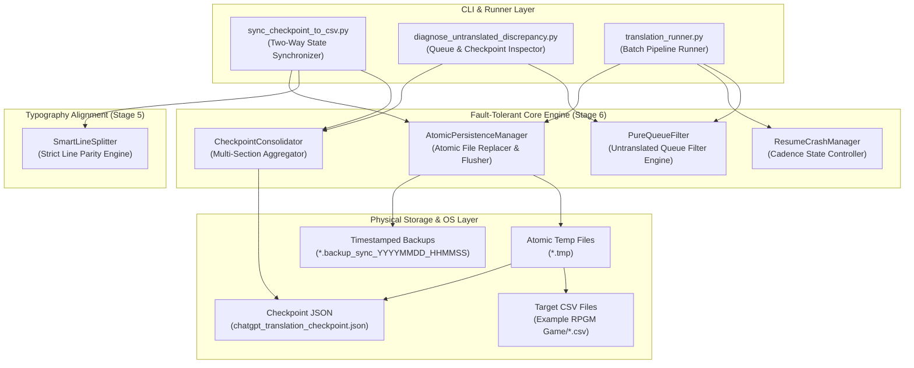
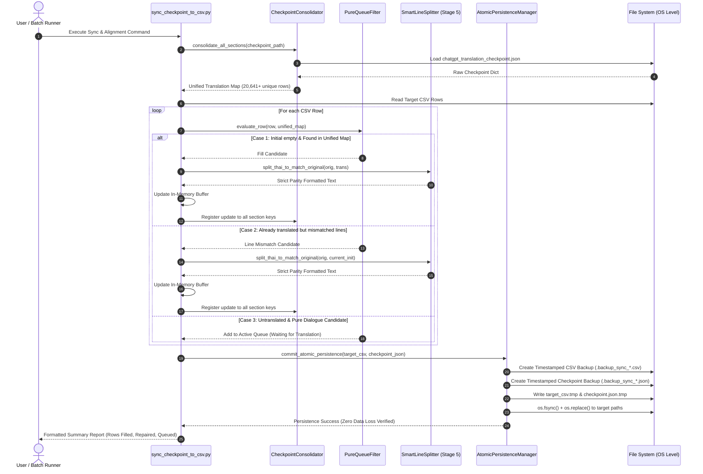

# Software Architecture Document (SAD)

**หมายเลขเอกสาร:** SAD-012  
**ชื่อระบบ:** Fault-Tolerant Translation Runner and State Synchronization Architecture  
**สถานะ:** Approved Architecture  
**วันที่:** 2026-09-23  
**เอกสารอ้างอิง:** ADR-017, SDD-014, SAD-011, ADR-016  

---

## 1. บทนำและวิสัยทัศน์ของระบบ (System Overview & Architectural Vision)

ในการแปลเกมสเกลขนาดใหญ่ (Large-Scale Game Localization) ที่มีข้อมูลหลายหมื่นบรรทัดและต้องใช้เวลาประมวลผลต่อเนื่องข้ามคืน ความเสี่ยงสูงสุดไม่ได้อยู่ที่ "คุณภาพการแปล" เพียงอย่างเดียว แต่อยู่ที่ **"ความล้มเหลวของการจัดการสภาวะการทำงาน (State Inconsistency & Data Loss)"**

สถาปัตยกรรม **Fault-Tolerant Translation Runner and State Synchronization** ทำหน้าที่เป็น **Stage 6: State Persistence & Safe Synchronization Layer** ซึ่งเป็นปราการด่านสุดท้ายของไปป์ไลน์ ATF มีพันธกิจหลักในการรับประกันความปลอดภัยของข้อมูล 100% (Zero Data Loss), การจัดคิวแปลที่บริสุทธิ์ (Pure Untranslated Queue), การรันต่อได้ทันทีเมื่อระบบสะดุด (Instant Resumption), และการซิงค์ข้อมูลสอดคล้องกันแบบสองทิศทาง (Bi-directional Parity)

### เสาหลักทางสถาปัตยกรรม (Core Architectural Pillars)
1. **Unified Multi-Section Synchronization:** รวบรวมและประสานคำแปลจากทุก Section ใน Checkpoint ให้เป็นหนึ่งเดียว ป้องกันปัญหาคำแปลตกค้างจากการเปลี่ยนชื่อไฟล์ CSV ปลายทาง
2. **Atomic OS-Level Persistence:** รับประกันว่าไฟล์ Checkpoint JSON และ Target CSV จะไม่มีวันเสียหายจากการถูกตัดโปรเซสกลางคัน โดยใช้ Atomic Temporary Write (`.tmp` $\to$ `os.replace`)
3. **Pure Queue Purity & Zero Waste:** คัดกรองเฉพาะบทสนทนาและข้อความที่มนุษย์มองเห็นจริง (`Displayable=Yes`) เท่านั้นที่ส่งเข้าคิวแปล ป้องกันการเสีย Token และเวลาไปกับสัญลักษณ์ว่างเปล่าหรือรหัสควบคุมเกม
4. **Cadence-Based Checkpointing:** บันทึกสถานะการแปลลงฮาร์ดดิสก์อย่างสม่ำเสมอทุกๆ $N$ แถว รองรับการ Resume งานได้ทันทีภายใน 1 วินาที
5. **No API Timeout & No Skip Guarantee:** ปฏิบัติตามกฎเหล็กของระบบ โดยไม่กำหนด Timeout ในการเรียก LLM API (`timeout=None`) และห้ามข้ามแถวที่เกิดข้อผิดพลาดโดยเด็ดขาด พร้อมระบบ Auto-Repair และ Adaptive Fallback

---

### 1.1 ตำแหน่งของระบบในภาพรวมไปป์ไลน์ของ ATF (Placement in ATF Global Pipeline)

```
[SAD-005: Raw Game Data Layer] 
       │ (สกัดบทสนทนา & จัดโครงสร้าง CSV)
       ▼
[SAD-010: Global-Relational Macro Engine (Stage 1-3)] 
       │ (Macro Consensus & Deterministic Pronouns)
       ▼
[SAD-010: Stage 4 Translation Runtime] 
       │ (LLM Translation Engine ส่งมอบ Raw Thai Output)
       ▼
[SAD-011: Stage 5 Typography & Line-Break Parity Engine] 
       │ (SmartLineSplitter จัดระเบียบบรรทัดตรงต้นฉบับ 100%)
       ▼
[SAD-012: Stage 6 Persistence & State Synchronization] <--- (ตำแหน่งของเอกสารฉบับนี้)
       │ (Pure Queue Filtering -> Cadence Checkpointing -> Atomic Multi-Section Sync)
       ▼
[Final Playable Localized Game & Resilient Checkpoint Data]
```

---

## 2. โครงสร้างความสัมพันธ์ระหว่างโมดูล (Component Architecture)



---

## 3. ผังลำดับการทำงาน (Interaction Sequence Diagram)



---

## 4. รายละเอียดขั้นตอนการทำงานของสถาปัตยกรรม (Pipeline Breakdown)

### Stage 6.1: Multi-Section Consolidation
สกัดและยุบรวมก้อนข้อมูลคำแปลจาก `checkpoint_data["csv_translations"]`:
1. ตรวจสอบคีย์ทุกคีย์ใน `csv_translations` (เช่น `"SSPV034v1.35 - Trans - Processed_v3.csv"`, `"SSPV034v1.35 - Trans - Processed_v3_translated.csv"`, และชื่อไฟล์ปัจจุบัน)
2. รวมคำแปลเข้าสู่ `unified_translations: Dict[str, str]` โดยอิงดัชนีหมายเลขแถว (`row_index`)
3. เมื่อตรวจพบว่าแถวใดได้รับการอัปเดตหรือจัดบรรทัดใหม่ ให้สะท้อนค่าที่ซ่อมแซมแล้วกลับสู่ **ทุก Section** ใน Checkpoint ทันที

### Stage 6.2: Pure Untranslated Queue Filtering
ระบบจำแนกประเภทแถวใน CSV ก่อนส่งเข้าคิวแปล:
1. **Eligibility Filter:**
   - ตรวจสอบ `Displayable == "Yes"`
   - ตรวจสอบ `Role \in {"Dialogue/Story", "System/Menu", "Skill/Item"}`
2. **Content Sanitization:**
   - ปฏิเสธแถวที่มีเฉพาะสัญลักษณ์ เช่น `re.match(r"^[\s\-_.\*]+$", orig)`
   - ปฏิเสธแถวที่มีเฉพาะ Game Control Codes เช่น `\^`, `\!`
   - แถวที่ไม่ผ่านเกณฑ์ด้านภาษา ให้คัดลอกค่าจาก `Original` ไปยัง `Initial` โดยอัตโนมัติ (Auto-Bypass)
3. **Queue Prioritization:**
   - จัดลำดับแถวบทสนทนาที่มี Speaker และข้อความต่อเนื่องเข้าสู่คิวแปลตามลำดับของเรื่องราว

### Stage 6.3: Cadence-Based Checkpointing & Resume Strategy
1. **Cadence Trigger:**
   - บันทึก Checkpoint ลงดิสก์ทุกครั้งที่แปลเสร็จ $N$ แถว (ค่ามาตรฐาน $N = 10$) หรือทุกๆ 60 วินาที
2. **Instant Resume:**
   - เมื่อเริ่มต้นกระบวนการแปล ระบบจะโหลด `checkpoint_data` ขึ้นมาตรวจสอบทันที หากแถวใดมีผลลัพธ์ใน Checkpoint แล้ว ระบบจะดึงคำแปลมาใส่และข้ามการเรียก API ทันที การันตีการ Resume ภายในเวลาน้อยกว่า 1 วินาที

### Stage 6.4: Two-Stage Atomic Persistence Protocol
เพื่อป้องกันปัญหาไฟดับหรือโปรเซสถูกตัดกลางคัน:
```
[In-Memory Buffer]
       │
       ▼ (1. Write complete bytes)
[Target.tmp] ──(2. os.fsync)──► [Disk Platter]
       │
       ▼ (3. os.replace - OS Atomic Invariant)
[Target File] (Replaced instantaneously without corrupt state)
```

---

## 5. การวิเคราะห์ความซับซ้อนและประสิทธิภาพ (Complexity & Performance)

1. **Time Complexity:**
   - การรวบรวม Section ใน Checkpoint: $O(S \cdot M)$ โดยที่ $S$ คือจำนวน Section (~3 Section) และ $M$ คือจำนวนคำแปล (~20,000 แถว) $\to \approx 60,000$ operations ($< 0.05$ วินาที)
   - การคัดกรอง Pure Queue Filter: $O(N)$ โดยที่ $N$ คือจำนวนแถวใน CSV (~82,538 แถว) $\to \approx 0.15$ วินาที
   - การเขียน Checkpoint JSON แบบ Atomic: $O(S \cdot M)$ ใช้เวลาประมาณ $0.2 - 0.4$ วินาที
   - **เวลารวมทั้งหมดในการทำ Full Sync & Filter:** ไม่เกิน 2.5 วินาที สำหรับทั้งโปรเจกต์
2. **Space Complexity:**
   - หน่วยความจำสำหรับ Checkpoint Map: ~35 MB
   - หน่วยความจำสำหรับ CSV Buffer: ~50 MB
   - หน่วยความจำรวมขณะทำงาน: ไม่เกิน 120 MB (ปลอดภัยบนระบบทุกระดับ)

---

## 6. เมทริกซ์การจัดการข้อผิดพลาดและความเสี่ยง (Failure Modes & Recovery Matrix)

| Failure Scenario | Root Cause | Impact | Architectural Mitigation Strategy |
|---|---|---|---|
| **Process Killed Mid-Write** | โปรเซสถูกปิดกะทันหันขณะกำลังเขียน Checkpoint JSON | ไฟล์ JSON เสียหาย (Corrupted JSON) ข้อมูลการแปลสูญหาย | **Atomic Swap:** เขียนลง `.tmp` และทำการ `os.fsync()` ก่อนใช้ `os.replace()` ซึ่งรับประกันระดับ OS ว่าไฟล์ปลายทางจะไม่มีวันเสียหาย |
| **Section Name Mismatch** | มีการเปลี่ยนชื่อไฟล์ CSV ปลายทางในแต่ละรอบการทำงาน | ระบบมองเห็นว่ายังไม่ได้แปล เกิดการส่งแปลซ้ำซ้อน | **Multi-Section Consolidation:** สแกนและรวมคำแปลจากทุก Section Key ใน Checkpoint เสมอ |
| **API 400 Bad Request / Payload Error** | ข้อความใน Batch มี Control Code แปลกปลอมหรือยาวเกิน Token Limit | โมเดลปฏิเสธการประมวลผล | **Adaptive Reduce & Retry:** หั่นครึ่ง Batch ทันที (Split Batch), กรอง Control Codes และ Retry ซ้ำจนกว่าจะสำเร็จ (No Skip Rule) |
| **Network Disconnection** | เครือข่ายหลุดระหว่างส่งแปล | โปรเซสหยุดชะงัก | **Cadence Checkpoint + Infinite Retry:** มีสถานะล่าสุดบันทึกอยู่ใน Checkpoint ไม่เกิน 10 แถวที่ผ่านมา สามารถต่อเน็ตและสั่ง Resume ได้ทันที |
| **Console Encoding Crash** | เทอร์มินัลรันด้วยโค้ดเพจที่ไม่รองรับ UTF-8 (เช่น CP874) | สคริปต์แครชด้วย `UnicodeEncodeError` | **Standard Stream Re-wrapping:** หุ้ม `sys.stdout` และ `sys.stderr` ด้วย UTF-8 Wrapper ตั้งแต่ส่วนหัวของสคริปต์ |

---

## 7. แผนภาพการเชื่อมโยงทางสถาปัตยกรรม (Architectural Traceability & Cross-References)

| Document ID | Title | Relationship to this Architecture |
|---|---|---|
| **[ADR-017](../adr/ADR-017-Atomic-Checkpoint-Persistence-and-Queue-Filtering.md)** | Atomic Checkpoint Persistence & Pure Queue Filtering | บันทึกการตัดสินใจทางสถาปัตยกรรม (ADR) ที่เป็นรากฐานของ SAD ฉบับนี้ |
| **[SDD-014](../design/SDD-014-Untranslated-Queue-Filter-and-Checkpoint-Sync-Specification.md)** | Untranslated Queue Filter and Checkpoint Sync Specification | รายละเอียดการออกแบบเชิงวิศวกรรม, โครงสร้างข้อมูล และอัลกอริทึมของโมดูลนี้ |
| **[SAD-011](SAD-011-Typography-Alignment-and-Line-Break-Parity.md)** | Typography Alignment and Line-Break Parity Architecture | โมดูล Stage 5 ต้นน้ำซึ่งส่งมอบบทสนทนาที่จัดระเบียบบรรทัดตรงกับต้นฉบับ 100% |
| **[ADR-016](../adr/ADR-016-Smart-Line-Splitting-and-Strict-Invariant-Restoration.md)** | Smart Line Splitting & Strict Invariant Restoration | กฎการตัดคำและ Invariant Postcondition ที่ Stage 6 ต้องเรียกใช้ขณะ Sync ข้อมูล |
| **[SAD-010](SAD-010-TLAS-Global-Relational-Architecture.md)** | TLAS Global-Relational Localization Architecture (v4.0) | สถาปัตยกรรมหลักชั้นบนที่ส่งมอบคำแปลเข้าสู่ Translation Runtime |
| **[ARCHITECTURE_INDEX](../ARCHITECTURE_INDEX.md)** | ATF Master Architectural Index | แผนที่แสดงผังรวมท่อส่งข้อมูล (Pipeline Map Layer 1-5) ทั้งหมดของ ATF |
