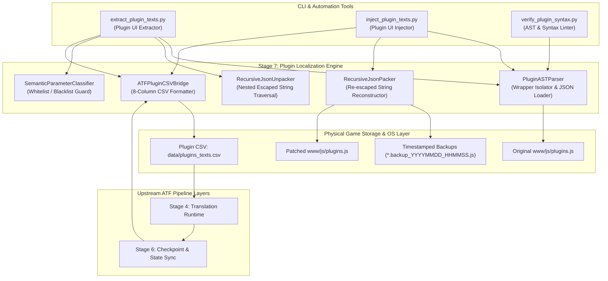
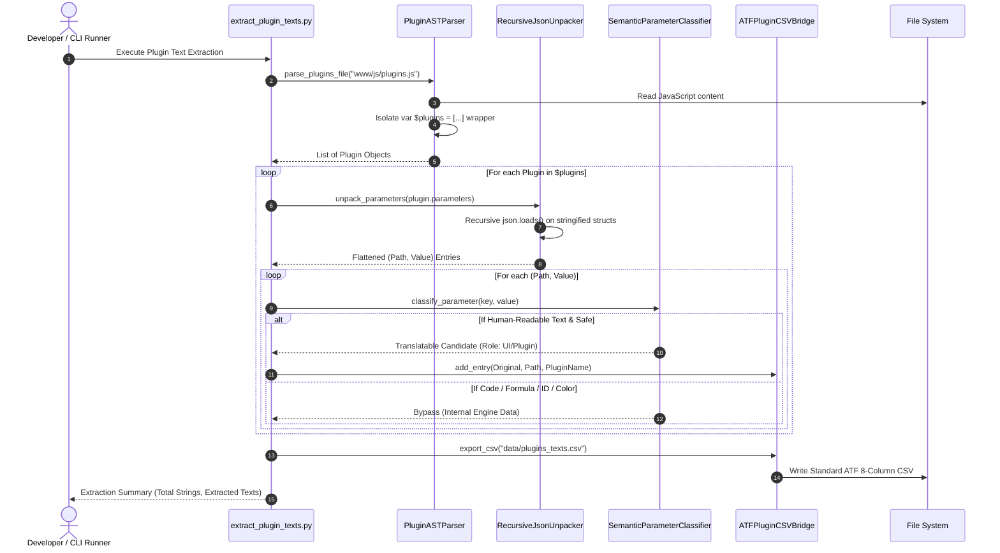
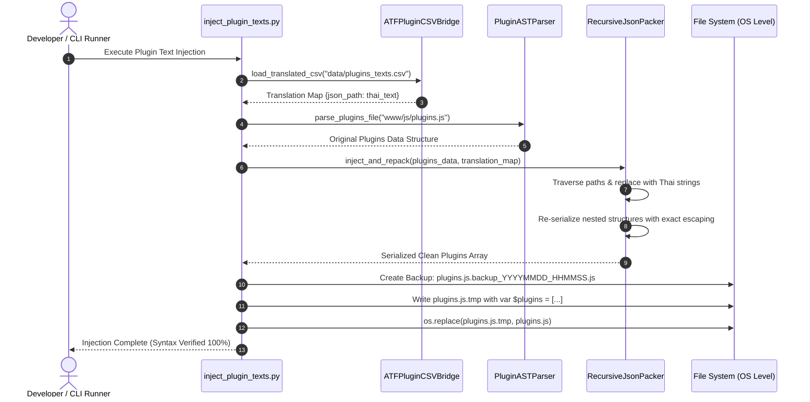

# Software Architecture Document (SAD)

**หมายเลขเอกสาร:** SAD-013  
**ชื่อระบบ:** RPG Maker MV Plugin Localization Pipeline Architecture  
**สถานะ:** Approved Architecture  
**วันที่:** 2026-09-23  
**เอกสารอ้างอิง:** ADR-018, SDD-015, SAD-012, SDD-004  

---

## 1. บทนำและวิสัยทัศน์ของระบบ (System Overview & Architectural Vision)

ในสถาปัตยกรรมของเอนจิน RPG Maker MV/MZ ระบบการเล่นหลักหลายระบบไม่ได้ถูกขับเคลื่อนด้วยฐานข้อมูลกลางในโฟลเดอร์ `data/` เพียงอย่างเดียว แต่ถูกขับเคลื่อนผ่านสถาปัตยกรรมส่วนเสริม (Plugin System) ผ่านไฟล์ `www/js/plugins.js` โดยระบบสำคัญ เช่น สมุดบันทึกเควสต์ (Quest Journal), ระบบเวลาและปฏิทินในเกม (Game Time System), หน้าต่างตัวเลือก (Option Windows), และระบบมินิเกม (Mini-Games UI) ล้วนมีข้อความส่วนติดต่อผู้ใช้ (UI Text) และบทสนทนาฝังตัวอยู่ภายในโครงสร้างพารามิเตอร์แบบซ้อนทับ (Nested Stringified JSON)

สถาปัตยกรรม **RPG Maker MV Plugin Localization Pipeline** ถูกออกแบบขึ้นเพื่อทำหน้าที่เป็น **Stage 7: Plugin Localization & Safe AST Injection Layer** เพื่อเติมเต็มช่องว่างที่ระบบสกัดข้อความทั่วไปเข้าไม่ถึง โดยมีพันธกิจหลักคือการสกัดข้อความ UI จาก `plugins.js` ออกมาเป็นไฟล์ CSV มาตรฐานของ ATF เพื่อแปลผ่านไปป์ไลน์หลัก และฉีดคำแปลภาษาไทยกลับเข้าสู่ `plugins.js` อย่างปลอดภัย 100% โดยไม่ทำให้ JavaScript Syntax เสียหายหรือตัวเกมแครช

### เสาหลักทางสถาปัตยกรรม (Core Architectural Pillars)
1. **Zero-Breakage Structural Integrity:** การันตีว่าโครงสร้างไฟล์ JavaScript และการซ้อนทับของ JSON Escape Sequences ใน `plugins.js` จะคงเดิม 100% ปราศจากไวยากรณ์ผิดพลาด
2. **Deterministic Code/Data Separation:** คัดแยกเฉพาะข้อความที่มนุษย์อ่านได้ (Human-Readable UI Strings) ออกจากสูตรคำนวณ โค้ด JavaScript ไอดีตัวแปร และคอนฟิกสีอย่างแม่นยำ
3. **Seamless ATF Interoperability:** เชื่อมต่อกับไปป์ไลน์หลักของ ATF ได้ทันทีโดยใช้ CSV Schema 8 คอลัมน์มาตรฐาน และรองรับการบันทึกสถานะผ่าน Checkpoint System
4. **Bi-directional JSON Path Addressability:** กำกับตำแหน่งข้อความทุกชิ้นด้วย JSON Path เพื่อให้ขั้นตอนการฉีดคำแปลกลับ (Injection) สามารถนำค่าภาษาไทยไปแทนที่ได้อย่างตรงจุดระดับศัลยกรรม
5. **Atomic OS-Level Persistence & Instant Rollback:** รับประกันความปลอดภัยของไฟล์เกมด้วยการเขียนไฟล์ผ่าน `.tmp` $\to$ `os.replace` และมี Timestamped Backup เสมอ

---

### 1.1 ตำแหน่งของระบบในภาพรวมไปป์ไลน์ของ ATF (Placement in ATF Global Pipeline)

```
[SAD-005: Raw Game Data Layer] ──────┐
       │ (สกัด Dialogue & Items)      │
       ▼                              │
[SAD-010: Macro Engine (Stage 1-3)]   │
       │                              ▼
[SAD-010: Stage 4 Translation] ◄── [SAD-013: Stage 7 Plugin Extractor] (สกัด UI Text ลง CSV)
       │                              ▲
       ▼                              │
[SAD-011: Stage 5 Typography Parity]  │
       │                              │
       ▼                              │
[SAD-012: Stage 6 Checkpoint Sync] ───┘ (ส่งคำแปล UI ที่สมบูรณ์กลับมา)
       │
       ▼
[SAD-013: Stage 7 Safe AST Injector] ──► [Updated www/js/plugins.js]
       │
       ▼
[Final 100% Fully Localized Playable Game]
```

---

## 2. โครงสร้างความสัมพันธ์ระหว่างโมดูล (Component Architecture)



---

## 3. ผังลำดับการทำงาน (Interaction Sequence Diagrams)

### 3.1 วงจรการสกัดข้อความ (Extraction Sequence Flow)


---

### 3.2 วงจรการฉีดคำแปลกลับ (Injection Sequence Flow)


---

## 4. รายละเอียดขั้นตอนการทำงานของสถาปัตยกรรม (Pipeline Breakdown)

### Stage 7.1: AST & Wrapper Boundary Isolation
ไฟล์ `plugins.js` มีการห่อหุ้มด้วยตัวแปรโกลบอลของ RPG Maker:
```javascript
// Generated by RPG Maker.
// Do not edit this file directly.
var $plugins =
[
  ...
];
```
1. สกัดตัวแปรด้วย Regex: `re.search(r"var\s+\$plugins\s*=\s*(\[[\s\S]*\])\s*;?", content)`
2. แปลงก้อนสตริง JSON เป็น Python List of Dictionaries ผ่าน `json.loads(raw_json)`
3. ในขั้นตอนเขียนกลับ ให้ห่อหุ้มด้วย Comment และ Header เดิม:
   `// Generated by RPG Maker.\n// Do not edit this file directly.\nvar $plugins =\n` + `json_str` + `;\n`

### Stage 7.2: Recursive Unpacker (Nested Stringified JSON)
ในโครงสร้างของ Yanfly หรือ DK Plugins พารามิเตอร์ประเภท `struct` หรือ `structA` จะถูก Stringify ซ้อนกัน:
```
Top Level String: "{\"redZoneFillColor:str\":\"#ad189a\",\"fishes:structA\":\"[{\\\"id:i\\\":\\\"8\\\"}]\"}"
```
1. ตรวจสอบว่าค่านั้นเป็นสตริงที่ขึ้นต้นด้วย `{"` หรือ `["` หรือไม่
2. หากใช่ ให้ทำการ `json.loads()` และลงลึกไปในระดับลูกแบบ Recursive
3. บันทึกเส้นทาง (Path Tokens) ในรูปแบบอาเรย์ เช่น:
   `["YEP_QuestJournal", "parameters", "Quest Category Window", "Available Text"]`

### Stage 7.3: Semantic Parameter Classifier & Safety Guard
เกณฑ์การคัดแยกข้อความเพื่อความปลอดภัยสูงสุดของเอนจินเกม:
*   **Reject Rules (ห้ามแปล):**
    - มีซับสตริง: `:bool`, `:css`, `:color`, `:file`, `:img`, `:image`, `:variable`, `:switch`, `:id`, `:i`, `:e`
    - มีไวยากรณ์คำนวณ: `Graphics.`, `Window_Base.`, `.prototype.`, `===`, `&&`, `||`, `Math.`
    - เป็นสตริงสั้นหรือรหัสสี: `#ffffff`, `rgba(...)`, `true`, `false`, `auto`
*   **Accept Rules (ส่งแปล):**
    - คีย์ระบุข้อความชัดเจน: `Text`, `Title`, `Name`, `Command`, `Format`, `Label`, `Cancel`, `Read`
    - ข้อความมีอักขระภาษาธรรมชาติ และสัญลักษณ์แสดงผล RPG Maker เช่น `\i[192]Available (%1)`

### Stage 7.4: Standard CSV Export & ATF Flow
ส่งออกข้อความที่ผ่านการคัดกรองลงไฟล์ `data/plugins_texts.csv` โดยใช้คอลัมน์มาตรฐาน:
`Original, Initial, Filename, Row, Note, Role, Speaker, Displayable`
ทำให้สามารถส่งต่อเข้าสู่ Translation Runtime และ Checkpoint Sync ได้ทันที

### Stage 7.5: Recursive Packer & Atomic Injection
1. แทนที่ค่าเดิมด้วยคำแปลภาษาไทยตาม JSON Path
2. ประกอบก้อน Struct ย่อยจากในสุดออกมาด้วย `json.dumps(..., ensure_ascii=False)` เพื่อให้ Escape Slashes (`\"`, `\\\"`, `\\\\\\\"`) ถูกสร้างขึ้นอย่างถูกต้องตามมาตรฐาน
3. ทำการบันทึกไฟล์แบบ Atomic ด้วย `.tmp` $\to$ `os.replace` พร้อมสร้าง Timestamped Backup

---

## 5. การวิเคราะห์ความซับซ้อนและประสิทธิภาพ (Complexity & Performance)

1. **Time Complexity:**
   - การสกัด (Extraction): $O(P \cdot K \cdot D)$ โดยที่ $P$ คือจำนวนปลั๊กอิน (~20-50 ตัว), $K$ คือจำนวนพารามิเตอร์ต่อปลั๊กอิน, $D$ คือความลึกของ Nested JSON ($D \le 4$) $\to$ ใช้เวลาน้อยกว่า **0.15 วินาที**
   - การฉีดคำแปล (Injection): $O(T + P \cdot K \cdot D)$ โดยที่ $T$ คือจำนวนข้อความที่แปล (~200-500 รายการ) $\to$ ใช้เวลาน้อยกว่า **0.20 วินาที**
2. **Space Complexity:**
   - การเก็บโครงสร้างข้อมูลใน RAM: ประมาณ 5-10 MB (เบามากเมื่อเทียบกับหน่วยความจำระบบ)

---

## 6. เมทริกซ์การจัดการข้อผิดพลาดและความเสี่ยง (Failure Modes & Recovery Matrix)

| Failure Scenario | Root Cause | Impact | Architectural Mitigation Strategy |
|---|---|---|---|
| **JavaScript Syntax Error After Inject** | มีการหลุดของเครื่องหมายคำพูด (Unescaped Quotes) ในสตริงที่ซ้อนทับ | เกมเปิดไม่ขึ้น (Black Screen / Engine Crash) | **Native JSON Serialization:** ใช้ `json.dumps()` ของ Python ในการแพ็คระดับลึกเสมอ ห้ามใช้ String Concatenation เด็ดขาด พร้อมมี Linter ตรวจสอบ syntax ก่อนเซฟ |
| **Accidental Translation of Formula** | ฟิลด์สูตรคำนวณหลุดรอดจากตัวกรองถูกส่งไปแปล | ฟังก์ชันในเกมแครชเมื่อเรียกใช้สูตร | **Strict Regex Classifier:** ดักจับคำสั่ง JavaScript (`Graphics.`, `.prototype.`, `Math.`) และบล็อกทิ้งทันที |
| **Missing Control Tags in Thai Text** | AI แอบลบแท็ก `\i[192]` หรือ `%1` ทิ้งระหว่างแปล | ไอคอนบนปุ่มเควสต์หาย หรือตัวเลขจำนวนเควสต์ไม่แสดง | **Tag Parity Assertion:** มีระบบตรวจสอบความสมบูรณ์ของ Control Tags และ Format Specifiers (`%1`, `%2`) ก่อนทำการฉีดกลับ |
| **Process Interruption Mid-Write** | โปรเซสหยุดกะทันหันขณะเขียน `plugins.js` | ไฟล์ปลั๊กอินเกมพัง ข้อมูลเกมเสียหาย | **Atomic OS Swap:** เขียนลง `plugins.js.tmp` และใช้ `os.replace` พร้อมสร้าง `.backup_YYYYMMDD_HHMMSS.js` เสมอ |
| **Encoding Corruption** | ไฟล์ถูกบันทึกด้วย ANSI หรือ TIS-620 | ภาษาไทยในเกมกลายเป็นภาษาต่างดาว (Mojibake) | **Strict UTF-8 Encoding:** บังคับใช้ `encoding="utf-8"` โดยไม่มี BOM ทั้งตอนอ่านและเขียน |

---

## 7. แผนภาพการเชื่อมโยงทางสถาปัตยกรรม (Architectural Traceability & Cross-References)

| Document ID | Title | Relationship to this Architecture |
|---|---|---|
| **[ADR-018](../adr/ADR-018-RPG-Maker-MV-Plugin-Parameter-Extraction-and-AST-Injection.md)** | Plugin Parameter Extraction & AST Injection | บันทึกการตัดสินใจทางสถาปัตยกรรม (ADR) ที่เป็นรากฐานของ SAD ฉบับนี้ |
| **[SDD-015](../design/SDD-015-Plugin-Parameter-Extractor-and-Injector-Specification.md)** | Plugin Parameter Extractor and Injector Specification | รายละเอียดการออกแบบเชิงวิศวกรรม, โครงสร้างคลาส และอัลกอริทึมของโมดูลนี้ |
| **[SAD-012](SAD-012-Fault-Tolerant-Translation-Runner-and-State-Sync.md)** | Fault-Tolerant Translation Runner Architecture | โมดูล Stage 6 ซึ่งรับหน้าที่ซิงค์คำแปล UI เข้าสู่ Checkpoint |
| **[SDD-004](../design/SDD-004-TLAS-Implementation-Details.md)** | TLAS Implementation Details | ข้อกำหนด CSV Columns 8 คอลัมน์มาตรฐานที่โมดูลนี้ส่งออก |
| **[ARCHITECTURE_INDEX](../ARCHITECTURE_INDEX.md)** | ATF Master Architectural Index | แผนที่แสดงผังรวมท่อส่งข้อมูลทั้งหมดของ ATF |
