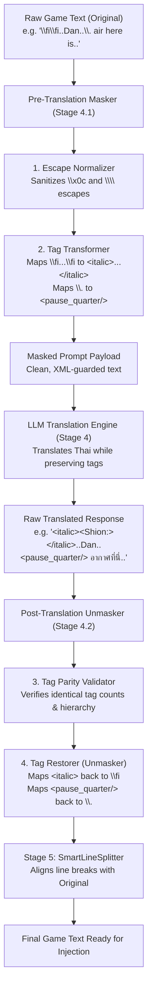

# SAD-014: Control Code Masking and Sanitization Engine Architecture

## 1. System Overview & Mission Statement
ในระบบสากลสำหรับการแปลเกม (Universal Game Localization Framework) ปัญหาสำคัญอันดับหนึ่งที่พบในเกมทุก Engine (โดยเฉพาะ RPG Maker, Ren'Py, WOLF RPG Editor, Unity TextMeshPro) คือการแทรก **In-line Control Codes** ลงในข้อความบทสนทนา เช่น:
- รหัสกำกับสไตล์ข้อความ: `\fi...\fi` (Italic), `\fb...\fb` (Bold)
- รหัสกำกับสีข้อความ: `\C[n]...\C` (Color Window/System)
- รหัสแทรกตัวแปร/ไอคอน/สเกล: `\I[n]` (Icon), `\V[n]` (Variable), `\N[n]` (Actor Name), `\{`, `\}` (Font Size Up/Down)
- รหัสกำกับจังหวะเวลาและการแสดงผล: `\.`, `\|`, `\!`, `\^`, `\..` (Pause / Wait for Input)
- รหัสเว้นบรรทัดและควบคุมกล่องข้อความ: `\n`, `\\n`, `\x0c` (Form Feed Hazard)

**SAD-014** กำหนดสถาปัตยกรรมระดับเอนจิน **"Stage 4.1: Control Code Masking and Sanitization Engine"** เพื่อทำหน้าที่เป็นเกราะป้องกันข้อความเกมก่อนส่งเข้าสู่ LLM Translation Engine และกู้คืนรหัสแท็กเดิมกลับมาอย่างเที่ยงตรง 100% โดยไม่สูญเสียความหมายและตำแหน่งไวยากรณ์

---

## 2. Root Cause Analysis (RCA) & Historical Failure Modes

| Failure ID | Problem Pattern | Root Cause | Universal Architectural Solution |
| :--- | :--- | :--- | :--- |
| **RCA-1** | `\fi` กลายเป็น Form Feed `\x0c` () | ภาษา Python ตีความ `\f` เป็น Form Feed escape sequence หากไม่ได้ escape สองชั้น | Strict Escape Sanitizer & Raw Regex processing |
| **RCA-2** | AI ย้าย/สลับ/ครอบแท็กสไตล์ผิดคำ | AI มอง `\fi`, `\fb` เป็นข้อความธรรมดาหรือพิมพ์ผิด จึงพยายามแปลหรือลบทิ้ง | แปลงรหัสทึบเป็น **Semantic XML-like Tags** เช่น `<italic>...</italic>`, `<bold>...</bold>` ซึ่ง LLM มีความคุ้นเคยระดับลึกซึ้งว่าจะต้องคงแท็กครอบเนื้อหาเดิม |
| **RCA-3** | รหัสเดี่ยว (Self-closing) เช่น `\.`, `\I[12]` หายไป | AI มองสัญลักษณ์จุดและแบ็กสแลชเป็นวรรคตอนทั่วไป จึงตัดทิ้งระหว่างแปลไทย | แปลงเป็น Self-closing XML Tags เช่น `<pause_quarter/>`, `<icon id="12"/>` พร้อมคำสั่งระบบใน System Prompt |
| **RCA-4** | แท็กเปิด-ปิดไม่สมดุล (Tag Mismatch) | LLM ตอบกลับมาโดยลืมปิดแท็กหรือสะกดชื่อแท็กผิด | **Automated Tag Parity Assertion & Auto-Repair Engine**: ตรวจนับจำนวนและชื่อแท็กระหว่างต้นฉบับกับผลลัพธ์ หากไม่ตรงกันจะทำการกู้คืนหรือทริกเกอร์ Self-Healing Retry ทันที |

---

## 3. High-Level Engine Architecture (Stage 4.1)

---

## 4. Tag Mapping Standard (Universal Game Code Matrix)

ระบบออกแบบ Tag Mapping ให้มีความเป็นสากล สามารถประยุกต์ใช้กับ Game Engine ใดๆ ก็ได้ในอนาคต:

### 4.1 Paired / Formatting Codes (รหัสแบบเปิด-ปิด)
| Game Engine Code (Raw) | Normalized Code | Semantic XML Tag | Purpose / Meaning |
| :--- | :--- | :--- | :--- |
| `\fi...\fi` | `\\fi...\\fi` | `<italic>...</italic>` | ตัวเอียง (Italic Text) |
| `\fb...\fb` | `\\fb...\\fb` | `<bold>...</bold>` | ตัวหนา (Bold Text) |
| `\C[n]...\C` / `\C[n]...\C[0]` | `\\C[n]...\\C` | `<color id="n">...</color>` | เปลี่ยนสีข้อความตาม ID พาเล็ตต์ |
| `\{...\}` | `\\{...\\}` | `<scale step="+1">...</scale>` | ขยาย/ลดขนาดตัวอักษร |

### 4.2 Self-Closing / Point Codes (รหัสจุดเดียวและอินไลน์)
| Game Engine Code (Raw) | Normalized Code | Semantic XML Tag | Purpose / Meaning |
| :--- | :--- | :--- | :--- |
| `\.` | `\\.` | `<pause_quarter/>` | หยุดรอ 1/4 วินาที (15 frames) |
| `\|` | `\\|` | `<pause_second/>` | หยุดรอ 1 วินาที (60 frames) |
| `\!` | `\\!` | `<wait_for_input/>` | หยุดรอให้ผู้เล่นกดปุ่ม |
| `\^` | `\\^` | `<no_input_advance/>` | เลื่อนข้อความข้ามโดยไม่ต้องกดปุ่ม |
| `\I[n]` | `\\I[n]` | `<icon id="n"/>` | แทรกไอคอนรูปภาพหมายเลข n |
| `\V[n]` | `\\V[n]` | `<var id="n"/>` | แทรกค่าตัวแปรในเกมหมายเลข n |
| `\N[n]` | `\\N[n]` | `<actor id="n"/>` | แทรกชื่อตัวละครหมายเลข n |
| `\P[n]` | `\\P[n]` | `<party id="n"/>` | แทรกชื่อสมาชิกปาร์ตี้ลำดับที่ n |
| `\G` | `\\G` | `<currency/>` | แทรกสกุลเงิน (Gold/Currency) |

---

## 5. Architectural Quality Attributes & Invariants

1. **Bidirectional Isomorphism (Invariance 1):**
   $$\text{Unmask}(\text{Mask}(T)) \equiv T$$
   สำหรับข้อความใดๆ ในระบบ หากนำไปผ่าน Mask แล้ว Unmask กลับมา จะต้องได้ข้อความและ Control Code ที่ตรงกันกับต้นฉบับ 100% ทุกตัวอักษร

2. **Zero Semantic Tag Loss (Invariance 2):**
   จำนวนและชนิดของ Tag ในข้อความก่อนส่งแปล จะต้องเท่ากับจำนวนและชนิดของ Tag ในผลลัพธ์หลังแปลเสมอ:
   $$\text{Tags}(\text{Masked Original}) \equiv \text{Tags}(\text{Masked Translated})$$
   หากระบบตรวจพบว่า AI ทำแท็กหาย (Missing Tag) หรือเพิ่มแท็กขึ้นมาเอง (Extraneous Tag) ระบบจะไม่อนุญาตให้บันทึกลง Target CSV แต่จะสั่ง Auto-repair หรือ Fallback ทันที

3. **Engine Portability (Invariance 3):**
   Engine สามารถเพิ่มกฎ Control Code ของเกมอื่นๆ (เช่น Ren'Py `{i}...{/i}`, Unity TextMeshPro `<color=#hex>...</color>`) ได้ผ่าน Registry โดยไม่ต้องแก้แกนหลักของ Translation Runner
