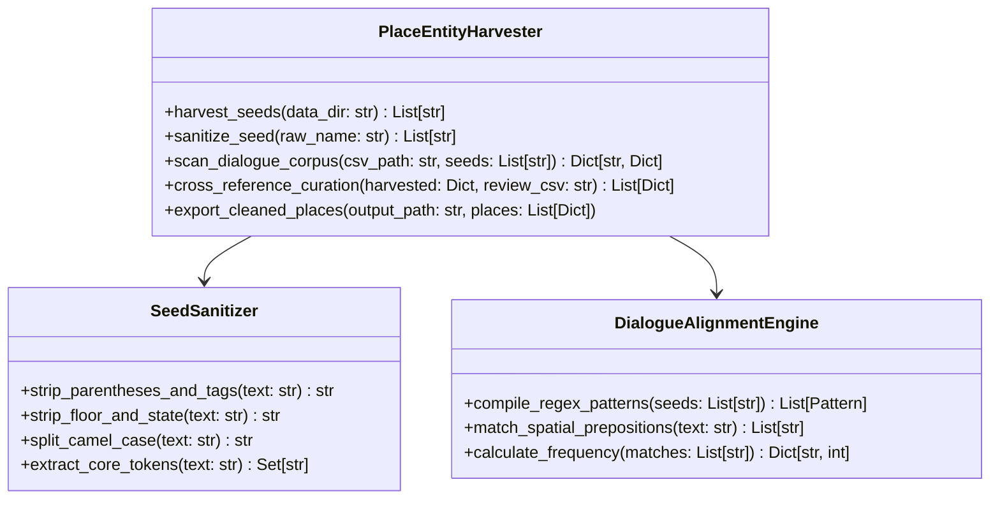

# SDD-017: Place Entity Harvester and Dialogue Alignment Engine Specification

## 1. System Objective
เอกสารนี้กำหนดรายละเอียดทางวิศวกรรมและการออกแบบอัลกอริทึมสำหรับ **`PlaceEntityHarvester`** เพื่อรองรับข้อกำหนดตาม [ADR-023](../adr/ADR-023-Dialogue-Corroborated-Place-Entity-Extraction.md) โดยมีเป้าหมายในการสกัดชื่อสถานที่แท้จริงที่ถูกพูดถึงในบทสนทนา (Corroborated Spoken Places) และกำจัดชื่อแผนที่ทางเทคนิค (Technical Map Artifacts) ออกจากระบบ TLAS Glossary 100%

---

## 2. Architecture & Component Interaction



---

## 3. Algorithm Specification

### 3.1 Step 1: Candidate Seed Cleaning Rules
ตัวกรอง `SeedSanitizer` ประมวลผลชื่อวัตถุดิบจาก `MapInfos.json`, `Tilesets.json`, `System.json` ผ่านลำดับการแปลง (Transformation Pipeline) ดังนี้:

```python
# 1. ลบวงเล็บและก้ามปู เช่น (Event), [Stealth], (True), (REC), (D2), (Questdup)
text = re.sub(r"\(.*?\)|\[.*?\]", " ", raw_name)

# 2. ลบตัวระบุชั้น เช่น 1F, 2F, B1, 1f, 2f
text = re.sub(r"\b\d+[Ff]\b|\b[Ff]\d+\b|\bB\d+\b", " ", text)

# 3. คลี่ CamelCase เป็นคำเว้นวรรค เช่น BeachHouse -> Beach House
text = re.sub(r"([a-z])([A-Z])", r"\1 \2", text)
text = re.sub(r"([A-Z]+)([A-Z][a-z])", r"\1 \2", text)

# 4. ลบตัวเลขต่อท้ายโดดๆ เช่น Map2, RV2 -> RV
text = re.sub(r"\b\d+\b", " ", text)

# 5. Normalization ช่องว่าง
clean_name = re.sub(r"\s+", " ", text).strip()
```

### 3.2 Step 2: Dialogue Corpus Corroboration Engine
ระบบจะโหลดบทสนทนาทั้งหมดจาก `processed_dialogues_v3.csv` ที่มีสถานะ `Displayable == 'Yes'`:
1. ทำการค้นหา Exact Phrase Matching แบบ Case-Insensitive ของ Candidate Seed ในบทสนทนา
2. ตรวจสอบบริบท **Spatial Prepositions** เพื่อตรวจจับสถานที่ที่มีการพูดถึงจริง:
   - `r"\b(?:to|at|in|into|towards|from)\s+(?:the\s+)?([A-Z][a-z]+(?:\s+[A-Z][a-z]+)*)\b"`
   - `r"\b(?:go\s+to|head\s+to|visit|reach|arrive\s+at)\s+(?:the\s+)?([A-Z][a-z]+(?:\s+[A-Z][a-z]+)*)\b"`
3. บันทึกค่า **`dialogue_count`** (จำนวนครั้งที่พบในบทสนทนา) และ **`sample_sentence`** (ประโยคตัวอย่างที่พบในเกม)

### 3.3 Step 3: Thresholding & Acceptance Rule
* **Spoken Invariant Threshold:**
  - หาก `dialogue_count >= 1`: อนุมัติเข้าสู่ Spoken Places ทันที
  - หาก `dialogue_count == 0`: จัดเป็น **Developer Internal Map** ให้คัดแยกออกไปยังรายงานเบื้องหลัง และไม่นำเข้า Glossary เด็ดขาด!

---

## 4. Schema & Data Structure

### 4.1 Output Review Structure (`places_review_cleaned.csv`)
```csv
Category,ID,Original_EN,Initial_TH,Dialogue_Occurrences,Sample_Context,Status
Place,1,Beach House,บ้านริมหาด,14,"I will wait for you at the Beach House.",Spoken
Place,2,Ram City,เมือง Ram,28,"We need to head into Ram City tomorrow.",Spoken
Place,3,Sauna,โรงซาวน่า,9,"Are you going to the Sauna today?",Spoken
Place,4,Drex's Place,บ้านของ Drex,6,"Let's meet near Drex's Place.",Spoken
```

---

## 5. Backward Compatibility & Curation Inheritance
ระบบจะนำไฟล์ `delta_glossary_review.csv` ที่ผู้ใช้ได้ลงมือแปลไว้ก่อนหน้านี้มาจับคู่ (Match) ตาม `Original_EN` หรือความใกล้เคียงของชื่อ (Levenshtein / Token Overlap) หากพบว่าชื่อสถานที่ที่ผ่านเกณฑ์มีคำแปลที่ผู้ใช้เคยกรอกไว้แล้ว ระบบจะดึงคำแปลไทย (`Initial_TH`) นั้นมาใช้งานทันที 100% ทำให้ผู้ใช้ไม่ต้องเสียเวลาแปลซ้ำ
